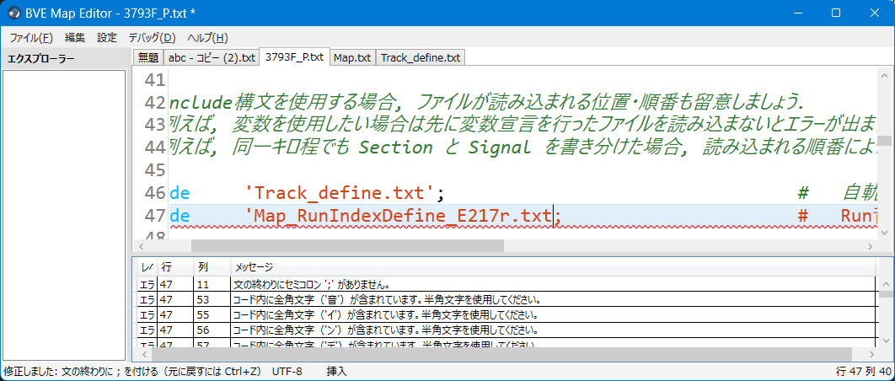
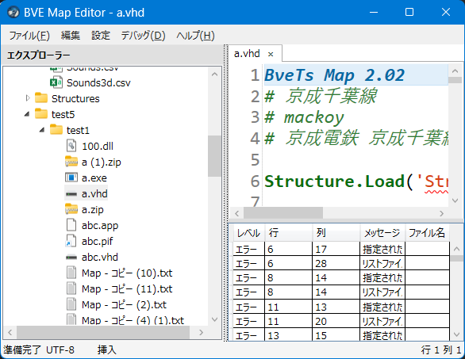

# BVEMapEditer 作成プラン

## 実装済み機能
- パイプ通信
  - 脆弱性対策(現在ユーザーかどうか、バッファオーバーラン対策)
  - パイプ通信再試行
  - 入力を止めるまでタスクを実行しない

- AvalonEditを採用
- Encoding.RegisterProvider(CodePagesEncodingProvider.Instance);
- タブ機能
  - タブを切り替えた時に描画更新
  - 
- エラーの波線を追加
- 現在行の協調
- ステータスバーに行と列と文字コード
- ファイル保存と開く
- プロジェクトファイルの保存と開く
- エクスプローラーペイン
- エクスプローラーペイン設定ファイル保存と開く
- クラッシュログ作成
- フォント設定
- 右端で折り返す
- BVEとQuickMapViewerを開く
- ヘルプメニュー
  - 対処法のページ 
- 公式サイトへのリンクメニュー
## 実装済み機能（BveMapParserWorker）
- 自動補完のカスタマイズ(xhsd)
- 字句解析　トークン処理(BveMapParserWorker)
  - 不明な単語の処理
  - ヘッダーの処理
  - 構文辞書
  - 引数の数辞書
  - セミコロン漏れと連続
  - カッコ忘れと連続
  - キーを読む
  - Load系の確認
  - ファイルパスの読み取り
  - インクルード先のエラーチェック（2026-11-14 修正: 未保存タブ・親子対応表に対応）
  - 変数

## 完了した作業の記録 (2026-11-14 動作確認済み)

### 新しい機能
- 修正提案 まとまり4: 同じファイルの同じ種類のエラー（; 抜け・全角文字など8種類）を「まとめて直す」。Ctrl+Z 1回で元に戻せる (2026-11-15, ErrorFix.cs)
- 修正提案 まとまり4: エディタのエラーのある行を右クリックしても、メニューの先頭に「修正の候補」を出す (2026-11-15, ErrorFix.cs / MainWindow.xaml)
- 修正提案 まとまり3: 'BeginTransition' is required before 'Begin' / 'End' のとき、ダイアログで距離程を選び、その行のすぐ下に Curve / Gradient / Track['x'].Cant の BeginTransition の行を足す (2026-11-15, ErrorFix.cs)
- 修正提案 まとまり3: 引数の数が合わないとき、足りない引数を後ろに足す（数値は 0、文字列は ''）・多い引数を後ろから消す候補（Repeater は除く） (2026-11-15, ErrorFix.cs / BveMapParserWorker/BveSemanticCommandRules.cs)
- 修正提案: 引数の数が合わないとき、数が合う兄弟のコマンドに変える候補（Put ↔ Put0、Begin ↔ Begin0） (2026-11-15, ErrorFix.cs)
- 修正提案 まとまり2: . のない単語にも似た名前を候補に出す（includ → include / Curvee → Curve）。閉じる ' の足し忘れを直す候補（include 'a.txt; / Begin0('RoadR, 1, ...）。行に閉じていない ' があるときの「; 抜け」は ' を足す候補にする (2026-11-15, ErrorFix.cs)
- 修正提案: 似たコマンド名の候補は、( ) の中の引数の数が合うものだけを出す（Put0 と Put など）。Structure['a']Put( / Structure['a'] Put0( のような . 抜けも直せる (2026-11-15, ErrorFix.cs / BveMapParserWorker/BveSemanticCommandRules.cs)
- 修正提案 段階3: 必須の Load がないときは Load の行（Sound.Load は Station.Load より前）、Cant.SetGauge / Curve.SetGauge がないときは SetGauge の行（1.067 / 1.435）を足す候補を出す。ファイル名が空のエラーは、インクルード先のタブからでもルートファイルを開く。開いているタブへは確認なしで切り替える (2026-11-15, ErrorFix.cs / MainWindow.xaml.cs)
- 修正提案 段階2: 未知のコマンド・リストにないキーで、つづりの近い名前を最大3つ「修正の候補」に出す (2026-11-15, ErrorFix.cs)
- 修正提案 段階1: エラー一覧の右クリック「修正の候補」で、; 抜け・; の連続・() 抜け・. 抜け・全角英数記号をその場で直す（Ctrl+Z で戻せる） (2026-11-15, ErrorFix.cs / MainWindow.xaml / MainWindow.xaml.cs)
- キーの自動補完: Repeater['abc'] など ] まで打つと関数の候補（.Begin(); / .Begin0(); / .End(); など）を出す。自動で入った ] の直前で ] を打つと二重にならずに進む。キーの候補は入力した文字で「始まる」ものだけに絞り込む (2026-11-15, AvalonEditClass.cs)
- 不具合修正: 候補が出ているときに [ などの記号を打つと候補が勝手に確定していたのを、確定せずに閉じるようにした (2026-11-15, AvalonEditClass.cs)
- キーの自動補完: Structure[''] のようにキーが空の引用符の間にカーソルを置くと、キーの候補を出す（Repeater は除く） (2026-11-15, AvalonEditClass.cs / ProjectFile.cs / MainWindow.xaml.cs)
- キーの自動補完: キーを選んで '] が入ったら、続けて .Put(); などの関数を候補に出す（選ぶとカーソルが ( と ) の間へ） (2026-11-15, AvalonEditClass.cs / BveCompletionData.cs)
- キーの自動補完: キーを選ぶと閉じる '] を足りない分だけ自動で入れる（Repeater の引数では ' だけ） (2026-11-15, BveCompletionData.cs / AvalonEditClass.cs)
- キーの自動補完 2-3: 「設定」メニューに「キーの自動補完を有効にする」を追加（「自動補完」とは別にオン・オフ、設定ファイルに保存） (2026-11-15, AppSettings.cs / MainWindow.xaml / SettingsMenu.cs / AvalonEditClass.cs)
- キーの自動補完 2-2: Repeater の Begin（11番目以降）/ Begin0（5番目以降）の引数で ' を打つと、ストラクチャーのキーを候補に出す (2026-11-15, AvalonEditClass.cs)
- キーの自動補完 2-1: Structure[' / Sound[' / Sound3D[' / Station[' / Signal[' / Train[' と打つと、読み込んだリストのキーを候補に出す (2026-11-15, AvalonEditClass.cs / BveCompletionData.cs / MainWindow.xaml.cs)
- キーの自動補完 段階1: ワーカーが構文チェックの結果と一緒に、読み込んだリストのキーの一覧を返し、エディタが覚えておく（画面はまだ変わらない） (2026-11-15, BveMapParserWorker/BveSemanticAnalyzer.cs / MapParser.cs / Program.cs / MainWindow.xaml.cs)

### ソースの整理
- 整理C: 自動補完の辞書をワーカーの BveSyntaxProvider.cs の1か所にまとめた。エディタはそこから候補を作るだけ。コマンドを足すときはワーカー側だけ直せばよい（候補の中身は変わらない） (2026-11-15, BveMapParserWorker/BveSyntaxProvider.cs / BveSyntaxProvider.cs)
- 整理A: 使われていない処理（CheckIncludeSyntaxWithUnsaved / 古い ParseRequest / QuickParseRegion / SaveFileAs）を削除、ルートファイルをたどる処理を GetRootFilePath にまとめた、重なった行とビルドの警告2件を修正（動きは変わらない） (2026-11-15, BveMapParserWorker/BveSemanticAnalyzer.cs / Program.cs / MapParser.cs / TextFileManager.cs / MainWindow.xaml.cs / AvalonEditClass.cs / ErrorFix.cs)

### 不具合の修正
- 文字列の引数の ' ' 忘れ（Put(xyz, …) / Put0(distance, …)）がエラーにならなかった不具合を修正し、'xyz' に直す候補を追加。閉じる ' が1つもない Put('0, 0, …) も直せる。distance + のように演算子で終わる距離程をエラーにし、演算子を消す候補を追加。閉じる ' がない行でコメントの日本語が1文字ずつ全角文字のエラーになるのを出さないようにした (2026-11-15, BveMapParserWorker/BveSemanticAnalyzer.cs / MapParser.cs / ErrorFix.cs)
- 1行に2つの文があり間の ; が抜けているとき、1つの文として読んで誤ったエラー（.End() の引数…）を出していた不具合を修正（; 抜けを出し、修正の候補で ) の後ろに ; を入れる）。SpeedLimit の複数記述の波線をコマンド名だけに。全角文字のエラーを続いている文字ごとに1件にまとめ、修正の候補でまとめて半角にする (2026-11-15, BveMapParserWorker/BveParser.cs / MapParser.cs / ErrorFix.cs)
- 検索ウィンドウを閉じるとメインウィンドウが別のアプリの後ろに回る不具合、開いたままタブを切り替えると前のタブを検索・置換していた不具合を修正 (2026-11-15, SearchWindow.xaml.cs / MainWindow.xaml.cs)
- 検索ウィンドウで Enter を押しても検索しない不具合、Ctrl+F・Ctrl+Shift+S が効かない不具合を修正。検索ウィンドウは1つだけ開き、開いていれば前に出して今のタブを検索する (2026-11-15, SearchWindow.xaml / .cs / MainWindow.xaml / EditMenu.cs)
- Station.Load が Structure.Load より前にあると、すべての Structure キーがエラーになる不具合を修正。書く順番に関係なくストラクチャーリストを読む (2026-11-15, BveMapParserWorker/BveSemanticAnalyzer.cs)
- 上書き保存すると文字コードが自動で記憶され、確認ダイアログが二度と出なくなる不具合を修正。ダイアログの「このファイルは次回から確認しない」にチェックしたときだけ記憶する (2026-11-15, SaveEncodingDialog.xaml / .cs / TextFileManager.cs)
- Ctrl＋マウスホイールの拡大・縮小が一番上を基準にしていた不具合を修正。マウスの下の文字を中心に拡大・縮小する (2026-11-15, SettingsMenu.cs)
- 「BOMなしUTF-8」で上書き保存すると、次回から「BOM付き」で保存される不具合を修正 (TextFileManager.cs)
- 文字コードがタブごとに管理されていなかった不具合を修正 (MainWindow.xaml.cs / TextFileManager.cs)
- BOM付きファイルを開くと BOM 文字が本文に残る不具合を修正。BOM付きのまま保存できるようにした (MainWindow.xaml.cs / TextFileManager.cs / ProjectFile.cs)
- 文字コードをファイル先頭 4KB だけで判定していた不具合を修正。ファイル全体で判定する (MainWindow.xaml.cs / TextFileManager.cs / ProjectFile.cs)
- Shift-JIS で保存できない文字が黙って「?」になる不具合を修正。保存前に確認する。保存キャンセル時に閉じる処理を止める (TextFileManager.cs / MainWindow.xaml.cs)
- 新規作成で開いていたファイルが閉じられる不具合を修正。新規作成は「無題」のタブを追加する (MainWindow.xaml.cs)
- 構文チェックのパイプ通信が毎回失敗する不具合を修正。ワーカーのやり取りの形をエディタに合わせた (BveMapParserWorker/Program.cs)
- 構文チェックの結果が波線に表示されない不具合を修正 (MainWindow.xaml.cs / ErrorUnderlineRenderer.cs)
- include のファイル名を読み取れず、インクルード先の中身がチェックされていなかった不具合を修正 (BveMapParserWorker/BveSemanticAnalyzer.cs)
- BOM付きのインクルード先の1行目が誤ってエラーになる不具合を修正 (BveMapParserWorker/BveSemanticAnalyzer.cs)
- include のチェックが同じ行に2回呼ばれていた無駄を削除 (BveMapParserWorker/BveSemanticAnalyzer.cs)
- インクルード先の全角文字・; の連続などのエラーが親ファイルのエラーとして表示される不具合を修正 (BveMapParserWorker/BveSemanticAnalyzer.cs)
- パーサー内で想定外のエラーが起きてもワーカーを強制終了せず、エラー内容をエラー一覧に表示する (BveMapParserWorker/Program.cs)
- タブのファイル名の「_」が表示されない不具合を修正 (MainWindow.xaml)
- 「; 抜け」の検出を新しく作った（カッコが閉じている文が対象、レベルはエラー） (2026-11-15, BveMapParserWorker/BveParser.cs)
- 書き換えて元に戻したときも未保存の警告が出ていた不具合を修正。開いた・保存した時点の本文と比べて「変更あり」を決める (2026-11-15, MainWindow.xaml.cs / AvalonEditClass.cs / TextFileManager.cs)
- 脆弱性対策 V3・V4: 計算式での「.名前」（関数の呼び出しなど）を禁止し、細工されたマップでメモリを大量に使わせられないようにした。通信のデータは読みながら上限を確認 (2026-11-15, BveMapParserWorker/BveSemanticAnalyzer.cs / Program.cs)
- 上下にスクロールすると水平スクロールバーが出たり消えたりして画面がガタガタする不具合を修正（常に表示。折り返し時は非表示） (2026-11-15, MainWindow.xaml)
- 何もしていないときもエディタが CPU を 8% 前後使っていた不具合を修正（波線の描き直しの繰り返しを削除） (2026-11-15, ErrorUnderlineRenderer.cs)
- 脆弱性対策 V1・V2: パイプの名前をエディタごとに変え、接続相手が同じユーザー・自分が起動したワーカーかを確認。2つ目のワーカーが CPU を使い続ける問題も解消 (2026-11-15, MainWindow.xaml.cs / BveMapParserWorker/Program.cs)
- 波線を間違っている部分だけに引くようにした（キー・ファイルパス・コマンド名・引数の値・変数名など。約 87% のエラーが対象） (2026-11-15, BveMapParserWorker/MapParser.cs / BveParser.cs)
- 文を元の空白どおりに組み立てるようにし、止まっていたチェック（[] 抜け・. 抜け・Load のファイル確認など）が動くようにした。エラーの列も正しくなった。() 抜けの検出を追加。行末より後ろを指すエラー（閉じ括弧不足など）も波線を表示 (2026-11-15, BveMapParserWorker/BveParser.cs / ErrorUnderlineRenderer.cs)
- 波線をエラー・警告ごとに描き、重なりは1本にまとめ、エラー（赤）を警告（オレンジ）より優先。ParseError に長さ Length を追加（段階2の準備） (2026-11-15, ErrorUnderlineRenderer.cs / BveMapParserWorker/MapParser.cs)
- ファイルを開くときの余計な確認（エラー残存・未保存の変更）をやめた。空の無題タブ以外は新しいタブで開き、無題タブの内容が消えないようにした (2026-11-15, TextFileManager.cs)
- 複数行にまたがる文（次の行が + で始まる等）が「; 抜け」と誤検出される不具合を修正。1つの文として読む (2026-11-15, BveMapParserWorker/BveParser.cs)
- 解析をさらに高速化（distance の式・正規表現の作り直し削減・変数代入）。作業用フォルダの計測で 3793F_P.txt 約 0.8 秒 → 約 0.43 秒、include 4 倍のマップで約 33% 短縮。174 ファイルでエラー内容が一致 (2026-11-15, BveMapParserWorker/BveSemanticAnalyzer.cs / BveParser.cs)
- include が多いマップの解析を高速化（3793F_P.txt で約 7 秒 → 約 1.5 秒）。「数字 ± 変数」の距離程を重い Eval なしで計算、正規表現を覚えておく数を増やした (2026-11-15, BveMapParserWorker/BveSemanticAnalyzer.cs / Program.cs)
- 大きいマップで「ワーカーとの通信に失敗しました」になる不具合を修正。問い合わせを1つずつにし、接続待ちを5秒に、時間切れでワーカーを強制終了しないようにした。失敗時は詳しい理由を表示 (2026-11-15, MainWindow.xaml.cs)
- Track[''].Gauge(); が「未知のコマンド」になる不具合を修正。自動補完にも追加 (2026-11-15, BveMapParserWorker/BveSyntaxProvider.cs / BveSemanticCommandRules.cs / BveSemanticAnalyzer.cs / BveSyntaxProvider.cs)
- インクルード先の未保存の内容でチェックするようにした。インクルード先のタブでは親ファイルからたどってチェックする（親子対応表）(BveMapParserWorker/BveSemanticAnalyzer.cs / MapParser.cs / Program.cs)

## 実装がまだ
- [x] プロジェクト内のソースコードを整理する / バグつぶし ← 整理A・B・C すべて完了・動作確認OK (2026-11-15)
	- [x] 小さく進める
	- 調査 (2026-11-15)。作業用フォルダでビルドした警告は2件だけ（ErrorFix.cs / Program.cs の null の可能性）
		- [x] 整理A ← A1〜A4 まとめて作成済み・動作確認OK (2026-11-15)
			- A1: CheckIncludeSyntaxWithUnsaved（BveSemanticAnalyzer.cs）・古い ParseRequest（Program.cs）・QuickParseRegion（MapParser.cs）・SaveFileAs（TextFileManager.cs）を削除（削除した所に「整理」のコメント）
			- A2: MainWindow.xaml.cs に GetRootFilePath を追加し、RunSyntaxCheck / OpenErrorFileAsync / GetKeyList（AvalonEditClass.cs）から使う
			- A3: SaveFile の2回続いていた isModified = false を1つに（UpdateTitle は間に別の処理があるので2回のまま）
			- A4: 警告2件を直した（ErrorFix.cs: 辞書がなければ空として扱う / Program.cs: jsonRequest ?? string.Empty）
			- 作業用フォルダで確認: エディタのコピーをビルドして警告 0 件。ワーカーは 175 ファイルでエラー内容が整理前と完全に一致
			- ユーザーが古いファイル（BveCommandRules.cs / CheckCommandArguments.cs / CheckCommandSyntax.cs / CommandRules.cs）を削除済みなのを確認 → CLAUDE.md の構成から外した
			- 修正前のファイル: _backup/2026-11-15/*.beforeCleanA.bak（8ファイル: Worker_BveSemanticAnalyzer.cs / Worker_Program.cs / Worker_MapParser.cs / TextFileManager.cs / MainWindow.xaml.cs / AvalonEditClass.cs / ErrorFix.cs / CLAUDE.md）
		- 整理A（動きは変わらない）
			- A1. どこからも呼ばれていない処理: BveSemanticAnalyzer.cs の CheckIncludeSyntaxWithUnsaved（約110行）、Program.cs の古い ParseRequest、MapParser.cs の QuickParseRegion、TextFileManager.cs の SaveFileAs
			- A2. 「ルートファイルをたどる」同じ処理が3か所（MainWindow.xaml.cs の RunSyntaxCheck と OpenErrorFileAsync、AvalonEditClass.cs の GetKeyList）→ 1つにまとめる
			- A3. TextFileManager.cs の SaveFile に同じ行が2回ずつ（isModified = false / UpdateTitle）
			- A4. ビルドの警告2件
		- 整理B（見つけた不具合）: 検索ウィンドウで Enter を押しても検索しない（SearchWindow.xaml.cs の CmbQuery_KeyDown がどこにもつながっていない）
			- [x] ← 修正済み・動作確認OK (2026-11-15)
			- SearchWindow.xaml: 検索欄 CmbSearchQuery の PreviewKeyDown に CmbQuery_KeyDown をつないだ
			- SearchWindow.xaml.cs: Enter で「次を検索」と同じ動き。履歴の一覧を開いているときは検索しない（一覧から選ぶ操作のため）
			- 作業用フォルダでエディタのコピーをビルドできることを確認（警告 0 件）
			- 修正前のファイル: _backup/2026-11-15/SearchWindow.xaml(.cs).beforeEnter.bak（2ファイル）
			- ユーザー確認 (2026-11-15): Enter は動いた。しかし Ctrl+F で検索ウィンドウが開かない
				- 原因: メニューの「Ctrl+F」は表示だけ（InputGestureText）で、キーにつながっていなかった。同じ理由で Ctrl+Shift+S（名前を付けて保存）も動かない見込み（WPF の SaveAs には決まったキーがない）
				- 修正（動作確認OK）: MainWindow.xaml に ApplicationCommands.Find（Ctrl+F）のつなぎを追加し、EditMenu.cs の MenuSearchCommand_Executed から検索ウィンドウを開く。Ctrl+Shift+S も Window.InputBindings でつないだ
				- 作業用フォルダでエディタのコピーをビルドできることを確認（警告 0 件）
				- 修正前のファイル: _backup/2026-11-15/*.beforeCtrlF.bak（MainWindow.xaml / EditMenu.cs）
			- [x] ユーザー要望 (2026-11-15): 検索ウィンドウがすでにあるときに Ctrl+F で新たに開かないようにする ← 修正済み・動作確認OK
				- EditMenu.cs: 開いている検索ウィンドウを _searchWindow に覚える。開いていれば新しく作らず、最小化を戻して前に出す（閉じたら忘れる）
				- SearchWindow.xaml.cs: ReuseFor を追加。検索するエディタを今のタブに差し替え（タブを切り替えた後でも今のタブを検索する）、検索欄の文字を全選択する
				- 作業用フォルダでエディタのコピーをビルドできることを確認（警告 0 件）
				- 修正前のファイル: _backup/2026-11-15/*.beforeSingle.bak（SearchWindow.xaml.cs / EditMenu.cs）
		- 整理C（大きめ・後で）: 自動補完の辞書（BveSyntaxProvider.cs）がエディタとワーカーに2つある（中身の73個は同じ）。片方だけ直すとずれる（Track.Gauge のときは両方直した）→ 1つにまとめる
			- 調査 (2026-11-15): 作業用フォルダで2つの辞書の中身を比べた。73個すべて、並び順・コマンド・説明文が完全に同じ。違いは、エディタ側は改行のある説明文2つ（SetFunction）を折り返し表示の部品（TextBlock）にしていることだけ
			- エディタはワーカーのプロジェクトを参照している（BveMapEditor.csproj）ので、ワーカーの辞書をそのまま読める
			- まとめ方の案: ワーカーの辞書（BveMapParserWorker/BveSyntaxProvider.cs）を「元」にする
				1. ワーカー側: 辞書をエディタから読めるようにし（public）、「コマンドと説明文の一覧」を返す GetSyntaxEntries を追加。チェック（GetValidCommands）は今まで通り
				2. エディタ側（BveSyntaxProvider.cs）: 73個の一覧を消し、ワーカーの一覧から候補を作るだけにする。改行のある説明文は今まで通り折り返し表示にする
				- これからコマンドを足すときは、ワーカーの BveSyntaxProvider.cs の1か所だけ直せばよい
				- 確かめ方: 作業用フォルダで、まとめる前と後のエディタの候補（73個のコマンド・説明文）が同じこと、ワーカーの 175 ファイルの結果が同じことを比べる
			- [x] ← 案のとおり作成済み・動作確認OK (2026-11-15)
				- BveMapParserWorker/BveSyntaxProvider.cs: クラスを public にし、GetSyntaxEntries（コマンドと説明文の一覧）を追加。GetAllSyntaxes はワーカーの中だけで使う（internal）
				- BveMapEditor/BveSyntaxProvider.cs: 73個の一覧を消し、ワーカーの GetSyntaxEntries から候補を作るだけにした。改行のある説明文は折り返し表示（TextBlock）
				- 作業用フォルダで確認: まとめる前と後で、エディタの候補 73 個（コマンド・説明文・表示の種類）が完全に同じ。ワーカーは 175 ファイルでエラー内容が完全に一致。ビルドの警告 0 件
				- 修正前のファイル: _backup/2026-11-15/*.beforeOneDict.bak（BveSyntaxProvider.cs / Worker_BveSyntaxProvider.cs / CLAUDE.md）
		- 参考: エディタ・ワーカーの古いファイル（CheckCommandArguments.cs / CheckCommandSyntax.cs / CommandRules.cs / BveCommandRules.cs）はユーザーが削除済み (2026-11-15)
- [x] インクルード先のエラーチェックを直す ← (A)〜(E) すべて修正・動作確認OK (2026-11-14)
	- 調査結果 (2026-11-14)。場所はすべて BveMapParserWorker/BveSemanticAnalyzer.cs
	- [x] (A) include のファイル名を読み取る正規表現 IncludePathRegex が壊れている（いちばん大きい原因） ← 修正済み・動作確認OK (2026-11-14)
		- 確認: インクルード先に存在しないコマンドを書くと、親ファイルのエラー一覧に出た
		- 修正: `(['"])` に直した。PowerShell で include 'a.txt' / include "a.txt" が一致することを確認済み
		- 修正前のファイル: _backup/2026-11-14/Worker_BveSemanticAnalyzer.cs.beforeIncA.bak
		- 今の形 `(\['"\])` は「'」や「"」ではなく「['"]」という4文字そのものを探してしまう
		- そのため `include 'a.txt';` が一致せず、すべての include 行が「アポストロフィ等で囲む必要があります」エラーになり、インクルード先の中身は一度もチェックされていない
		- 直し方: `(['"])` に直す（1行）
	- [x] (B) インクルード先のファイルを読むとき、BOM（見えない文字）を取り除いていない（ReadAllTextWithEncodingFallback） ← 修正済み・動作確認OK (2026-11-14)
		- 修正: 読み込んだ文字列の先頭の U+FEFF を取り除く
		- 修正前のファイル: _backup/2026-11-14/Worker_BveSemanticAnalyzer.cs.beforeIncB.bak
		- BOM付きのインクルード先は 1 行目が誤ってエラーになる。エディタ側の (3) と同じ問題
	- [x] (C) インクルード処理が2つある
		- 使われている CheckIncludeSyntaxInternal: 書き方のチェックはあるが、未保存のタブの内容を使わない（保存済みのファイルを読む）、親子対応表（ParentMap）を作らない
		- 使われていない CheckIncludeSyntaxWithUnsaved: 未保存タブ・親子対応表に対応しているが、書き方のチェックがない
		- ParentMap が空のため、エディタでインクルード先のファイルのタブを開くと、そのファイルだけで単独のマップとして解析される（ヘッダーなし・Load なしなどの誤ったエラーが出る）
		- 直し方: 使われている方に「未保存タブ」「親子対応表」を足し、MapParser.Parse → Program.cs まで受け渡す。使われていない方は使用しない印をつける
		- 直し方の案（詳細, 2026-11-14）。変更はワーカー側の3ファイルだけ。エディタ側は変更なし
			1. BveSemanticAnalyzer.cs: CheckIncludeSyntaxInternal に「親ファイルのパス」「未保存タブの内容」「親子対応表」を追加。未保存の内容があればそれを使い、親子対応表に「インクルード先 → 親」を記録する。Analyze → CheckIncludeSyntax にも同じものを追加（省略可能な引数にして、ほかの呼び出しに影響させない）
			2. MapParser.cs: 上の3つを受け取る Parse を追加（今の Parse はそのまま残す）
			3. Program.cs: リクエストの RouteFilePath / UnsavedTexts を渡し、できた親子対応表を ParentMap に入れて返す。UnsavedTexts は大文字小文字を区別しない辞書に入れ直す（JSON から読むと区別する辞書になるため）
			4. CheckIncludeSyntaxWithUnsaved は「使用しない」とコメントする（消さない）
		- 制限: 親ファイルを一度もチェックしていない状態でインクルード先だけを開くと、親子対応表がないので今まで通り単独で解析される
		- ← 案のとおり修正済み・動作確認OK (2026-11-14)
			- BveSemanticAnalyzer.cs: Analyze / CheckIncludeSyntax / CheckIncludeSyntaxInternal に rootFilePath・unsavedTexts・parentMap（省略可）を追加
			- MapParser.cs: Parse(text, baseDirectory, rootFilePath, unsavedTexts, parentMap) を追加。今の Parse(text, baseDirectory) はこれを呼ぶだけにした
			- Program.cs: RouteFilePath・UnsavedTexts を渡し、ParentMap を返す
			- 修正前のファイル: _backup/2026-11-14/Worker_*.beforeIncC.bak（3ファイル）
	- [x] (E) インクルード先の字句解析・構文解析のエラー（BveLexer / BveParser）が FileName 空のまま追加され、親ファイルのエラーとして扱われる ← 修正済み・動作確認OK (2026-11-14)
		- 修正: CheckIncludeSyntaxInternal で、字句解析・構文解析のエラーを別のリストに集め、インクルード先のファイル名を付けてから追加する
		- 修正前のファイル: _backup/2026-11-14/Worker_BveSemanticAnalyzer.cs.beforeIncE.bak
		- 経緯: 「; 抜け」がエラー一覧に出ない報告を調べて見つけた。「; 抜け」の検出処理自体がないことは、別作業「; 抜けを検出する処理を作り直す」に移した
	- [x] (D) Analyze の中で CheckIncludeSyntax が同じ行に対して2回呼ばれている（237行目と304行目。2回目は意味がない） ← 修正済み・動作確認OK (2026-11-14)
		- 修正: 2回目の呼び出しを削除（チェック結果は変わらない）
		- 修正前のファイル: _backup/2026-11-14/Worker_BveSemanticAnalyzer.cs.beforeIncD.bak
- [x] ワーカーがパーサー内のエラーで強制終了する（Environment.FailFast）← 修正済み・動作確認OK (2026-11-14)
	- 修正: BveMapParserWorker/Program.cs で FailFast をやめ、エラー内容（例外の種類とメッセージ）をエディタのエラー一覧に返す
	- 修正前のファイル: _backup/2026-11-14/Worker_Program.cs.beforeFailFast.bak
- [x] 「; 抜け」を検出する処理を作り直す（今のパーサーにはない。親ファイル・インクルード先の両方で必要）
	- 調査結果 (2026-11-15): 以前のパーサーのファイル（CheckCommandSyntax.cs など）にも ; 抜けの検出は残っていない。新しく作る
	- 作り方の案: BveMapParserWorker/BveParser.cs の ParseTokens だけを変更
		- 今のパーサーは「行が変わったのに ; が来ていない文」を、その行で区切って続けている（51〜60行目、90〜98行目）
		- その2か所で「文の最後が ; ではない」ことを見つけたら、「文の終わりにセミコロン ';' がありません。」を追加する
		- 位置は文の最後の文字の直後（行・列）。ヘッダー行（BveTs Map …）とコメントだけの行は対象外
		- インクルード先も同じパーサーを通るので、(E) の修正によりインクルード先のファイル名付きで出る
	- 決めること: レベル（エラー / 警告）、括弧が閉じていない行（複数行にまたがる文の可能性）も対象にするか
		- 決定 (2026-11-15): レベルは「エラー」。カッコ・角括弧が閉じている文だけを対象にする
	- ← 修正済み・動作確認OK (2026-11-15)
		- 修正: BveParser.cs に CheckMissingSemicolon を追加し、ParseTokens の2か所（行が変わったとき・ファイルの最後）で呼ぶ
		- 位置は「文の最後の単語・記号」（行末より後ろだと波線が描けないため）
		- 修正前のファイル: _backup/2026-11-14/Worker_BveParser.cs.beforeSemicolon.bak
- [ ] 全作業が終わったら RELEASE.md にリリース内容を書く 
- [x] 脆弱性対策が必要かどうかを監査する。 ← V1〜V4 すべて修正・動作確認OK (2026-11-15)
	- 監査結果 (2026-11-15)。ファイルは変更せず、ソースの確認と作業用フォルダでの試験で調べた
	- 対策が必要なもの（危険の大きさ順）
		- [x] V1.（中）パイプの「なりすまし」: パイプの名前が固定（BveMapParserPipe）。別のユーザーや別のプログラムが先に同じ名前のパイプを作ると、エディタはそれに接続してしまい、マップの本文を渡したり、偽の結果を受け取ったりする。エディタは相手のプロセスIDを取得しているが、自分が起動したワーカーか比べていない（MainWindow.xaml.cs の ParseViaPipeAsync）
			- 対策案: パイプの名前をエディタごとに変える（エディタのプロセスIDを付けてワーカーに渡す）。接続時に「相手が自分と同じユーザー」（PipeOptions.CurrentUserOnly）と「相手が自分の起動したワーカー」を確認する
		- [x] V2.（中・推定）エディタを2つ起動すると、2つ目のワーカーがパイプを作れず、待ち時間なしで作り直しを繰り返して CPU を使い続ける（Program.cs の while ループ。作成に失敗すると catch してすぐ次へ）
			- 対策案: V1 の「名前をエディタごとに変える」で同時に解決。加えて、作成に失敗したら少し待つ
		- V1・V2 ← 修正済み・動作確認OK (2026-11-15)
			- MainWindow.xaml.cs: パイプの名前を BveMapParserPipe_<エディタのプロセスID> にし、ワーカーに「--worker --pipe 名前」で渡す。接続時に PipeOptions.CurrentUserOnly を付け、相手のプロセスIDが起動したワーカーと同じか確かめる（違えば送らない）
			- BveMapParserWorker/Program.cs: 「--pipe 名前」を受け取る（BveMapParserPipe_数字 の形だけ受け付ける。無ければ以前の名前）。パイプを作れなかったら 1 秒待ってやり直す
			- 作業用フォルダでワーカーのコピーをビルドして試験: 渡した名前のパイプで返事が来ること、同じ名前で2つ目を起動しても CPU を使わない（3 秒で 0 ms）ことを確認。エディタ側はアプリでの確認が必要
			- 修正前のファイル: _backup/2026-11-14/*.beforeV1.bak（2ファイル）
		- [x] V3.（低〜中）細工されたマップで大量のメモリを使わせられる: 計算式（Eval）で文字列の関数が使える（例: "x".PadLeft(50000000) を 4 回つなぐと約 400MB を確保できた）。BVE の構文には文字列の関数呼び出しはない
			- 対策案: 計算式に「.名前(」の形（関数の呼び出し）がある場合は計算しない
			- ← 修正済み・動作確認OK (2026-11-15): BveSemanticAnalyzer.cs の NormalizeVariableExpression（全ての Eval が通る所）で、'…' "…" の外に「.名前」があれば計算しない（エラー「計算式に「.名前」の形（関数の呼び出しなど）は使えません。」）
				- 試験: 細工したマップ（"x".PadLeft(50000000) など）が 1094 ms → 117 ms・エラー表示に。普通の式（floor・'…'+'.txt'・1.5+0.25）は今まで通り。174 ファイルでエラー内容は全く同じ
		- [x] V4.（低）20MB の上限チェックが、1行を全部読み込んだ後に行われている（Program.cs）。同じユーザーのプログラムからしか送れないため影響は小さい
			- 対策案: 読み込みながら上限を超えたら打ち切る
			- ← 修正済み・動作確認OK (2026-11-15): Program.cs に ReadLineWithLimit を追加。読みながら 20MB 相当を超えたら、それ以上はためずに読み捨てて「大きすぎる」と返す（読み捨ても 200MB 相当で打ち切り）
				- 試験（ワーカーのコピーを起動）: 普通のリクエストは今まで通り。2,200 万文字のリクエストで、ワーカーの最大メモリ 193MB → 87MB。返事は今まで通り「大きすぎる」
			- V3・V4 の修正前のファイル: _backup/2026-11-14/Worker_*.beforeV3V4.bak（2ファイル）
	- 問題なかったもの
		- 計算式から System.IO・Environment などのクラスやリフレクション（GetType など）は使えない（試験で確認。DynamicExpresso が既定で禁止）
		- パイプは「今のユーザーだけ」がワーカーに接続できる（Program.cs の PipeSecurity）
		- エラーのヘルプ（HTML）はメッセージを HTML エンコードしてから埋め込んでいる。Google 検索の URL もエスケープしている
		- 関連付けのレジストリ登録はパスを " で囲んでいる。管理者権限は登録・解除のときだけ UAC で求める。管理者で起動したときは警告を出す
		- 通信・設定・プロジェクトの JSON は決まった型にだけ読み込む
	- [ ] 小さく進める
- [x] リストからキーを抽出して['']の中に自動補完候補 ← 段階1・2-1〜2-3、ユーザー追加の6項目すべて完了・動作確認OK (2026-11-15)
    - Repeater構文の場合はBegin 12引数以降 Begin 6引数以降 
	- 設定を追加する
	- 調査 (2026-11-15): キーの一覧はワーカーが構文チェックのときに読み込んでいる（BveSemanticAnalyzer.cs の LoadKeysFromCsv）が、エディタには渡していなかった
		- Repeater のキーの位置: Begin は丸括弧の11番目以降、Begin0 は5番目以降（Repeater['キー'] を1つ目と数えると12番目・6番目）
		- 調査中に見つけた不具合（Station.Load が先だと Structure キーがすべてエラー）は先に修正済み（バグの欄を参照）
	- [x] 段階1（ワーカー側）: 構文チェックの結果と一緒にキーの一覧を返す ← 修正済み・動作確認OK (2026-11-15)
		- BveSemanticAnalyzer.cs: ParseResponse に KeyLists を追加。Analyze が Structure / Sound / Sound3D / Station / Signal / Train のキーを名前順で書き込む
		- MapParser.cs: keyLists を受け取る Parse を追加 / Program.cs: KeyLists をエディタに返す
		- MainWindow.xaml.cs: 受け取ったキーの一覧をルートファイルごとに覚える（_keyListsByRoute）。画面はまだ変わらない
		- 作業用フォルダで確認: 3793F_P.txt で Structure 730 / Sound 15 / Sound3D 19 / Station 12 / Signal 4 個のキーが返る
		- 制限: インクルード先に書いた .Load のキーは入らない（今のキーのチェックと同じ）
		- 修正前のファイル: _backup/2026-11-15/*.beforeKeyLists.bak（4ファイル）
	- [x] 段階2（エディタ側）: Structure[' などで候補を出す。Repeater の Begin / Begin0 のキーの位置でも出す。「設定」メニューにオン・オフを追加
		- [x] 2-1: ['' の中でキーの候補を出す ← 作成済み・動作確認OK (2026-11-15)
			- AvalonEditClass.cs: TryShowKeyCompletion を追加。カーソルの手前が Structure[' / Sound[" などなら、そのリストのキーを候補に出す（Structure / Sound / Sound3D / Station / Signal / Train）。入力した文字で絞り込み。引用符の中ではコマンドの候補を出さない
			- AvalonEditClass.cs（TextEntering）: キーの候補中は ' " ] ) 空白で候補を閉じる（選択中の候補は入れない）。- などはそのまま入力
			- BveCompletionData.cs: キー用の候補 BveKeyCompletionData を追加（引用符の直後から入力中の文字までを置き換える）
			- MainWindow.xaml.cs: 受け取ったキーの一覧を大文字小文字を区別しない辞書に入れ直す
			- 今は「自動補完」のオン・オフに従う（キー専用のオン・オフは 2-3）。構文チェックが一度終わるまでは候補なし
			- 作業用フォルダでエディタのコピーをビルドできることを確認
			- 修正前のファイル: _backup/2026-11-15/*.beforeKeyComp.bak（2ファイル）
		- [x] 2-2: Repeater の Begin / Begin0 で候補を出す ← 作成済み・動作確認OK (2026-11-15)
			- AvalonEditClass.cs: TryGetRepeaterKeyContext を追加。手前の ; より後ろから Repeater['…'].Begin( / Begin0( を探し、カンマを数えて（引用符・内側の括弧の中は数えない）、Begin は11番目以降・Begin0 は5番目以降の引用符の中ならストラクチャーのキーを候補に出す
			- 複数行にまたがる Repeater にも対応（手前 4000 文字まで）
			- 作業用フォルダでエディタのコピーをビルドできることを確認
			- 修正前のファイル: _backup/2026-11-15/AvalonEditClass.cs.beforeRepeaterKey.bak
		- [x] 2-3: 「設定」メニューにオン・オフを追加 ← 作成済み・動作確認OK (2026-11-15)
			- AppSettings.cs: EnableKeyCompletion（最初はオン）を追加
			- MainWindow.xaml: 「設定」メニューの「自動補完を有効にする」の下に「キーの自動補完を有効にする(_K)」を追加
			- SettingsMenu.cs: MenuKeyCompletion_Click（すぐ保存）、起動時にチェック状態を反映
			- AvalonEditClass.cs: キーの自動補完は「自動補完」とは別にオン・オフを決める。オフのときは候補を出さない（引用符の中ではコマンドの候補も出さない）
			- 作業用フォルダでエディタのコピーをビルドできることを確認
			- 修正前のファイル: _backup/2026-11-15/*.beforeKeySetting.bak（4ファイル）
	- [x] ['']のようにキーが空の時にカーソルを持ってくると自動補完を表示する (Repeater構文は空でもエラーにならないのでRepeater構文を除く)
		- ← 作成済み・動作確認OK (2026-11-15)
		- AvalonEditClass.cs: OnCaretMovedForKeyCompletion を追加。カーソルの両側が '' か "" で、手前が Structure[ などなら、キーの候補を出す（Repeater は対象外: TryShowKeyCompletion に allowRepeater を追加）。入力の焦点があり、選択なし、ほかの候補が出ていないときだけ。「キーの自動補完」がオフなら出さない
		- ProjectFile.cs（InitializeEditor）/ MainWindow.xaml.cs（最初の「無題」タブ）: カーソルが動いたときに上の処理を呼ぶ
		- 作業用フォルダでエディタのコピーをビルドできることを確認
		- 修正前のファイル: _backup/2026-11-15/*.beforeEmptyKey.bak（3ファイル）
	- [x] 入力後に自動的に']を挿入する　（オプションの設定にある自動補完はキーの挿入後は動かないので注意）
		- ← 作成済み・動作確認OK (2026-11-15)
		- BveCompletionData.cs（BveKeyCompletionData.Complete）: キーを選んだ後、カーソルの後ろを見て足りない分だけ入れる。何もない → ']、] だけ → '、'] がある → 入れない。カーソルは ] の後ろへ。開いた引用符と同じ文字（' か "）で閉じる。キーの途中を書き換えたとき（後ろにキーの続きがある）は何も入れない。Ctrl+Z 1回で戻せる
		- Repeater の引数のキーでは閉じる引用符だけ入れる（AvalonEditClass.cs から closeBracket を渡す）
		- 作業用フォルダで確認: 上の6通りの入力で期待どおりの結果。エディタのコピーもビルドできる
		- 修正前のファイル: _backup/2026-11-15/*.beforeAutoClose.bak（2ファイル）
	- [x] 挿入後の残りの関数を続けて挿入する。(Structure['abc -> この先はどうするかを候補を出す Structure['abc'].put...)
		- ← 作成済み・動作確認OK (2026-11-15)
		- AvalonEditClass.cs: ShowMethodCompletion を追加。キーを選んで '] まで入ったら、その種類の関数（Structure なら .Put(); / .Put0(); / .PutBetween();）を候補に出す。候補は自動補完の辞書（BveSyntaxProvider の Structure[''].Put(); など）から取り出す。後ろにすでに . があるとき（キーだけ直したとき）は出さない。Repeater の引数のキーでは出さない。候補中は ; でも閉じる
		- BveCompletionData.cs: BveKeyCompletionData に AfterClose（'] を入れた後の処理）を追加。関数用の候補 BveMethodCompletionData を追加（.Put(); を入れてカーソルを ( と ) の間へ）
		- 作業用フォルダで確認: キーを選ぶと AfterClose が呼ばれる（キーの途中・Repeater では呼ばれない）。.Put(); を選ぶと Structure['KEY'].Put(|); になる。エディタのコピーもビルドできる
		- 修正前のファイル: _backup/2026-11-15/*.beforeMethodComp.bak（2ファイル）
	- [x] Repeater構文も']まで入力したら自動補完候補を出す(End, Begin, Begin0)
		- ← 作成済み・動作確認OK (2026-11-15)
		- AvalonEditClass.cs: TryShowMethodAfterBracket を追加。] を打ってカーソルの手前が Repeater['abc'] などになったら関数の候補を出す（Repeater は .Begin(); / .Begin0(); / .End();。Track・Structure なども同じ仕組みで出る）
		- AvalonEditClass.cs: TryStepOverClosingBracket を追加。括弧の自動補完で入った ] の直前で ] を打ったら、]] にせず ] の後ろへ進む（その後に関数の候補）
		- 「キーの自動補完」がオフなら出さない
	- [x] バグ Structure[ など、[を入力すると自動的に自動補完候補が確定されてしまう
		- ← 修正済み・動作確認OK (2026-11-15)
		- 原因: AvalonEditClass.cs の TextEntering で、コマンドの候補が出ているときに記号（[ ( ' ; など）を打つと、選択中の候補を確定していた
		- 修正: 記号を打ったら候補を確定せずに閉じる。確定は Enter / Tab のときだけ
	- [x] 入力文字を見て候補を絞り込む（ユーザー回答: キーの候補のこと）
		- ← 作成済み・動作確認OK (2026-11-15)
		- 原因: 候補ウィンドウ標準の絞り込みは、入力した文字を「含む」キーも出していた
		- AvalonEditClass.cs: FilterKeyCompletion を追加。入力した文字で「始まる」キーだけにする（大文字小文字は区別しない）。文字の入力・Backspace のたびに絞り込み直す。1つもなければ候補を閉じる
	- 3項目まとめて: 作業用フォルダでエディタのコピーをビルドできることを確認 / 修正前のファイル: _backup/2026-11-15/AvalonEditClass.cs.beforeKeyFilter.bak

	- [x] 修正提案の時、Structure...Put0 / Put の提案がある場合は()内の引数の数を見る（間違って引数が合わない方を選択してエラーを増やすだけです）
		- 調査 (2026-11-15): 引数の数の決まりはワーカーの BveSemanticCommandRules.cs にある（例: Structure.Put は 9 個、Structure.Put0 は 3 個）が、エディタからは読めない。今の「似たコマンド名」の候補は、つづりだけで選んでいる
		- 直し方の案:
			1. ワーカー（BveSemanticCommandRules.cs）: 「コマンドの引数の数の範囲」を返す GetArgumentCountRange を追加（エディタから読めるように public）
			2. エディタ（ErrorFix.cs）: エラーの行の ( ) の中の引数を数え（引用符の中・内側の括弧の中のカンマは数えない）、数が合わない候補は出さない。決まりのないコマンドや、( ) が次の行に続いていて数えられないときは今まで通り
	- [x] Structure['CrossSig']Put('',...をStructure['CrossSig'].Put('', ... のように直せるようにする
		- 調査 (2026-11-15): この書き方は「未知のコマンドまたは存在しない単語です: 'StructurePut'」になる（キーの部分を除いて名前を作るため . のない1つの名前になる）。今の候補は「Structure.Put」が出るが、. の数が違うので「自動で直せませんでした」になる
		- 直し方の案（ErrorFix.cs）: 候補の名前から . を除くとエラーの名前と同じとき（StructurePut と Structure.Put）は、行の中の「Structure['CrossSig']Put」を探して、抜けている所に . を入れる（Structure['CrossSig'].Put）。1 の引数の数の確認もかかる（Put と Put0 のうち、数が合う方だけ出す）
	- 2項目まとめて ← 作成済み・動作確認OK (2026-11-15)
		- BveMapParserWorker/BveSemanticCommandRules.cs: GetArgumentCountRange（コマンドの引数の数の範囲。決まりがなければ false）を追加
		- ErrorFix.cs: GetErrorLineText（エラーの行を、開いているタブ・なければファイルから読む）、CountArguments（( ) の中の引数を数える）を追加。似たコマンド名の候補は、引数の数が合わないもの・直せない形のものを出さない
		- ErrorFix.cs: InsertMissingDots / CanReplaceCommandName を追加。. が抜けているだけなら抜けている所に . を入れる（間の空白も . にする）
		- 作業用フォルダで確認: Structre.Put0('0',0,1) → Structure.Put0 だけ / Structre.Put(9個) → Structure.Put だけ / Structure['CrossSig']Put(9個) → Structure['CrossSig'].Put / Structure['CrossSig'] Put0(3個) → Structure['CrossSig'].Put0 / ) が次の行に続くときは今まで通り。ワーカーは 175 ファイルで結果が同じ。ビルドの警告 0 件
		- 修正前のファイル: _backup/2026-11-15/*.beforeArgCount.bak（ErrorFix.cs / Worker_BveSemanticCommandRules.cs）
		- ユーザー報告 (2026-11-15): Structure['CrossSig'] Put0('0', 0, 1);（] と Put0 の間に空白）で修正の候補が出ない
			- 原因: 空白があると、エラーの名前が「Structure」だけになる（「未知のコマンドまたは存在しない単語です: 'Structure'」）。Structure は正しい名前なので、似た名前の候補がなかった
			- 修正（動作確認OK）: ErrorFix.cs に JoinFollowingWord を追加。エラーの名前の後ろに、キーと空白をはさんで名前と ( が続いていれば、つなげた名前（StructurePut0）で候補を探す → 「Structure.Put0」が出て、選ぶと Structure['CrossSig'].Put0( になる
			- 作業用フォルダで確認: 空白あり Put0(3個) → Structure.Put0 / 空白あり Put(9個) → Structure.Put / キーなし「Structure  Put0(」→ Structure.Put0。前の試験も同じ結果。ビルドの警告 0 件
			- 修正前のファイル: _backup/2026-11-15/ErrorFix.cs.beforeSpaceDot.bak
	- [x] エラーがいくつかある場合はまとめて修正できるか ← 作成済み・動作確認OK (2026-11-15)
		- ← 作成済み・動作確認OK (2026-11-15)
			- ErrorFix.cs: まとめて直せる候補に種類の印（BatchKind）を付けた: ; 抜け / ; の連続 / () 抜け / . 抜け / 全角文字 / 閉じる ' 抜け / 演算子で終わる距離程 / ' ' のない文字列（行の中だけで決まる直し方だけ。似た名前・引数の足し引き・行を足すものは1件ずつ選ぶ）
			- 「修正の候補」の中（エラー一覧の右クリック・エディタの右クリックの両方）に「このファイルの「; 抜け」をまとめて直す（N 件）」を出す（同じファイルの同じ種類が2件以上のとき）
			- ApplyBatchFix: 先に全部の直し方を求めてから、ファイルの後ろから順に入れる（位置がずれないように）。重なるものと直せないものは飛ばして、件数をステータスバーに出す。Ctrl+Z 1回でまとめて元に戻せる
			- 作業用フォルダでエディタのコピーをビルドできることを確認（警告 0 件）。動きは画面で確認が必要
			- 修正前のファイル: _backup/2026-11-15/ErrorFix.cs.beforeBatch.bak（MainWindow.xaml は変更なし）
	- [x] エラー行を右クリックして修正提案 ← 作成済み・動作確認OK (2026-11-15)
		- ← 作成済み・動作確認OK (2026-11-15)
			- MainWindow.xaml: タブ（EditorTabControl）に ContextMenuOpening をつないだ（右クリックメニューを開くときの処理。どのタブのエディタにも効く）
			- ErrorFix.cs: EditorTabControl_ContextMenuOpening を追加。右クリックした行（マウスの位置。取れなければカーソルの行）のエラーを、エラー一覧から波線と同じ絞り込みで探し（GetErrorsOfEditor）、修正の候補をエディタの右クリックメニューの先頭に「修正の候補」として出す。エラーのない行では何も足さない。候補がなければ「修正の候補はありません」（灰色）。各候補にマウスを乗せるとエラーの文が出る
			- 作業用フォルダでエディタのコピーをビルドできることを確認（警告 0 件）。動きは画面で確認が必要
			- 修正前のファイル: _backup/2026-11-15/*.beforeEditorFix.bak（MainWindow.xaml / ErrorFix.cs）
	- [x] includ の時、include に直せるようにする ← まとまり2で作成・動作確認OK (2026-11-15)
	- [x] include 	'Map_RunIndexDefine_E217r.txt; を include 	'Map_RunIndexDefine_E217r.txt';に直せるようにする（'の中は例です） ← まとまり2で作成・動作確認OK (2026-11-15)
	- [x] 'BeginTransition' is required before 'Begin'. のエラーの時の修正提案はどうするか。 ← 作成済み・動作確認OK (2026-11-15)
		- ダイアログを出して挿入位置を決めるか　エラーの距離程の位置から0までの距離程
		- ユーザー回答 (2026-11-15): ダイアログで距離程を選ぶ
		- ← 作成済み・動作確認OK (2026-11-15)
			- ErrorFix.cs: 修正の候補「Curve.BeginTransition(); を足す（距離程を選ぶ…）」。エラーの行から Curve / Gradient / Track['A'].Cant を取り出し（FindTransitionHead）、エラーの行より上の距離程の行を近い順に一覧にしたダイアログ（ChooseDistanceLine）で選ぶと、その距離程の行のすぐ下にエラーの行と同じ字下げで足す（FindDistanceLinesAbove / InsertLineBelow）。キャンセルしたら何もしない
			- 距離程の行の見分け方: 数字・$変数・( ・- ・distance で始まり、= を含まず ; で終わる行（コメント・コマンドの行は除く）
			- ダイアログは新しいファイルを作らず、ErrorFix.cs の中で組み立てた
			- 作業用フォルダで確認: 距離程の行の一覧（distance + 25; / 1500; / 1320 + $WK; / 0;。コメントの # 1500; と変数の代入は入らない）、選んだ行の下に字下げ付きで足されること。エディタのコピーをビルドできる（警告 0 件）。ダイアログの見た目は画面で確認が必要
			- 修正前のファイル: _backup/2026-11-15/ErrorFix.cs.beforeTransition.bak
	- [x] Repeater['RoadR_Road'].Begin0('RoadR, 1 ... 文字列となるところの囲み忘れの修正提案 ← まとまり2で作成・動作確認OK (2026-11-15)
		- [x] ほかの構文（Structure）の引数に文字列があるときにも適用する ← 作成済み・動作確認OK (2026-11-15)（下の「Structure['abc'].Put(xyz, …」の項目に記録）
		- [x] バグがあります。下を見てください ← 下の「Structure['abc'].Put(xyz, …」の項目。作成済み・動作確認OK (2026-11-15)
	- [x] 存在しない単語があるとき、酷似している、近い単語を提案する ← まとまり2で作成・動作確認OK (2026-11-15)（コマンド名・include・名前空間・キーと比べる）
	- [x] バグ Repeater['FenceR'].End() Structure['CrossSig'].Put0('0', 0, 1); のようにEnd();のセミコロンが抜けてる時の修正提案が働かない ← まとまり1で修正・動作確認OK (2026-11-15)
		- [x] .End() の引数には何も指定できません。と表示されるバグ ()の中に何も書かれていないのに誤ったエラー
	- [x] 引数が合わないときは増やすか減らすかを選択する(Repeater構文を除く) ← 作成済み・動作確認OK (2026-11-15)
		- ユーザー回答 (2026-11-15): 足す値は「数値の位置は 0、文字列の位置は ''」。BeginTransition の行は「ダイアログで距離程を選ぶ」（次の作業）
		- ← 作成済み・動作確認OK (2026-11-15)
			- BveMapParserWorker/BveSemanticCommandRules.cs: IsNumericArgument（その位置の引数が数値か）を追加
			- ErrorFix.cs: 引数の数のエラーの候補に「足りない引数 N 個を後ろに足す（'', 0, 0）」「多い引数 N 個を後ろから消す」を追加（AddArguments / RemoveLastArguments / FindArgumentSpans）。Repeater は除く。) が次の行に続くときは候補なし
			- 作業用フォルダで確認: Put(引数7個) → 0, 0 を足して9個 / Put0() → '', 0, 0 / Put0(5個) → 後ろの2個を消す / 引数の中の floor(3, 4) のカンマは数えない / コメントはそのまま。ビルドの警告 0 件
			- 修正前のファイル: _backup/2026-11-15/*.beforeArgAdjust.bak（ErrorFix.cs / Worker_BveSemanticCommandRules.cs）
	- 調査 (2026-11-15)。ユーザー追加の項目（上の 316〜326 行と、下の SpeedLimit の波線・全角文字）を、作業用フォルダのワーカーのコピーで試した
		- いま出るエラー
			- Repeater['FenceR'].End() Structure['CrossSig'].Put0(...); → 「.End() の引数には何も指定できません」だけ（誤り）。1行に2つの文があり ; が抜けているのに、パーサーが1つの文としてつないでしまい、後ろの文が End の引数扱いになっている。; 抜けは出ない
			- includ 'a.txt'; → 「未知のコマンド: 'includ'」。似た名前の候補は . のあるコマンド名だけから探すため include が候補にない
			- include 'Map_….txt; → 「'include' の引数はアポストロフィ等で囲む必要があります」と「; 抜け」（閉じる ' がないので ; まで文字列の中と読まれる）
			- Repeater['RoadR_Road'].Begin0('RoadR, 1, 25, 25, 'x'); → 「Repeater.Begin0 の引数の数は 5〜無制限 個（現在: 1個）」（閉じる ' がないので後ろが全部1つの文字列になる）
			- Section.SetSpeedLimit が2つ → エラーの列・長さがないため、波線が行末まで
			- Curve.Begn（３００）; → 全角文字ごとにエラーが1件ずつ（「（」「３」「０」「０」「）」で5件。「（」「）」は字句解析と全角チェックの両方から出ている）
			- Curvee(300); → 「'Curve' の後にドット」と「未知のコマンド: 'Curvee'」
			- 'BeginTransition' is required before 'Begin' / 'End' → 修正の候補なし
			- Structure.Put の引数は 9 個である必要があります（現在: 7個）→ 修正の候補なし
		- 進め方の案（小さい順に4つのまとまり）
			- まとまり1（不具合・ワーカー側）
				1. 1行に2つの文があって間の ; が抜けているとき（「) の後に名前が続く」）は「文の終わりにセミコロン ';' がありません」を出し、2つの文に分けて読む → .End() の誤ったエラーも消える。修正の候補（; を付ける）も ) の後ろに入れる
				2. SpeedLimit の複数記述のエラーに、コマンド名の位置と長さを付ける（波線をコマンド名だけに）
				3. 全角文字のエラーを、続いている全角文字ごとに1件にまとめる（「（３００）」で1件）。字句解析と全角チェックの重なりもなくす。修正の候補は続いている全角文字をまとめて半角にする
			- [x] まとまり1 ← 1〜3 まとめて作成済み・動作確認OK (2026-11-15)
				- 1. BveMapParserWorker/BveParser.cs: IsNewStatementOnSameLine を追加。コマンドの文が ) で終わりカッコがすべて閉じていて、同じ行に次の名前が続くときは文を区切り、前の文の「; 抜け」を出す（位置は ) ）→ .End() の誤ったエラーが消え、後ろの文も正しくチェックされる
				- 1. ErrorFix.cs: AddSemicolon がエラーの列と長さを使い、) の後ろに ; を入れる（Repeater['FenceR'].End(); Structure[...]）。分からないときは今まで通り行のコードの最後
				- 2. BveMapParserWorker/MapParser.cs: SpeedLimit の複数記述のエラーに、行の中の Section.SetSpeedLimit / Signal.SpeedLimit の位置と長さを入れる（波線がコマンド名だけ）
				- 3. MapParser.cs: MergeFullWidthErrors / FindFullWidthRuns を追加。全角文字のエラーを、行の中で続いている全角文字ごとに1件にまとめ、列と長さを入れる（引用符の中・コメントは除く）。字句解析と全角チェックの重なりも消える。行を読む処理を CreateLineReader にまとめた
				- 3. ErrorFix.cs: 続いている全角文字をまとめて半角にする候補（「（３００）」→「(300)」）。1文字でも半角にできない文字があれば候補なし
				- 作業用フォルダで確認: 試験用マップで、End() の行は「; 抜け」（) の位置）と後ろの文のキーのエラーになり .End() の誤ったエラーは消えた。全角「（３００）」は5件 → 1件。SpeedLimit は列1・長さ21。175 ファイルの比較で変わったのは全角文字の多いファイル1つだけ（32件 → 6件にまとまった）。ほかは完全に同じ。ビルドの警告 0 件
				- 修正前のファイル: _backup/2026-11-15/*.beforeGroup1.bak（Worker_BveParser.cs / Worker_MapParser.cs / ErrorFix.cs）
			- [x] まとまり2 ← 4・5 まとめて作成済み・動作確認OK (2026-11-15)
				- 4. ErrorFix.cs: KnownWords（include と名前空間 Curve / Structure / Track など）を追加。. のない未知の単語は、コマンド名と KnownWords の両方から似た名前を探す（includ → include / Curvee → Curve / Strucure → Structure / CurveBegin → Curve.Begin）
				- 5. ErrorFix.cs: 閉じる ' の足し忘れの候補を追加
					- 「'include' の引数はアポストロフィ等で囲む必要があります」→ CloseUnclosedQuote（閉じていない引用符の後ろで最初の , ) ; の前に ' を足す。include 'a.txt; → include 'a.txt';）
					- 「; 抜け」で、行に閉じていない引用符があるとき → ; ではなく ' を足す候補を出す
					- 引数の数のエラーで、カンマを含む文字列があるとき → CloseQuoteBeforeComma（文字列の中の最初の , の前に ' を足す。Begin0('RoadR, 1, 25, 25, 'x') → Begin0('RoadR', 1, 25, 25, 'x')）
				- 作業用フォルダで確認: 上の例がすべて期待どおり。Structure.Load('a.csv); → Structure.Load('a.csv'); も直る。エディタのコピーをビルドできる（警告 0 件）
				- 修正前のファイル: _backup/2026-11-15/ErrorFix.cs.beforeGroup2.bak
			- まとまり2（修正の候補を増やす・小さい）
				4. 未知の単語の似た名前の候補に、include や名前空間（Curve / Structure など）も入れる（includ → include、Curvee → Curve）
				5. 閉じる ' が抜けている文字列（include 'a.txt; / Begin0('RoadR, 1, ...）→ 閉じる ' を足す候補（; の前、またはカンマの前）
			- まとまり3（修正の候補・考えることが多い）
				6. 引数の数が合わない → 「足りない分を 0 で足す」「多い分を後ろから消す」を選べる（Repeater は除く）
				7. 'BeginTransition' is required before 'Begin' → BeginTransition の行を足す。足す位置（距離程）は、ダイアログでエラーの距離程から 0 までの間を選ぶか、まずは「エラーの行のすぐ上」にするか決める
			- まとまり4（使い方を広げる）
				8. エディタの行を右クリックしても「修正の候補」を出す（その行のエラーの候補）
				9. 同じ種類のエラーをまとめて直す（例: このファイルの ; 抜けをすべて直す）

- [x] 修正提案の方法（エラー一覧から選択して修正提案） ← AIを使わない簡易な方で段階1〜3すべて完了・動作確認OK (2026-11-15)
    - 簡易な方　AIを使用しないので単純で軽いが、予測ができない
    - AIを扱う　予測して修正提案する。コストがかかるため非推奨
	- 調査 (2026-11-15): エラー一覧の右クリックメニューは「行のコピー / ファイルツリーで選択 / エクスプローラーで表示 / 検索・ヘルプ / Geminiに修正を依頼」（MainWindow.xaml）。修正を直接入れる機能はない
		- サンプル174ファイルで多いエラー: キーの検証（リスト未読込）、必須 Load なし、Cant.SetGauge 前のカント、未知のコマンド、距離程の値 など。; 抜けが多いのは他列車ファイル（マップではない）を含むため
	- 案（AIを使わない簡易な方）: 右クリックメニューの先頭に「修正の候補」を出し、選ぶとエディタに直接入れる（元に戻す Ctrl+Z 可・保存はしない）
		- 段階1: 仕組み + 確実に直せるもの（; 抜け → 行末に ; / 全角文字 → 半角に / ; の連続 → 1つに / () 抜け → () を付ける / . 抜け → . を入れる）
			- [x] ← 作成済み・動作確認OK (2026-11-15)
			- ErrorFix.cs（新しいファイル）: エラーのメッセージから候補を作る GetErrorFixSuggestions、メニューを作る FillErrorFixMenu、直しを入れる ApplyErrorFix。行の文字列だけを見て直し方を求める ErrorFix クラス（引用符の中・# や // のコメントは見ない）
			- 直せる内容が行に見つからないとき（行が変わった等）は「自動で直せませんでした」と知らせて何もしない
			- 全角文字は、全角英数・記号と全角スペースだけ半角に直せる（ひらがな等は候補なし）
			- MainWindow.xaml: エラー一覧の右クリックメニューの先頭に「修正の候補」を追加
			- MainWindow.xaml.cs: ダブルクリックのファイルを開く部分を OpenErrorFileAsync に分けた（動きは同じ）。右クリックメニューを開くときに FillErrorFixMenu を呼ぶ
			- 作業用フォルダで確認: 13通りの行で期待どおりの直し方になる。エディタのコピーもビルドできる
			- 修正前のファイル: _backup/2026-11-15/*.beforeErrorFix.bak（MainWindow.xaml / MainWindow.xaml.cs / CLAUDE.md）
		- 段階2: 似た名前の候補（未知のコマンド → 似たコマンド名、リストにないキー → 似たキー。編集距離で近いものを最大3つ）
			- [x] ← 作成済み・動作確認OK (2026-11-15)
			- ErrorFix.cs: 「未知のコマンド」は自動補完の辞書のコマンド名（73個）から、「リストにないキー」（Structure / Sound / Sound3D / Station / Signal、Repeater のストラクチャキー、トレインキー）は構文チェックで受け取ったキーの一覧から、つづりの近いものを最大3つ出す
			- 違ってよい文字数: 名前が 4 文字以下なら 1、10 文字以下なら 2、それより長ければ 3（隣どうしの入れ替えも 1 と数える。大文字小文字は区別しない）
			- コマンド名は . で区切った部分ごとに比べ、違う部分だけ書き換える（Structre['a'].Put → Structure['a'].Put。キーはそのまま）
			- 作業用フォルダで確認: Structre.Put → Structure.Put / Curve.Begn → Curve.Begin / Track.Cant.SetGuage → Track.Cant.SetGauge / Bg_Fnie → Bg_Fine など。似ていない名前（Xyz.Abc）は候補なし。エディタのコピーもビルドできる
			- 修正前のファイル: _backup/2026-11-15/ErrorFix.cs.beforeSimilar.bak
		- 段階3: 行を足すもの（必須 Load なし → Load の行、Cant.SetGauge なし → SetGauge の行 など）
			- [x] ← 作成済み・動作確認OK (2026-11-15)
			- ErrorFix.cs: 必須の X.Load なし → 「X.Load('');」の行を足す（最後の Load の行の下・同じ字下げ。Load がなければヘッダーの次の行。カーソルは '' の間）。すでにあれば直さない
			- ErrorFix.cs: Track['X'].Cant.SetGauge なし / Curve.SetGauge なし → エラーの行の上に同じ字下げで SetGauge の行を足す。軌間は 1.067（狭軌）/ 1.435（標準軌）の2つの候補
			- ファイルの改行の書き方（\r\n / \n）に合わせる
			- ユーザー報告 (2026-11-15): Sound.Load を Station.Load の後に足すとエラーになる → Sound.Load だけは、Station.Load があればその行の上に足すように修正（動作確認OK）。作業用フォルダで確認済み。修正前: _backup/2026-11-15/ErrorFix.cs.beforeSoundOrder.bak
			- MainWindow.xaml.cs（OpenErrorFileAsync）: ファイル名が空のエラー（ルートファイルのもの）は、インクルード先のタブを見ていても親をたどってルートファイルを開く。すでに別のタブで開いていれば「既に開かれています」の確認を出さずに切り替える（ダブルクリックも同じ動きになる）
			- 作業用フォルダで確認: 5通りで期待どおり。エディタのコピーもビルドできる
			- 修正前のファイル: _backup/2026-11-15/*.beforeAddLine.bak（ErrorFix.cs / MainWindow.xaml.cs）
- [ ] ErrorMenuSearchHelp_Clickで不足しているエラー一覧のヘルプhtmlを追加する RELEASE.mdの前に行う
	- 調査 (2026-11-15)
		- Help フォルダにあるのは default.html / Put.html / Structure.html の3つだけで、3つとも中身は同じ（「不明なエラーが発生しました…」）
		- MainWindow.xaml.cs の ErrorMenuSearchHelp_Click は、メッセージの言葉で structure / sound / station / file / Put / SignalLimitSection の HTML を選ぶが、sound・station・file・SignalLimitSection の HTML はない（default.html になる）。また最初の条件に「キー」が入っているため、キーのエラーはすべて structure.html になる
		- ワーカーのエラーの文は約 80 種類。似たものをまとめると 15 くらいの種類になる
		- csproj は HTML を1つずつ「出力フォルダにコピー」と書いているため、新しい HTML を足すたびに書き足す必要がある
	- 作り方の案
		1. エラーの種類ごとの HTML を作る（それぞれ「原因」「直し方」「例（間違い → 正しい）」「修正の候補で直せるか」を書く）
			- semicolon（; 抜け・連続）/ brackets（括弧の不足・対応なし・() 抜け・[] と () の使い分け）/ key（キー: [] 不足・未指定・囲み・リストにない・リスト未読込・Repeater・Train・Station 重複）/ load（Load 系: 必須なし・位置・囲み・重複・リストファイル）/ include / unknown（未知のコマンド・. 抜け・Invalid character・その名前は存在しない）/ arguments（引数の数・数値でない・文字列の囲み・0か1・傾斜）/ fullwidth（全角文字）/ distance（距離程: 0 以上・カンマ・演算子で終わる・Int32 など）/ transition（BeginTransition・SetGauge 前のカント）/ speedlimit / cabilluminance / train（他列車ファイル）/ bveex / internal（パーサー内部のエラー・ファイルが空・大きすぎる）、default は「一般的な調べ方」に書き直す
		2. MainWindow.xaml.cs: HTML を選ぶ部分を、上から順に「メッセージの形 → HTML」を調べる表にする（キーのエラーがすべて structure.html になる問題も直る）
		3. BveMapEditor.csproj: Help\*.html をまとめて出力フォルダにコピーする書き方にする（これから HTML を足しても csproj を直さなくてよい）
		- 既存の Put.html / Structure.html は使わなくなる（中身は default と同じ。削除はユーザーにお願いする）
	- ← 案のとおり作成済み・ユーザーの動作確認待ち (2026-11-15)
		- Help フォルダに 15 個の HTML を追加: semicolon / brackets / key / load / include / unknown / arguments / fullwidth / distance / transition / speedlimit / cabilluminance / train / bveex / internal。default.html は「調べ方」に書き直した（ファイル・行・メッセージの表示は今まで通り）
		- MainWindow.xaml.cs: HelpPageRules（メッセージの形 → HTML の対応表。上から順に調べる）と GetHelpPageName を追加し、ErrorMenuSearchHelp_Click から使う
		- BveMapEditor.csproj: Help\*.html をまとめて出力フォルダにコピーする書き方にした
		- 作業用フォルダで確認: エディタのコピーをビルドして、Help の HTML が出力フォルダにすべてコピーされる（警告 0 件）。サンプル・試験用マップで出るエラーの文（約 50 種類）がすべて意図した HTML になる（「引数」の値に distance がある文、「() 抜け」の例に SetGauge がある文は、順番を直して正しい HTML に）
		- Put.html / Structure.html はもう使われない（削除はユーザーにお願いする。残っていても動きには影響しない）
		- 修正前のファイル: _backup/2026-11-15/*.beforeHelp.bak（MainWindow.xaml.cs / BveMapEditor.csproj / Help_default.html / CLAUDE.md）
- [x] タブを右クリックできるようにする　バツボタン追加 未保存の警告などは出す。 ← 作成済み・動作確認OK (2026-11-15)
	- 調査 (2026-11-15)
		- 今タブを閉じられるのはメニューの「タブを閉じる」「すべてのタブを閉じる」だけ（MainWindow.xaml.cs の CloseTab / CloseAllTabs）
		- CloseTab は未保存なら「保存しますか?（はい/いいえ/キャンセル）」を出す仕組みがすでにある → × ボタンと右クリックからもこれを呼べばよい
		- タブ名の表示は MainWindow.xaml の TabControl.Resources にある HeaderTemplate（TextBlock だけ）
		- 注意: エディタの右クリック（修正の候補）は TabControl の ContextMenuOpening で処理している。タブ名の右クリックでこれが動かないように分ける必要がある
	- 直し方の案（MainWindow.xaml / MainWindow.xaml.cs）
		- HeaderTemplate を「タブ名 ＋ 小さな × ボタン」にする。× を押すと CloseTab（未保存の警告あり）
		- タブ名の右クリックメニュー: 「閉じる」「ほかのタブをすべて閉じる」「すべて閉じる」「ファイルのパスをコピー」「エクスプローラーで開く（ファイルの場所）」
		- タブ名をマウスの真ん中ボタンで押しても閉じる（よくあるエディタと同じ。不要なら付けない）
	- ← 案のとおり作成 (2026-11-15)。ユーザーの動作確認待ち
		- MainWindow.xaml: タブ名の表示（HeaderTemplate）を「タブ名 ＋ ×」にし、タブ名に右クリックメニューを付けた
		- MainWindow.xaml.cs: CloseAllTabs の下に × ボタン・真ん中ボタン・右クリックメニューの処理を追加（どれも CloseTab を呼ぶので未保存の警告が出る）。無題のタブでは「パスをコピー」「場所を開く」は押せない。「ほかのタブをすべて閉じる」は途中でキャンセルするとそこで止まる
		- 作業用フォルダでエディタのコピーをビルドできることを確認（警告 0 件）。ユーザーが画面で動作確認OK
		- 修正前のファイル: _backup/2026-11-15/*.beforeTabClose.bak（MainWindow.xaml / MainWindow.xaml.cs）

## バグ
- [x] （修正済み・動作確認OK 2026-11-16）ユーザー報告 (2026-11-16): 起動してからファイルを開いてタブを作ると、そのタブだけ Ctrl＋ホイールの拡大・縮小ができない。閉じて開き直すと動く
	- 原因: ファイルを開いて作るタブ（TextFileManager.cs の OpenFileAsync）は、エディタを別のやり方で作っていて、Ctrl＋ホイール（PreviewMouseWheel）をつないでいなかった。閉じて開き直したとき（前回の復元）は共通の初期化（ProjectFile.cs の InitializeEditor）を通るので動いていた
		- 同じ理由で、そのタブではカーソル位置のステータスバー表示・キーの候補（カーソルが [''] に来たとき）・Insert キーの切り替えもつながっていなかった
	- ← 修正・動作確認OK (2026-11-16)
		- TextFileManager.cs の OpenFileAsync: 新しいタブのエディタを InitializeEditor で作るようにした（別に書いていた右クリックメニュー・ハイライト・各種のつなぎは削除。InitializeEditor に全部入っている）
		- 作業用フォルダでエディタのコピーをビルドでき（警告 0 件）、ファイルを渡して起動するとタブが開き、クラッシュログが出ないことを確認。Ctrl＋ホイールは画面では未確認
		- 修正前のファイル: _backup/2026-11-16/TextFileManager.cs.beforeWheel.bak

- [ ] おそらくバグがいくつかあるかもしれない
	- [ ] Claude が確認したバグをここに追記しますー
	- [x] Station.Load が Structure.Load より前にあると、すべての Structure キーが「リストファイルに存在しません」になる（キーの自動補完の調査中に発見 2026-11-15）
		- 原因: BveSemanticAnalyzer.cs で、Station.Load より後の Structure.Load ではキーを読み込まないのに「読み込み済み」にしていた
		- 修正（2026-11-15・動作確認OK）: 他のリストと同じ ProcessListLoadCommand で読み込むようにした
		- 作業用フォルダで確認: 174 ファイルでエラー内容が修正前と一致。Station.Load を先に書いた試験用マップで、正しいキーのエラーが消え、存在しないキーだけがエラーになる
		- 修正前のファイル: _backup/2026-11-15/Worker_BveSemanticAnalyzer.cs.beforeStructLoad.bak
	- [x] エクスプローラーペイン内の項目を右クリックしても一番上の項目へ戻るバグ ← 修正済み・動作確認OK (2026-11-15)
		- 原因 (2026-11-15): 右クリックした項目を選ぶ処理（FileExplorerPaine.cs の TreeViewItem_MouseRightButtonDown）は MainWindow.xaml の ItemContainerStyle で付けているが、これが付くのは一番上の項目（ルートフォルダ）だけ。中の項目を右クリックすると、その上にある一番上の項目の処理が動き、一番上の項目を選んでいた
		- ← 修正・動作確認OK (2026-11-15)
			- FileExplorerPaine.cs の TreeViewItem_MouseRightButtonDown: 右クリックした場所（e.OriginalSource）からいちばん近い項目を探して選ぶ
			- 作業用フォルダでエディタのコピーをビルドできることを確認（警告 0 件）。ユーザーが画面で動作確認OK
			- 修正前のファイル: _backup/2026-11-15/FileExplorerPaine.cs.beforeRightClick.bak
		- これが直ると B4（名前を変えたらタブも更新）を確かめられる
- [x] 開く、保存の文字コードあたりがおかしい気がします ← (1)〜(6) すべて修正・動作確認OK (2026-11-14)
	- [x] (1) 「BOMなしUTF-8」で上書き保存すると、次回から「BOM付き」で保存される ← 修正済み・動作確認OK (2026-11-14)
		- TextFileManager.cs の SaveFile / MenuSave_Click。記憶する名前 "utf-8" から作り直すと BOM付きになってしまう
		- 修正: 記憶する名前を BOMなし "utf-8" / BOM付き "utf-8-bom" に分けた（EncodingToSettingKey / SettingKeyToEncoding を追加）
		- 修正前に記憶された "utf-8" は「BOMなし」として扱う
		- 修正前のファイル: _backup/2026-11-14/TextFileManager.cs.bak
		- [x] 別件: 一度記憶すると確認ダイアログが二度と出ない（詳細設定でクリアするまで）← 修正済み・動作確認OK (2026-11-15)
			- 原因 (2026-11-15): 上書き保存するたびに、ファイルごとの文字コードが自動で記憶されていた
			- 修正（2026-11-15・動作確認OK）: 保存時のダイアログに「このファイルは次回から確認しない」チェックを追加（最初はオフ）。チェックしたときだけ記憶する
				- SaveEncodingDialog.xaml / .cs: チェックボックス ChkRemember と RememberForFile を追加。PromptEncoding が Remember も返す
				- TextFileManager.cs: SaveFile に rememberEncoding を追加。上書き保存での自動記憶をやめた
				- これまで自動で記憶されたものは、詳細設定の「特定ファイルの設定をリセット」で消す
				- 修正前のファイル: _backup/2026-11-15/*.beforeRememberEnc.bak（3ファイル）
	- [x] (2) 文字コードの判定がファイル先頭 4KB だけで行われる ← 修正済み・動作確認OK (2026-11-14)
		- 修正: 4か所すべてでファイル全体を渡して判定するようにした
		- 修正: UTF-8 の確認を Utf8.IsValid に変更（文字列を作らないので大きいファイルでもメモリを余分に使わない）
		- 修正前のファイル: _backup/2026-11-14/*.before2.bak
		- MainWindow.xaml.cs の DetectEncodingFromSample 呼び出し（TextFileManager.cs / ProjectFile.cs / MainWindow.xaml.cs）
		- 先頭が英数字だけの Shift-JIS ファイルを UTF-8 と誤判定 → 後半の日本語が文字化け
		- 4KB の境目で UTF-8 の日本語が切れると Shift-JIS と誤判定 → 全体が文字化け
	- [x] (3) BOM付きファイルを開くと、BOM（見えない文字 U+FEFF）が本文の先頭に残る ← 修正済み・動作確認OK (2026-11-14)
		- 1行目のエラー判定: パイプ通信修正後に確認OK (2026-11-14)
		- 保存のたびに BOM が残る/二重になる原因。1行目のエラー判定にも影響する可能性
		- 修正: 読み込んだ本文の先頭の BOM 文字を取り除く RemoveLeadingBom を追加（MainWindow.xaml.cs）
			- 使用箇所: TextFileManager.cs の OpenFileAsync / ProjectFile.cs の LoadProjectDataAsync / MainWindow.xaml.cs の ReadAllLinesWithAnsiFallbackAsync
		- 修正: BOM付き UTF-8 を「UTF-8 (BOM付)」と判定するようにした（DetectEncodingFromSample）。「元の文字コードを保持」で保存すると BOM付きのまま
		- 修正前のファイル: _backup/2026-11-14/*.before3.bak
	- [x] (4) Shift-JIS で保存すると、Shift-JIS にない文字（一部の記号・絵文字など）が黙って「?」に置き換わる ← 修正済み・動作確認OK (2026-11-14)
		- 例外で UTF-8 に切り替える処理があるが、例外が出ない設定のため動いていない
		- 修正: 保存前に FindUnencodableChar で調べ、見つかったら確認する（はい=UTF-8で保存 / いいえ=そのまま / キャンセル=保存しない）（TextFileManager.cs）
		- 修正: 動いていなかった UTF-8 切り替えの処理を削除
		- 修正: SaveFile が「保存できたか」を返すようにした。タブを閉じる・アプリを閉じる・新規作成のときに保存がキャンセル/失敗したら、閉じない（内容が消えるのを防ぐ）（MainWindow.xaml.cs）
		- 修正前のファイル: _backup/2026-11-14/*.before4.bak
	- [x] (6) 新規作成で「保存する」を選び、名前を付けて保存をキャンセルしても、内容が消えてしまう（MainWindow.xaml.cs の MenuNew_Click → SaveFileAs） ← 修正済み・動作確認OK (2026-11-14)
		- 修正: SaveFileAs が「保存できたか」を返すようにし、キャンセル・失敗なら新規作成しない（TextFileManager.cs）
		- 修正(2回目): ファイルを開いた状態で新規作成すると、そのファイルが閉じられていた（今のタブの中身を消していたため）
			- 新規作成は「無題」のタブを追加するように変更。今のタブはそのまま残るので、保存の確認も不要になった（MainWindow.xaml.cs の MenuNew_Click）
			- 1回目の修正（今のタブを「無題」に戻す・保存の確認）はこの変更で不要になったので置き換えた
		- 修正前のファイル: _backup/2026-11-14/*.before6.bak（1回目の前）、MainWindow.xaml.cs.before6b.bak（2回目の前）
	- [x] (5) 文字コードがタブごとに管理されていない ← 修正済み・動作確認OK (2026-11-14)
		- 修正: タブ切替時にそのタブの文字コードに合わせる（MainWindow.xaml.cs の EditorTabControl_SelectionChanged）
		- 修正: 保存後にタブの情報（パス・文字コード・タブ名）を更新し、ステータスバーも更新（TextFileManager.cs の SaveFile）
		- 修正前のファイル: _backup/2026-11-14/*.before5.bak
		- 上書き保存は「最後に開いたファイルの文字コード」を使う。タブを切り替えても変わらない
		- 保存後、タブの文字コード情報が更新されず、ステータスバー表示が古いまま
	- [ ] ほかにバグがあるか調べる
- [x] 起動時にパイプ通信アプリが落ちるバグ ← 修正・動作確認OK (2026-11-14)
	- [x] 再試行が失敗 
	- 原因（2026-11-14 調査）: エディタとワーカーで「やり取りするデータの形」が食い違っている
		- エディタ側（MainWindow.xaml.cs の ParseViaPipeAsync）が送るもの: RouteFilePath / RouteText / UnsavedTexts（BveSemanticAnalyzer.ParseRequest）
		- ワーカー側（BveMapParserWorker/Program.cs）が読むもの: Text / BaseDirectory（Program.cs 内の古い ParseRequest）→ 本文が空として扱われる
		- ワーカーが返すもの: エラーの「一覧」だけ / エディタが期待するもの: Errors と ParentMap を持つ ParseResponse
		- エディタが返事を読み取れずに例外 → 再起動して再試行 → 同じ理由で失敗 → 「通信に失敗しました」。ワーカーは落ちていないので、プロセスは残る
		- Program.cs だけが新しい形（ParseRequest / ParseResponse）に更新されていなかったのが原因
	- 直し方の案: Program.cs を BveSemanticAnalyzer.ParseRequest で受け取り、ParseResponse で返すように変える（Program.cs だけの変更）
	- ← 修正済み・動作確認OK (2026-11-14)
		- 修正: Program.cs で BveSemanticAnalyzer.ParseRequest を受け取り、RouteFilePath のフォルダを基準に MapParser.Parse を実行、ParseResponse で返す
		- 修正: 「データが大きすぎる」場合の返事も ParseResponse の形にした
		- ParentMap は今は空で返す（インクルード作業で対応）
		- 修正前のファイル: _backup/2026-11-14/Worker_Program.cs.beforePipe.bak
	- [x] 新しく見つけたバグ: 構文チェックの結果が波線に反映されない ← 修正済み・動作確認OK (2026-11-14)
		- MainWindow.xaml.cs の RunSyntaxCheck で、今のタブのエラー（targetErrors）を作っているが、波線の描画（ErrorUnderlineRenderer.SetErrors）に渡していない
		- 修正: RunSyntaxCheck で targetErrors を SetErrors に渡す（MainWindow.xaml.cs）
		- 修正: ErrorUnderlineRenderer.cs の Draw にあった二重の絞り込みを外した（CurrentFileName が未設定のため、インクルード先タブの波線が消える原因になる）
		- 修正前のファイル: _backup/2026-11-14/*.beforeWave.bak
	- 関連して見つけたこと（別作業）
		- Program.cs: パーサー内で想定外のエラーが起きると Environment.FailFast でワーカーごと強制終了する（エディタが再起動するが、エラー内容が失われる）
		- BveSemanticAnalyzer.cs の CheckIncludeSyntaxWithUnsaved（未保存タブ対応・親子対応表を作るインクルード処理）がどこからも呼ばれていない → 「インクルード先のエラーチェックを直す」で対応
		- 脆弱性監査で確認: 20MB 上限チェックは全部読み込んだ後に行われるため効果が薄い / エディタがパイプ相手のプロセスIDを取得しているが、起動したワーカーと一致するか比べていない

- [x] Track[].Gauge();がエラー判定になるバグ ← 修正・動作確認OK (2026-11-15)
	- おそらく辞書に書き忘れた可能性あり
	- 調査結果 (2026-11-14): 予想どおり辞書の書き忘れ。エラーは「未知のコマンドまたは存在しない単語です: 'Track.Gauge'」
		- 正しいコマンドの一覧は BveMapParserWorker/BveSyntaxProvider.cs（自動補完の辞書）から作られる。Track[''].Cant.SetGauge はあるが Track[''].Gauge がない（Curve は Curve.Gauge / Curve.SetGauge の両方がある）
		- 引数の数の辞書 BveSemanticCommandRules.cs にも Track.Gauge がない
		- 関連: BveSemanticAnalyzer.cs のカントのチェック（ValidateTrackCant）は Cant.SetGauge しか「軌間を設定した」と扱わないため、Track[].Gauge で設定しても、その後の Track[].Cant.〜 が「SetGauge が設定される前」と誤ってエラーになる
		- 直し方の案: (1) ワーカーの BveSyntaxProvider.cs に Track[''].Gauge(); を追加 (2) BveSemanticCommandRules.cs に Track.Gauge（引数1つ・数値）を追加 (3) ValidateTrackCant で Gauge も「軌間を設定した」と扱う (4) エディタの BveSyntaxProvider.cs（自動補完）にも追加
		- ← 案のとおり (1)〜(4) 修正済み・動作確認OK (2026-11-15)
			- 修正前のファイル: _backup/2026-11-14/*.beforeGauge.bak（4ファイル）
- [x] タブのファイル名にアンダースコアが表示されない ← 修正済み・動作確認OK (2026-11-14)
	- 原因: WPF のタブは、文字列の「_」をキーボードショートカットの印として扱い、表示から消す
	- 修正: MainWindow.xaml の EditorTabControl に、タブ名を TextBlock で表示するスタイルを追加（コードで追加するタブにも効く）
	- 修正前のファイル: _backup/2026-11-14/MainWindow.xaml.beforeUnderscore.bak
- [ ] まれにパーサーが落ちる。再現が難しいため追加で調査が必要かもしれない。(2026/11/15 15:56 現象未確認)
	- [x] 一部対処済み 
	- 2026-11-14: FailFast をやめたので、パーサー内のエラーなら「パーサー内部でエラーが発生しました（種類）: 内容」がエラー一覧に出るようになった。出たらその文面で調べる
	- 2026-11-15 ユーザー報告: 「マップパーサープロセス（ワーカー）との通信に失敗しました。構文チェックを実行できません。」が出た。詳細は不明
		- これはパーサー内のエラーではなく、エディタ側の通信（MainWindow.xaml.cs の ParseViaPipeAsync）が2回とも失敗したときの表示
		- 詳しい理由は App.LogOperation に書かれるが、操作履歴はメモリ上だけで、アプリが落ちたときしかファイルに出ないため見られない
		- 疑っている原因: ワーカーが前の解析で忙しいと、エディタの接続待ち（1秒）が時間切れになり、エディタがワーカーを強制終了→再起動してしまう（include が多いマップで起きやすい。「解析が遅い」問題とつながっている可能性）
		- 対応1: 失敗したときに、詳しい理由をエラー一覧のメッセージに付ける（原因を確かめるため） ← 修正済み・動作確認OK (2026-11-15)
			- MainWindow.xaml.cs の ParseViaPipeAsync。各試行の失敗理由（例外の種類と内容 / 空の返事）を「（詳細: …）」として付ける
			- 修正前のファイル: _backup/2026-11-14/MainWindow.xaml.cs.beforePipeDetail.bak
			- 結果 (2026-11-15): 「試行1: TimeoutException / 試行2: TimeoutException」→ 接続待ち（1秒）の時間切れが原因と確定
		- 原因の詳しい説明
			- ワーカーは1度に1つの接続しか受け付けない。解析中は次の接続を受け付けられない
			- エディタは入力が止まって 0.7 秒たつと構文チェックを始めるが、前のチェックが終わるのを待たない → 解析に時間がかかるマップだと、前の解析中に次の接続が来て 1 秒で時間切れ
			- 時間切れになると、エディタは解析中のワーカーを強制終了して再起動する → 前のチェックも失敗。再起動直後は準備ができていないので、2回目も時間切れ
			- アプリ起動直後（ワーカーの起動が終わる前）にチェックが走った場合も同じことが起きる
		- 対応2の案（MainWindow.xaml.cs だけ）
			1. エディタからワーカーへの問い合わせを1度に1つにする（前のチェックが終わるまで次は待つ。待っている間に新しい入力があれば古いチェックは取りやめる）
			2. 接続待ちを 1 秒 → 5 秒にする
			3. 時間切れのときはワーカーを強制終了しない。ワーカーのプロセスが本当に終わっているときだけ再起動する
		- ← 対応2 修正済み・動作確認OK (2026-11-15)
			- MainWindow.xaml.cs: _pipeLock（SemaphoreSlim）で問い合わせを1つずつにした。ParseViaPipeAsync に token を追加し、待っている間に取り消されたら何もせず終わる（RunSyntaxCheck で OperationCanceledException を受け止める）
			- 接続待ちを PipeConnectTimeoutMs = 5000 に変更
			- 再起動は IsParserWorkerExited() が true のときだけ
			- 残る制限: ワーカーが固まって（終了せずに）応答しない場合は、自動では再起動しない
			- 修正前のファイル: _backup/2026-11-14/MainWindow.xaml.cs.beforePipeLock.bak

- [x] 	$KTK_13A	=	'AddTrain_Formation\KTK200_1_'								#	小湊鐵道線：下り  
					+ ( Ceil(Rand(1.05)) )+'.txt';	  
					のような書き方にしている場合はエラー(文の終わりにセミコロンがありません)とみなしてしまうバグがあります。
					$KTK_13A	=	'AddTrain_Formation\KTK200_1_'+ ( Ceil(Rand(1.05)) )+'.txt';	と読むようにしてエラーを消す
	- ← 修正済み・動作確認OK (2026-11-15)
		- 原因: パーサー（BveParser.cs の ParseTokens）が行が変わると文を区切っていた。BVE 本体は改行を空白として扱い ; まで1つの文として読む
		- 修正: IsStatementContinuation を追加。前の行の最後が + = , ( [ . * / % - か、次の行の最初が + , ) ] . * / % - なら、区切らずにつなげる。行の比較も「文の最後の記号の行」と比べるようにした
		- 作業用フォルダで試験: 例の書き方のエラーが消え、本当の ; 抜けは引き続き検出。174 ファイルで比べ、変わったのは 5 ファイルの「; 抜け」誤検出 2 件ずつが消えたことだけ（増えたエラーなし）
		- 修正前のファイル: _backup/2026-11-14/Worker_BveParser.cs.beforeMultiline.bak

- [x] エラーと警告の波線が行全体に描画していた　キーのエラー、ファイルパスの問題、単語の間違いなどでも最後まで描画してしまう
    - キーのエラーならキーの部分だけ、ファイルパスのエラーならファイルパスの部分だけなどにする
	- 警告の波線よりエラー波線を優先させる
	- 調査結果 (2026-11-15)
		- エラーの情報は「行・列」だけで「長さ」がない（MapParser.cs の ParseError）。エディタ（ErrorUnderlineRenderer.cs の Draw）は、行ごとに「いちばん左の列から行末まで」1本の波線を引き、その行にエラーが1つでもあれば赤にしている
		- 列の値がチェックによってばらばら（試験用マップで確認）
			- 正しいもの: 「; 抜け」、カントのチェックなど（単語の位置を使っている）
			- 1列目・行の先頭になるもの: 未知のコマンド、リストファイルが見つからない、引数が数値でない など
			- ずれるもの: キーのチェックなど。文を「単語をスペースでつないだ文字列」にしてから位置を数えているため、ファイル上の位置と合わない（例: Sound['x'] のエラーが「ound」から始まる）
		- 直し方の案（2段階）
			- 段階1（エディタ側＋エラーの形）: ParseError に「長さ」Length を追加（0 なら今まで通り行末まで）。波線をエラーごとに引き、警告を先・エラーを後に描いてエラーの赤を上に重ねる。チェック結果は変わらない
			- ← 段階1 修正済み・動作確認OK (2026-11-15)
				- BveMapParserWorker/MapParser.cs: ParseError に Length を追加
				- ErrorUnderlineRenderer.cs の Draw: エラーごとに波線を引く。警告→エラーの順に描く。Length が 0 なら行末まで（今は全部 0 なので範囲は前と同じ）
				- 修正前のファイル: _backup/2026-11-14/*.beforeWaveRange1.bak
				- 動作確認で見つかった問題: エラーが2つ以上あると同じ場所に重ねて描かれ、線が濃くなった
				- ← 追加修正・動作確認OK (2026-11-15): 行ごとに、同じ色の範囲を1本にまとめ（MergeRanges）、警告の範囲からエラーの範囲を除いて（SubtractRanges）から描く
					- 修正前のファイル: _backup/2026-11-14/ErrorUnderlineRenderer.cs.beforeWaveMerge.bak
			- ← 段階2 修正済み・動作確認OK (2026-11-15)
				- BveMapParserWorker/MapParser.cs: AssignErrorRanges を追加。解析の最後に、メッセージから「指している文字」（キー・ファイルパス・コマンド名・引数の値・変数名・名前空間）を取り出し、その行で探して列と長さを入れる。見つからなければ今まで通り行末まで
				- BveMapParserWorker/BveParser.cs: 「; 抜け」のエラーに長さ（文の最後の単語・記号の長さ）を入れる
				- 作業用フォルダで試験: 174 ファイルで「レベル・行・ファイル・メッセージ」は全て同じ（変わったのは列と長さだけ）。エラー 12,456 件のうち 10,781 件に範囲が付いた。波線が指す文字をエラーの種類ごとに確認し、範囲外はなし
				- 修正前のファイル: _backup/2026-11-14/Worker_*.beforeWaveRange2.bak（2ファイル）
			- 段階2（ワーカー側）: エラーに「指している文字」（未知のコマンド名・ファイルパス・キー・引数の値など）を持たせ、最後にファイルの行からその文字を探して、正しい列と長さを入れる。位置がずれる問題もまとめて直る

- [x] 開くときの余計な警告ダイアログを直す
	- 調査 (2026-11-15): メニューの「ファイルを開く」（TextFileManager.cs の MenuOpen_Click）で、ファイルを選ぶ前に出る確認が2つある
		- 「エラー残存の確認」: エラー一覧に1件でもあれば出る。警告（必須の Station.Load がない等）も数えるので、ほぼ毎回出る。実際は新しいタブで開くので、何も破棄されない
		- 「未保存の変更の確認」: isModified を見ているが、タブがあると isModified は更新されないため、ほとんど出ない（出ても内容と合っていない）
		- 本当に内容が消える場合: 今のタブが「無題」のときは、新しいタブを作らずに今のタブへ読み込むため、無題タブに書いた内容が消える
	- 直し方の案（TextFileManager.cs だけ）
		1. 「エラー残存の確認」と「未保存の変更の確認」をやめる
		2. 今のタブが「無題」で何も書かれていないときだけ今のタブを使い、それ以外は新しいタブで開く（無題タブの内容が消えないようにする）
		- 残す確認: Map ファイルではない（ヘッダーがない）・すでに開いている・30MB を超える
	- ← 案のとおり修正済み・動作確認OK (2026-11-15)
		- MenuOpen_Click: 2つの確認を削除
		- OpenFileAsync: 今のタブが「無題・未変更・空」のときだけ今のタブに読み込み、それ以外は新しいタブで開く
		- 修正前のファイル: _backup/2026-11-14/TextFileManager.cs.beforeOpenDialog.bak
- [x] 閉じ括弧が不足しているときに波線が消えるバグ
- [x] Track[''].Cant.SetGauge; のように()が抜けてるのにエラー検知しない
- [x] Track.Cant.SetGauge(1);のように、[]が抜けてるのにエラー検知しない
	- 調査結果 (2026-11-15)。作業用フォルダの計測用プログラムで再現
		- [] 抜けの原因（いちばん大きい）: パーサー（BveParser.cs の BuildStatementNode）が文を「単語をスペース1つでつないだ文字列」（例: Track . Cant . SetGauge ( 1 ) ;）にしてから各チェックに渡している。「Track.」のように続けて書かれていることを前提にした正規表現が一致せず、[] 抜け・. 抜け・Load のファイル確認などのチェックが動いていなかった
			- 同じ理由で、エラーの列（位置）もずれていた（文の先頭の位置を足していない・空白が増えている）
		- 波線が消える原因: 「閉じ括弧 ')' が不足」のエラーの列が行の長さより後ろ（例: 25 文字の行で 35 列目）になり、描く場所がなかった
		- () 抜けの原因: () のないコマンドを調べるチェックがない
	- 直し方の案（作業用フォルダで試作・試験済み）
		- A. BveParser.cs: 文を「元のファイルどおりの空白」で組み立て、先頭に元の位置ぶんの空白を入れる（文字列の位置 = 行の中の位置）→ [] 抜けを検出。止まっていたチェックも動き、列も正しくなる
		- B. ErrorUnderlineRenderer.cs: エラーの列が行末より後ろのときは、行の最後の1文字に波線を引く → 閉じ括弧不足の波線が出る
		- C. BveParser.cs: 「名前空間[キー].メソッド」の形なのに () がない文をエラーにする（「コマンドの後に丸括弧 '()' がありません」）
		- 174 ファイルでの比較（今のプロジェクト ↔ A+C）: 変わったのは 6 ファイルだけ
			- 3793F_P.txt / 3793F_P3.txt / 3793F_P_wet.txt: 「指定されたファイルが見つかりません: '..\Structures.csv'」が 1 件増えた（実際にそのファイルは Maps の 1 つ上にない。今まで Load のファイル確認が動いていなかった）
			- map.txt: 同じく Load のファイルが見つからないエラーが 5 件増えた（実際にない）
			- AddTrain_KTK_0/1.txt: エラーの件数は同じで、メッセージ内のキーの表示から余分な空白が消えた
			- C のエラーはサンプルでは 0 件（誤検出なし）
	- ← A・B・C まとめて反映済み・動作確認OK (2026-11-15)
		- BveParser.cs: RebuildStatementText（A）と MissingParenCommandRegex のチェック（C）を追加（試験したファイルをそのまま反映）
		- ErrorUnderlineRenderer.cs の GetRange: 列が行末より後ろなら行の最後の1文字に波線（B）
		- 反映後のソースを作業用フォルダでビルドし、3 つのバグが検出されること・3793F_P.txt の結果が試験版と同じことを確認
		- 修正前のファイル: _backup/2026-11-14/*.beforeABC.bak（2ファイル）

- [x] エディタ側のCPU使用率が入力などをしていない状態で8%前後使われている 自環境はi7-12700なので影響はないが、ノートパソコンなどの省電力モデルでは高負荷になる可能性がある
	- ワーカー側は解析中に10%前後使うが、アイドル状態では0%だった。
	- 原因（2026-11-15）: ErrorUnderlineRenderer.cs で、画面の配置が更新されるたび（LayoutUpdated）に、エラーがあれば描き直し（InvalidateVisual）を指示していた。描き直すと配置がまた更新されるため、描き直しを繰り返していた
	- ← 修正済み・動作確認OK (2026-11-15): この処理を削除（波線は SetErrors で描き直しを指示済み、スクロール等はエディタが自動で描き直す）
		- 修正前のファイル: _backup/2026-11-14/ErrorUnderlineRenderer.cs.beforeCpu.bak
- [x] 水平スクロールバーが垂直スクロールするとガタガタしてしまう
	- 原因の見込み (2026-11-15): エディタ（AvalonEdit）は「画面に見えている行」だけで横幅を計算する。水平スクロールバーの表示が「自動」（Auto）のため、上下にスクロールして見えている行の長さが変わるたびに、スクロールバーが出たり消えたりし、そのたびに表示部分の高さが変わってガタガタする
	- ← 修正済み・動作確認OK (2026-11-15): MainWindow.xaml の EditorTabControl に、エディタの水平スクロールバーを常に表示するスタイルを追加（コードで作るタブのエディタにも効く）。「右端で折り返す」が有効なときは表示しない
		- 残る動き: つまみの大きさは、見えている行の長さに合わせて変わる（エディタ部品の仕組み）
		- 修正前のファイル: _backup/2026-11-14/MainWindow.xaml.beforeHScroll.bak

- [x] 書き換えてからすべて元に戻した状態でも未保存の警告ダイアログが出てしまう (Windowsメモ帳などでは戻したら警告ダイアログなしで閉じられます)
	- 原因 (2026-11-15): AvalonEditClass.cs の MapTextEditor_TextChanged が、一度でも書き換えたら「変更あり」にするだけで、元に戻したかを見ていなかった
	- ← 1回目の修正 (2026-11-15)。問題があったため下の2回目の修正で置き換え・動作確認OK
		- AvalonEditClass.cs: 「変更あり」を、エディタの元に戻す記録（UndoStack.IsOriginalFile = 保存・読み込み時点の内容と同じか）で決める。戻ったら「変更なし」に戻し、タイトルの * も消える
		- TextFileManager.cs の SaveFile: 保存した時点を「元の内容」として覚える（UndoStack.MarkAsOriginalFile）
		- 修正前のファイル: _backup/2026-11-14/*.beforeUndoModified.bak（2ファイル）
		- [x] 無題で a などを入れた時は * がつかず、元に戻すとなぜか * がついてしまう
			- 原因 (2026-11-15): エディタの「元に戻す」の記録は、続けて入力した文字をまとめておき、後で（カーソル移動や元に戻すのとき）確定する。そのため入力した直後は「元の内容のまま」と判定され、元に戻すと逆に「変更あり」と判定されていた
			- ← 2回目の修正・動作確認OK (2026-11-15): 「元に戻す」の記録を使うのをやめ、「変更なし」にした時点（開いた・保存した・新規作成した時点）の本文を TabDocumentInfo.OriginalText に覚え、書き換えるたびに比べる（文字数が違えばすぐ「変更あり」、同じときだけ全体を比べる）
				- MainWindow.xaml.cs: TabDocumentInfo の IsModified を false にしたときに本文を覚える
				- AvalonEditClass.cs: MapTextEditor_TextChanged で本文と比べる
				- TextFileManager.cs: 1回目に入れた MarkAsOriginalFile を削除
				- 修正前のファイル: _backup/2026-11-14/*.beforeUndoModified2.bak（3ファイル）

- [x] Ctrl + マウスホイール で拡大と縮小する際にマウスカーソル中心/ 現在行ではなく一番上から拡大縮小してしまう
	- 原因: 文字の大きさを変えたあと、表示位置を合わせ直していなかった（スクロール位置が一番上基準のまま）
	- 修正（2026-11-15・動作確認OK）: SettingsMenu.cs の MapTextEditor_PreviewMouseWheel
		- 変更前に「マウスの下の行」と「その行の上端からマウスまでの距離」を覚えておく
		- 変更後にその行が同じ高さに来るように縦スクロールし直す。横スクロールも文字の大きさの比率で合わせる（折り返し表示のときは縦だけ）
		- 修正前のファイル: _backup/2026-11-15/SettingsMenu.cs.beforeZoom.bak
- [x] 検索ウィンドウを閉じるとメインウィンドウが別のアプリケーションの後ろに回ってしまう ← 修正済み・動作確認OK (2026-11-15)
	- 調査 (2026-11-15): 検索ウィンドウはメインウィンドウを「持ち主」（Owner）にして開いているが、閉じるときにメインウィンドウを前に出していない。WPF では、持ち主のある小さなウィンドウを閉じると、Windows が別のアプリを前に出してしまうことがある（よく知られた動き）
	- 直し方の案: SearchWindow.xaml.cs で、閉じる直前（OnClosing）に持ち主のメインウィンドウを前に出す（Owner.Activate）
	- ← 案のとおり修正済み・動作確認OK (2026-11-15)。作業用フォルダでエディタのコピーをビルドできることを確認（警告 0 件）。修正前のファイル: _backup/2026-11-15/SearchWindow.xaml.cs.beforeSearchTab.bak
- [x] 検索ウィンドウを開いた状態でタブを切り替えると正常に動作しない ← 修正済み・動作確認OK (2026-11-15)
	- 調査 (2026-11-15): 検索ウィンドウは、開いたとき（または Ctrl+F を押したとき）のタブのエディタを覚えて、そこだけを検索・置換している。タブを切り替えても覚えているエディタは変わらないため、見えていない前のタブを検索・置換してしまう（前のタブを閉じた後は、閉じたタブの中を検索する）
	- 直し方の案: MainWindow.xaml.cs のタブ切り替え（EditorTabControl_SelectionChanged）で、検索ウィンドウが開いていれば、検索するエディタを新しいタブに差し替える（SearchWindow.xaml.cs に差し替え用の SetEditor を追加。検索欄の入力や選択はそのまま）
	- ← 案のとおり修正済み・動作確認OK (2026-11-15)。ReuseFor（Ctrl+F で前に出すとき）も SetEditor を使うようにした。作業用フォルダでエディタのコピーをビルドできることを確認（警告 0 件）。修正前のファイル: _backup/2026-11-15/*.beforeSearchTab.bak（SearchWindow.xaml.cs / MainWindow.xaml.cs）

- [x] Structure['CrossSig'] Put(''... の時に未知のコマンドまたは存在しない単語です: 'Structure' 修正提案なし ← 修正済み・動作確認OK (2026-11-15)。修正提案の「ユーザー報告: ] と Put0 の間に空白」と同じ（JoinFollowingWord）
- [x] Section.SetSpeedLimit または Signal.SpeedLimit が複数記述されています。 波線が行の最後まで引いてしまう ← まとまり1で修正・動作確認OK (2026-11-15)
- [x] 全角文字を1つずつ分けてエラー一覧に生成してしまう ← まとまり1で修正・動作確認OK (2026-11-15)
- [x] Structure['abc'].Put(xyz, 0, ... のように文字列に''を忘れた時にエラーにならないバグ ← 修正済み・動作確認OK (2026-11-15)
	- 調査 (2026-11-15): 引数のチェック（BveSemanticAnalyzer.cs の CheckCommandArguments）は、数値の引数だけを調べていて、文字列の引数（軌道名・ストラクチャーキーなど）は何も調べていなかった
	- 修正（動作確認OK）:
		- BveMapParserWorker/BveSemanticAnalyzer.cs: 数値ではない引数に、' ' で囲まれていない名前だけ（xyz など）が書かれていたら「○○ の第 N 引数は文字列のため ' ' で囲む必要があります（値: 'xyz'）。」を出す。distance と null は除く。波線は xyz だけ
		- ErrorFix.cs: 修正の候補「「xyz」を 'xyz' にする」（WrapWithQuotes）
		- 上の「ほかの構文（Structure）の引数に文字列があるときにも適用する」もあわせて対応: 引数の数のエラーで、閉じる ' が1つもないとき（Structure['a'].Put('0, 0, ...);）は、閉じていない ' を最初の , の前で閉じる候補を出す（Put('0', 0, ...)）
		- 作業用フォルダで確認: Structure.Put(xyz, …) / Repeater.Begin0(abc, …) がエラーになり、候補で 'xyz' / 'abc' に直る。Put('0, 0, …) / Put0('0, 1, 25) は Put('0', 0, …) / Put0('0', 1, 25) に直る。distance は今まで通りエラーにならない。175 ファイルの比較で結果は完全に同じ（誤検出なし）。ビルドの警告 0 件
		- 修正前のファイル: _backup/2026-11-15/*.beforeBareString.bak（Worker_BveSemanticAnalyzer.cs / ErrorFix.cs）
		- ユーザー指摘 (2026-11-15): distance は距離程の位置（distance + 100; など）以外ではただの文字列として扱われる
			- 修正（動作確認OK）: BveSemanticAnalyzer.cs で distance を除くのをやめ、ほかの名前と同じく「' ' で囲む必要があります」にする（null だけは除く）
			- 作業用フォルダで確認: Structure['abc'].Put0(distance, 1, 25); がエラーになり、波線は distance だけ。175 ファイルの比較で結果は完全に同じ

- [x] distance + （演算子）のような書き方でもエラーを検知しないバグ ← 修正済み・動作確認OK (2026-11-15)
	- 原因 (2026-11-15): 距離程の式の計算（BveSemanticAnalyzer.cs の CheckDistanceValue）が失敗しても、何もエラーを出していなかった
	- 修正（動作確認OK）: 式が演算子（+ - * / %）で終わっていたら「距離程の式が演算子 '+' で終わっています（式: 'distance +'）。…」を出す。波線は式だけ（MapParser.cs に「（式: '…'）」の位置探しを追加）。修正の候補「最後の演算子 + を消す」（ErrorFix.cs の RemoveTrailingOperator）
	- 作業用フォルダで確認: distance +; / distance + ; / 100 +; / distance + 100 +; / distance *; / 50 -; がエラーになり、候補で distance; などに直る。175 ファイルの比較で結果は完全に同じ
	- 残る制限: 「distance +」の次の行にコマンドが続くと、2行が1つの文としてつながり（+ で終わる行は次の行に続くと読むため）、エラーにならない
	- 修正前のファイル: _backup/2026-11-15/*.beforeDangling.bak（Worker_BveSemanticAnalyzer.cs / Worker_MapParser.cs / ErrorFix.cs）
- [x] エラー内容と一致しない 1文字ずつ分けてるのを直ってない ← 修正済み・動作確認OK (2026-11-15)
	- 原因 (2026-11-15、Editor01.png): include 'Map_RunIndexDefine_E217r.txt;    # Run インデックス… のように閉じる ' がないと、後ろのコメントまで文字列の中と読まれ、コメントの日本語が1文字ずつ「全角文字」のエラーになっていた。まとめる処理（MergeFullWidthErrors）は、文字列の中なのでまとめる相手が見つからず、1文字ずつのまま残していた
	- 修正（動作確認OK）: MapParser.cs の MergeFullWidthErrors で、行は読めたのに文字列・コメントの外に全角文字がないときは、そのエラーを出さない（本当の原因の「閉じる ' 抜け」は別のエラーで出て、修正の候補で直せる）
	- 作業用フォルダで確認: 例の行で全角文字のエラーが 8 件 → 0 件。「'include' の引数はアポストロフィ等で囲む必要があります」と「; 抜け」は出る。175 ファイルの比較で結果は完全に同じ

- [x] Structure['abc'].Put('', 1, 25);のように引数を見てput0にしなかった場合のエラーに修正提案する その逆でも同様のようにする ← 作成済み・動作確認OK (2026-11-15)
	- 修正（動作確認OK, 2026-11-15）: ErrorFix.cs の引数の数のエラーの候補に、「兄弟のコマンド」（同じ名前空間で、最後の数字を除くと同じ名前: Put と Put0、Begin と Begin0）のうち、( ) の中の引数の数が合うものに変える候補を追加（FindSiblingCommands）。例: 「Put を Put0 にする（引数 3 個に合う）」
	- 作業用フォルダで確認: Structure['abc'].Put('', 1, 25); → Put0 に / Structure['abc'].Put0(引数9個) → Put に。兄弟のない Curve.Begin は候補なし。ビルドの警告 0 件
	- 修正前のファイル: _backup/2026-11-15/ErrorFix.cs.beforeSwapPut.bak

## パフォーマンスの問題
- [x] includeを多用しているマップファイルで解析パフォーマンスが低下する
	- サンプルシナリオ(内房線製作チーム スタッフが制作した内房線のシナリオです)としてMapsフォルダを用意、Load系が含まれるメインファイルは3793F_P.txt
	- testフォルダは無視してください。include先にこのフォルダを使用していません
	- 調査結果 (2026-11-15)
		- 3793F_P.txt は約 40 個のファイルを include。Maps（test 以外）は .txt が 173 個・約 3 万 4 千行・距離程らしい行が約 6 千 4 百行。量としては多くないので、1行あたりの処理が重いと考えられる
		- いちばん怪しいもの: 計算式の評価（DynamicExpresso の Interpreter.Eval）を、ただの数字にも毎回使っている（BveSemanticAnalyzer.cs）
			- Eval は式を読み取って「プログラムを組み立てる」ため 1 回が重い
			- 距離程 1 行ごとに EvaluateDistance と CheckDistanceValue で 2 回 Eval。そのたびに ConfigureInterpreter（関数12個の登録）と SetInterpreterVariables（全変数の登録）もやり直す
			- 数値の引数でも CheckInt32Range / IsValidNumericOrExpression で Eval（IsValidNumericOrExpression は毎回 Interpreter を新しく作る）
		- そのほか: CheckUnknownCommand などで、毎回作り直す正規表現が多い（影響は小さいと思われる）
	- 直し方の案（小さい順。1つずつ確認しながら）
		1. ただの数字（例: 1234.5）のときは Eval を使わず、そのまま数値にする（EvaluateDistance / CheckDistanceValue / CheckInt32Range）。いちばん効果が大きい見込み ← 修正済み・動作確認OK (2026-11-15)
			- TryParsePlainNumber を追加し、EvaluateDistance と CheckDistanceValue の先頭で使う（CheckInt32Range と IsValidNumericOrExpression は元から数字なら Eval しない）
			- 数字でない式（変数・計算式・カンマ入り）は今まで通り Eval。チェック結果は変わらない
			- 修正前のファイル: _backup/2026-11-14/Worker_BveSemanticAnalyzer.cs.beforePerf1.bak
			- 結果: 3793F_P.txt で約 7 秒。あまり効かなかった
			- 理由: このマップの距離程はほとんど「1320 + $WK02;」のような変数入りの式（約 6,150 行）で、ただの数字は約 20 行だけだった
		1b. 「数字や変数を + / - でつないだだけの式」も Eval を使わずに計算する ← 修正済み・動作確認OK (2026-11-15)。約 7 秒 → 約 3 秒
			- TryEvaluateSimpleSum を追加し、EvaluateDistance と CheckDistanceValue で使う（Int32 の範囲チェックも同じ内容で行う）
			- 掛け算・割り算・関数・カッコ・未定義の変数・文字列の変数は今まで通り Eval。チェック結果は変わらない
			- 式の読み取りは PowerShell で確認済み（1320 + $WK02 / $KM - 15.5 / 100 + $A + $B は対象、1320 * $WK02 / floor($A) は対象外）
			- 修正前のファイル: _backup/2026-11-14/Worker_BveSemanticAnalyzer.cs.beforePerf2.bak
		1c. 次の候補（残り約 3 秒の原因）: 正規表現の作り直し
			- CheckNamespaceDot（19 種類 × 最大 3 個）、CheckKeyRequiredBrackets、CheckRequiredArguments などが、コマンド 1 行ごとに、名前を埋め込んだ正規表現を数十〜百個使っている。コマンドは約 1 万 2 千行
			- .NET は使った正規表現を 15 個までしか覚えておかない（Regex.CacheSize の初期値）。種類がそれより多いので、毎回「正規表現の組み立て」からやり直している
			- 直し方: ワーカー起動時に Regex.CacheSize を大きく（例: 500）する。1 行の追加（BveMapParserWorker/Program.cs）。チェック結果は変わらない
			- ← 修正済み・動作確認OK (2026-11-15)。Main の先頭（--worker の確認の後）で Regex.CacheSize = 500。約 3 秒 → 約 1.5 秒
			- 修正前のファイル: _backup/2026-11-14/Worker_Program.cs.beforeRegexCache.bak
	- 計測 (2026-11-15)。作業用フォルダ（プロジェクト外）でワーカーのソースのコピーを使い、計測用プログラムで測った（プロジェクトのファイルは変更していない）
		- 3793F_P.txt の解析 1 回: 約 0.8 秒（エディタで見える 1.5 秒は、入力後の待ち 0.7 秒を含む）
		- include の量を増やした試験（本文を繰り返して作成）: 1倍 0.5 秒 / 2倍 0.76 秒 / 4倍 1.37 秒 / 8倍 2.48 秒 → 量にほぼ比例。急に遅くなる処理はない
		- 最適化ビルド（Release・Optimize=true）でもほとんど変わらない
		- 時間のかかっている処理（4倍のとき、計測の上乗せ込み）:
			- 文の組み立て BuildStatementNode 225 ms / 字句解析 Tokenize 126 ms（毎回作る正規表現を使っている）
			- CheckRequiredArguments 201 ms（呼ばれるたびに辞書を作り直し、キーごとに正規表現を作る）
			- 変数の代入 TryHandleVariableAssignmentAst 178 ms（Eval を使う）
			- CheckCommandArguments 114 / CheckUnknownCommand 110 / CheckKeyRequiredBrackets 104 / CheckNamespaceDot 104 ms（名前を埋め込んだ正規表現を毎回使う）
		- 「Distance + 25」のような、組み込み変数 distance を使う距離程が Eval に回っていた（1 倍で 372 行 × 3 回）
	- 次の直し方（どれもチェック結果は変えない。1 つずつ）
		- [x] P1. 足し算・引き算の高速計算に distance（直前の距離程）を追加 ← 作業用フォルダで試験済み: 約 0.8 秒 → 約 0.5 秒、エラー内容は同じ
			- ← プロジェクトに反映済み・動作確認OK (2026-11-15)。反映後のソースを作業用フォルダでビルドして、エラー内容が同じ・平均約 0.48 秒を確認
			- EvaluateDistance / CheckDistanceValue / TryEvaluateSimpleSum に distanceVar（省略可）を追加。距離程の 3 か所で「直前の距離程」を渡す
			- 修正前のファイル: _backup/2026-11-14/Worker_BveSemanticAnalyzer.cs.beforeP1.bak
		- 作業用フォルダでの試験結果 (2026-11-15)。4倍のマップの中央値: P1 後 1048 ms → P2 後 約 930 → P3 後 802 → P4 後 733 → P5 後 697 ms（約 33% 短縮）。元の 3793F_P.txt: 360 → 279 ms（約 22% 短縮）
			- エラー内容の比較: Maps の .txt 173 個と map.txt をそれぞれルートとして解析し、P1 後と P2〜P5 後で全 174 ファイル・エラー 12,458 行が完全に一致
			- 注意: 計測用プログラムが 0 回計測のときに例外で落ち、Windows のデバッガー画面が出た → 計測用プログラムを修正済み（プロジェクトには関係なし）
		- P2〜P5 はまとめてプロジェクトに反映済み・動作確認OK (2026-11-15)。試験したファイルをそのまま反映（BveSemanticAnalyzer.cs / BveParser.cs）
			- 修正前のファイル: _backup/2026-11-14/Worker_BveSemanticAnalyzer.cs.beforeP2-5.bak / Worker_BveParser.cs.beforeP2-5.bak
		- [x] P2. CheckRequiredArguments の辞書と正規表現を最初に1回だけ作る
		- [x] P3. CheckNamespaceDot / CheckKeyRequiredBrackets の正規表現を最初に1回だけ作り、名前が含まれない行は正規表現を使わずに飛ばす
		- [x] P4. BuildStatementNode / CheckUnknownCommand の正規表現を最初に1回だけ作る
		- [x] P5. 変数の代入でも、足し算・引き算だけの式は Eval を使わない
		- 将来の案（大きい変更）: 変更のないインクルード先ファイルは、前回の字句解析・構文解析の結果を使い回す
		2. CheckDistanceValue は EvaluateDistance で計算済みの値を使い、2 回目の Eval をやめる
		3. 共通の Interpreter には関数を最初に1回だけ登録し、毎回の ConfigureInterpreter をやめる
	- 注意: 時間を測るにはビルドが必要。まずは体感で確認し、必要なら時間を測る仕組みを追加する

## アーカイブ (2026-11-17) Plan.md から移した完了済みの項目
(どれも動作確認OK。文章は Plan.md にあったときのまま)

### 元の場所: ## 実装がまだ（整理A・B・C）
- [x] プロジェクト内のソースコードを整理する / バグつぶし ← 整理A・B・C すべて完了・動作確認OK (2026-11-15)
	- [x] 小さく進める
	- 調査 (2026-11-15)。作業用フォルダでビルドした警告は2件だけ（ErrorFix.cs / Program.cs の null の可能性）
		- [x] 整理A ← A1〜A4 まとめて作成済み・動作確認OK (2026-11-15)
			- A1: CheckIncludeSyntaxWithUnsaved（BveSemanticAnalyzer.cs）・古い ParseRequest（Program.cs）・QuickParseRegion（MapParser.cs）・SaveFileAs（TextFileManager.cs）を削除（削除した所に「整理」のコメント）
			- A2: MainWindow.xaml.cs に GetRootFilePath を追加し、RunSyntaxCheck / OpenErrorFileAsync / GetKeyList（AvalonEditClass.cs）から使う
			- A3: SaveFile の2回続いていた isModified = false を1つに（UpdateTitle は間に別の処理があるので2回のまま）
			- A4: 警告2件を直した（ErrorFix.cs: 辞書がなければ空として扱う / Program.cs: jsonRequest ?? string.Empty）
			- 作業用フォルダで確認: エディタのコピーをビルドして警告 0 件。ワーカーは 175 ファイルでエラー内容が整理前と完全に一致
			- ユーザーが古いファイル（BveCommandRules.cs / CheckCommandArguments.cs / CheckCommandSyntax.cs / CommandRules.cs）を削除済みなのを確認 → CLAUDE.md の構成から外した
			- 修正前のファイル: _backup/2026-11-15/*.beforeCleanA.bak（8ファイル: Worker_BveSemanticAnalyzer.cs / Worker_Program.cs / Worker_MapParser.cs / TextFileManager.cs / MainWindow.xaml.cs / AvalonEditClass.cs / ErrorFix.cs / CLAUDE.md）
		- 整理A（動きは変わらない）
			- A1. どこからも呼ばれていない処理: BveSemanticAnalyzer.cs の CheckIncludeSyntaxWithUnsaved（約110行）、Program.cs の古い ParseRequest、MapParser.cs の QuickParseRegion、TextFileManager.cs の SaveFileAs
			- A2. 「ルートファイルをたどる」同じ処理が3か所（MainWindow.xaml.cs の RunSyntaxCheck と OpenErrorFileAsync、AvalonEditClass.cs の GetKeyList）→ 1つにまとめる
			- A3. TextFileManager.cs の SaveFile に同じ行が2回ずつ（isModified = false / UpdateTitle）
			- A4. ビルドの警告2件
		- 整理B（見つけた不具合）: 検索ウィンドウで Enter を押しても検索しない（SearchWindow.xaml.cs の CmbQuery_KeyDown がどこにもつながっていない）
			- [x] ← 修正済み・動作確認OK (2026-11-15)
			- SearchWindow.xaml: 検索欄 CmbSearchQuery の PreviewKeyDown に CmbQuery_KeyDown をつないだ
			- SearchWindow.xaml.cs: Enter で「次を検索」と同じ動き。履歴の一覧を開いているときは検索しない（一覧から選ぶ操作のため）
			- 作業用フォルダでエディタのコピーをビルドできることを確認（警告 0 件）
			- 修正前のファイル: _backup/2026-11-15/SearchWindow.xaml(.cs).beforeEnter.bak（2ファイル）
			- ユーザー確認 (2026-11-15): Enter は動いた。しかし Ctrl+F で検索ウィンドウが開かない
				- 原因: メニューの「Ctrl+F」は表示だけ（InputGestureText）で、キーにつながっていなかった。同じ理由で Ctrl+Shift+S（名前を付けて保存）も動かない見込み（WPF の SaveAs には決まったキーがない）
				- 修正（動作確認OK）: MainWindow.xaml に ApplicationCommands.Find（Ctrl+F）のつなぎを追加し、EditMenu.cs の MenuSearchCommand_Executed から検索ウィンドウを開く。Ctrl+Shift+S も Window.InputBindings でつないだ
				- 作業用フォルダでエディタのコピーをビルドできることを確認（警告 0 件）
				- 修正前のファイル: _backup/2026-11-15/*.beforeCtrlF.bak（MainWindow.xaml / EditMenu.cs）
			- [x] ユーザー要望 (2026-11-15): 検索ウィンドウがすでにあるときに Ctrl+F で新たに開かないようにする ← 修正済み・動作確認OK
				- EditMenu.cs: 開いている検索ウィンドウを _searchWindow に覚える。開いていれば新しく作らず、最小化を戻して前に出す（閉じたら忘れる）
				- SearchWindow.xaml.cs: ReuseFor を追加。検索するエディタを今のタブに差し替え（タブを切り替えた後でも今のタブを検索する）、検索欄の文字を全選択する
				- 作業用フォルダでエディタのコピーをビルドできることを確認（警告 0 件）
				- 修正前のファイル: _backup/2026-11-15/*.beforeSingle.bak（SearchWindow.xaml.cs / EditMenu.cs）
		- 整理C（大きめ・後で）: 自動補完の辞書（BveSyntaxProvider.cs）がエディタとワーカーに2つある（中身の73個は同じ）。片方だけ直すとずれる（Track.Gauge のときは両方直した）→ 1つにまとめる
			- 調査 (2026-11-15): 作業用フォルダで2つの辞書の中身を比べた。73個すべて、並び順・コマンド・説明文が完全に同じ。違いは、エディタ側は改行のある説明文2つ（SetFunction）を折り返し表示の部品（TextBlock）にしていることだけ
			- エディタはワーカーのプロジェクトを参照している（BveMapEditor.csproj）ので、ワーカーの辞書をそのまま読める
			- まとめ方の案: ワーカーの辞書（BveMapParserWorker/BveSyntaxProvider.cs）を「元」にする
				1. ワーカー側: 辞書をエディタから読めるようにし（public）、「コマンドと説明文の一覧」を返す GetSyntaxEntries を追加。チェック（GetValidCommands）は今まで通り
				2. エディタ側（BveSyntaxProvider.cs）: 73個の一覧を消し、ワーカーの一覧から候補を作るだけにする。改行のある説明文は今まで通り折り返し表示にする
				- これからコマンドを足すときは、ワーカーの BveSyntaxProvider.cs の1か所だけ直せばよい
				- 確かめ方: 作業用フォルダで、まとめる前と後のエディタの候補（73個のコマンド・説明文）が同じこと、ワーカーの 175 ファイルの結果が同じことを比べる
			- [x] ← 案のとおり作成済み・動作確認OK (2026-11-15)
				- BveMapParserWorker/BveSyntaxProvider.cs: クラスを public にし、GetSyntaxEntries（コマンドと説明文の一覧）を追加。GetAllSyntaxes はワーカーの中だけで使う（internal）
				- BveMapEditor/BveSyntaxProvider.cs: 73個の一覧を消し、ワーカーの GetSyntaxEntries から候補を作るだけにした。改行のある説明文は折り返し表示（TextBlock）
				- 作業用フォルダで確認: まとめる前と後で、エディタの候補 73 個（コマンド・説明文・表示の種類）が完全に同じ。ワーカーは 175 ファイルでエラー内容が完全に一致。ビルドの警告 0 件
				- 修正前のファイル: _backup/2026-11-15/*.beforeOneDict.bak（BveSyntaxProvider.cs / Worker_BveSyntaxProvider.cs / CLAUDE.md）
		- 参考: エディタ・ワーカーの古いファイル（CheckCommandArguments.cs / CheckCommandSyntax.cs / CommandRules.cs / BveCommandRules.cs）はユーザーが削除済み (2026-11-15)

### 元の場所: ## 実装がまだ（脆弱性の監査・修正提案・エラーのヘルプ HTML）
- [x] 脆弱性対策が必要かどうかを監査する。 ← V1〜V4 すべて修正・動作確認OK (2026-11-15)
		- [x] 再チェックする ← V5・V6 を修正・動作確認OK (2026-11-15)
			- 再チェックの結果 (2026-11-15)。ファイルは変更せず、ソースの確認と作業用フォルダでの試験で調べた
				- 前回の対策 V1〜V4（パイプの名前・相手の確認・計算式の「.名前」禁止・通信の大きさの上限）と、ヘルプの HTML エスケープはすべて残っている
				- 新しく見つかったもの
					- [x] V5.（低〜中）Load のリストファイル（LoadKeysFromCsv）と include 先のファイルは、マップに書かれたパスのファイルを大きさに関係なく丸ごと読む。細工したマップで巨大なファイルを指すと、ワーカーがメモリを大量に使い、解析が止まる。本文には 20MB の上限があるが、読み込むファイルには上限がない
						- 対策案: 読む前にファイルの大きさを確かめ、上限（本文と同じ 20MB）を超えたら「ファイルが大きすぎるため読み込みません」のエラーにする。リストファイルは1行目（ヘッダー）を先に確かめてから1行ずつ読む
						- ← 修正済み・動作確認OK (2026-11-15)
							- BveMapParserWorker/BveSemanticAnalyzer.cs: MaxReadFileBytes（20MB）と IsFileTooLarge を追加。include 先・リストファイル・他列車ファイルは、20MB を超えたら「〜が大きすぎるため読み込みません（20MB まで）」のエラーにして読まない。リストファイルは1行目を確かめてから1行ずつ読む（LoadKeysFromCsv）。他列車ファイルは1行目だけ読む
							- MapParser.cs: 波線の位置探しでも、20MB を超えるファイルは読まない
							- MainWindow.xaml.cs: ヘルプの対応表で、新しい「大きすぎる」のエラーがそれぞれ load / include / train のページになるようにした（internal は「メモリ不足」の文だけ）
							- 作業用フォルダで確認: 25MB のファイルを Structure.Load・include・Train.Load で指したマップで、修正前は 5.2 秒・最大メモリ 760MB・40 万件のエラー → 修正後は 0.9 秒・40MB・3 件のエラー（大きすぎる）。175 ファイルの比較で結果は完全に同じ
							- 修正前のファイル: _backup/2026-11-15/Worker_*.beforeV5.bak（2ファイル）/ MainWindow.xaml.cs.beforeV5Help.bak
					- [x] V6.（低）エディタの修正の候補「() を付ける」の正規表現（ErrorFix.cs の NoParenCommandRegex）が、特殊な長い行（a.a.a.… が 2 万文字）で約 7 秒かかる（候補を選んだときだけ。メニューを開くだけでは動かない）
						- 対策案: 修正の候補で使う正規表現に時間制限（例: 1 秒）を付け、時間切れなら「自動で直せませんでした」にする
						- ← 修正済み・動作確認OK (2026-11-15)
							- ErrorFix.cs: 修正の候補で行を調べる正規表現に 1 秒の時間制限（RegexTimeout）。NoParenCommandRegex は . や ] の直後から探し始めないようにし、キーの長さを 256 文字までにした（ほかのキー入りの形も同じ）
							- 時間切れのとき: メニューでは候補なし、候補を選んだときは「この行は長すぎるため、自動で直せませんでした」、まとめて直すときはその行を飛ばす
							- 作業用フォルダで確認: a.a.a.…（2 万文字）7058ms → 4ms、a[a[a[…（2 万文字）887ms → 5ms。ふつうの行の直し方は前と同じ。ビルドの警告 0 件
							- 修正前のファイル: _backup/2026-11-15/ErrorFix.cs.beforeV6.bak
				- 問題なかったもの
					- 新しく足した正規表現（キーの補完・Repeater の位置・閉じたキー・BeginTransition・引用符の中を消す など）は、長い行（数万〜10 万文字）でも 25ms 以内。ワーカーの似た正規表現（() 抜けの検出など）は行頭・行末に固定されているので速い（20k 文字で 1〜2ms）
					- 修正の候補で行の文字から正規表現を作るところは、すべて Regex.Escape 済み
					- 新しく Eval（計算式）を使う所はない。距離程の「演算子で終わる」チェックは Eval の前
					- ワーカーとの通信に KeyLists（キーの一覧）が増えたが、相手の確認（同じユーザー・起動したワーカー）は前回と同じ
					- ヘルプの HTML は一時フォルダに書いてから開く（メッセージ・ファイル名は HTML エスケープ、行番号は数値）
				- 参考（低・対策なし）: マップに書いたパス（..\ や C:\…）で、ユーザーが読めるファイルならどこでも読める。ただしリストとして読むのは1行目が「BveTs … List」のものだけ。読んだ内容はエディタに表示するだけで、外へは送らない
	- 監査結果 (2026-11-15)。ファイルは変更せず、ソースの確認と作業用フォルダでの試験で調べた
	- 対策が必要なもの（危険の大きさ順）
		- [x] V1.（中）パイプの「なりすまし」: パイプの名前が固定（BveMapParserPipe）。別のユーザーや別のプログラムが先に同じ名前のパイプを作ると、エディタはそれに接続してしまい、マップの本文を渡したり、偽の結果を受け取ったりする。エディタは相手のプロセスIDを取得しているが、自分が起動したワーカーか比べていない（MainWindow.xaml.cs の ParseViaPipeAsync）
			- 対策案: パイプの名前をエディタごとに変える（エディタのプロセスIDを付けてワーカーに渡す）。接続時に「相手が自分と同じユーザー」（PipeOptions.CurrentUserOnly）と「相手が自分の起動したワーカー」を確認する
		- [x] V2.（中・推定）エディタを2つ起動すると、2つ目のワーカーがパイプを作れず、待ち時間なしで作り直しを繰り返して CPU を使い続ける（Program.cs の while ループ。作成に失敗すると catch してすぐ次へ）
			- 対策案: V1 の「名前をエディタごとに変える」で同時に解決。加えて、作成に失敗したら少し待つ
		- V1・V2 ← 修正済み・動作確認OK (2026-11-15)
			- MainWindow.xaml.cs: パイプの名前を BveMapParserPipe_<エディタのプロセスID> にし、ワーカーに「--worker --pipe 名前」で渡す。接続時に PipeOptions.CurrentUserOnly を付け、相手のプロセスIDが起動したワーカーと同じか確かめる（違えば送らない）
			- BveMapParserWorker/Program.cs: 「--pipe 名前」を受け取る（BveMapParserPipe_数字 の形だけ受け付ける。無ければ以前の名前）。パイプを作れなかったら 1 秒待ってやり直す
			- 作業用フォルダでワーカーのコピーをビルドして試験: 渡した名前のパイプで返事が来ること、同じ名前で2つ目を起動しても CPU を使わない（3 秒で 0 ms）ことを確認。エディタ側はアプリでの確認が必要
			- 修正前のファイル: _backup/2026-11-14/*.beforeV1.bak（2ファイル）
		- [x] V3.（低〜中）細工されたマップで大量のメモリを使わせられる: 計算式（Eval）で文字列の関数が使える（例: "x".PadLeft(50000000) を 4 回つなぐと約 400MB を確保できた）。BVE の構文には文字列の関数呼び出しはない
			- 対策案: 計算式に「.名前(」の形（関数の呼び出し）がある場合は計算しない
			- ← 修正済み・動作確認OK (2026-11-15): BveSemanticAnalyzer.cs の NormalizeVariableExpression（全ての Eval が通る所）で、'…' "…" の外に「.名前」があれば計算しない（エラー「計算式に「.名前」の形（関数の呼び出しなど）は使えません。」）
				- 試験: 細工したマップ（"x".PadLeft(50000000) など）が 1094 ms → 117 ms・エラー表示に。普通の式（floor・'…'+'.txt'・1.5+0.25）は今まで通り。174 ファイルでエラー内容は全く同じ
		- [x] V4.（低）20MB の上限チェックが、1行を全部読み込んだ後に行われている（Program.cs）。同じユーザーのプログラムからしか送れないため影響は小さい
			- 対策案: 読み込みながら上限を超えたら打ち切る
			- ← 修正済み・動作確認OK (2026-11-15): Program.cs に ReadLineWithLimit を追加。読みながら 20MB 相当を超えたら、それ以上はためずに読み捨てて「大きすぎる」と返す（読み捨ても 200MB 相当で打ち切り）
				- 試験（ワーカーのコピーを起動）: 普通のリクエストは今まで通り。2,200 万文字のリクエストで、ワーカーの最大メモリ 193MB → 87MB。返事は今まで通り「大きすぎる」
			- V3・V4 の修正前のファイル: _backup/2026-11-14/Worker_*.beforeV3V4.bak（2ファイル）
	- 問題なかったもの
		- 計算式から System.IO・Environment などのクラスやリフレクション（GetType など）は使えない（試験で確認。DynamicExpresso が既定で禁止）
		- パイプは「今のユーザーだけ」がワーカーに接続できる（Program.cs の PipeSecurity）
		- エラーのヘルプ（HTML）はメッセージを HTML エンコードしてから埋め込んでいる。Google 検索の URL もエスケープしている
		- 関連付けのレジストリ登録はパスを " で囲んでいる。管理者権限は登録・解除のときだけ UAC で求める。管理者で起動したときは警告を出す
		- 通信・設定・プロジェクトの JSON は決まった型にだけ読み込む
	- [ ] 小さく進める

- [x] 修正提案の方法（エラー一覧から選択して修正提案） ← AIを使わない簡易な方で段階1〜3すべて完了・動作確認OK (2026-11-15)
    - 簡易な方　AIを使用しないので単純で軽いが、予測ができない
    - AIを扱う　予測して修正提案する。コストがかかるため非推奨
	- 調査 (2026-11-15): エラー一覧の右クリックメニューは「行のコピー / ファイルツリーで選択 / エクスプローラーで表示 / 検索・ヘルプ / Geminiに修正を依頼」（MainWindow.xaml）。修正を直接入れる機能はない
		- サンプル174ファイルで多いエラー: キーの検証（リスト未読込）、必須 Load なし、Cant.SetGauge 前のカント、未知のコマンド、距離程の値 など。; 抜けが多いのは他列車ファイル（マップではない）を含むため
	- 案（AIを使わない簡易な方）: 右クリックメニューの先頭に「修正の候補」を出し、選ぶとエディタに直接入れる（元に戻す Ctrl+Z 可・保存はしない）
		- 段階1: 仕組み + 確実に直せるもの（; 抜け → 行末に ; / 全角文字 → 半角に / ; の連続 → 1つに / () 抜け → () を付ける / . 抜け → . を入れる）
			- [x] ← 作成済み・動作確認OK (2026-11-15)
			- ErrorFix.cs（新しいファイル）: エラーのメッセージから候補を作る GetErrorFixSuggestions、メニューを作る FillErrorFixMenu、直しを入れる ApplyErrorFix。行の文字列だけを見て直し方を求める ErrorFix クラス（引用符の中・# や // のコメントは見ない）
			- 直せる内容が行に見つからないとき（行が変わった等）は「自動で直せませんでした」と知らせて何もしない
			- 全角文字は、全角英数・記号と全角スペースだけ半角に直せる（ひらがな等は候補なし）
			- MainWindow.xaml: エラー一覧の右クリックメニューの先頭に「修正の候補」を追加
			- MainWindow.xaml.cs: ダブルクリックのファイルを開く部分を OpenErrorFileAsync に分けた（動きは同じ）。右クリックメニューを開くときに FillErrorFixMenu を呼ぶ
			- 作業用フォルダで確認: 13通りの行で期待どおりの直し方になる。エディタのコピーもビルドできる
			- 修正前のファイル: _backup/2026-11-15/*.beforeErrorFix.bak（MainWindow.xaml / MainWindow.xaml.cs / CLAUDE.md）
		- 段階2: 似た名前の候補（未知のコマンド → 似たコマンド名、リストにないキー → 似たキー。編集距離で近いものを最大3つ）
			- [x] ← 作成済み・動作確認OK (2026-11-15)
			- ErrorFix.cs: 「未知のコマンド」は自動補完の辞書のコマンド名（73個）から、「リストにないキー」（Structure / Sound / Sound3D / Station / Signal、Repeater のストラクチャキー、トレインキー）は構文チェックで受け取ったキーの一覧から、つづりの近いものを最大3つ出す
			- 違ってよい文字数: 名前が 4 文字以下なら 1、10 文字以下なら 2、それより長ければ 3（隣どうしの入れ替えも 1 と数える。大文字小文字は区別しない）
			- コマンド名は . で区切った部分ごとに比べ、違う部分だけ書き換える（Structre['a'].Put → Structure['a'].Put。キーはそのまま）
			- 作業用フォルダで確認: Structre.Put → Structure.Put / Curve.Begn → Curve.Begin / Track.Cant.SetGuage → Track.Cant.SetGauge / Bg_Fnie → Bg_Fine など。似ていない名前（Xyz.Abc）は候補なし。エディタのコピーもビルドできる
			- 修正前のファイル: _backup/2026-11-15/ErrorFix.cs.beforeSimilar.bak
		- 段階3: 行を足すもの（必須 Load なし → Load の行、Cant.SetGauge なし → SetGauge の行 など）
			- [x] ← 作成済み・動作確認OK (2026-11-15)
			- ErrorFix.cs: 必須の X.Load なし → 「X.Load('');」の行を足す（最後の Load の行の下・同じ字下げ。Load がなければヘッダーの次の行。カーソルは '' の間）。すでにあれば直さない
			- ErrorFix.cs: Track['X'].Cant.SetGauge なし / Curve.SetGauge なし → エラーの行の上に同じ字下げで SetGauge の行を足す。軌間は 1.067（狭軌）/ 1.435（標準軌）の2つの候補
			- ファイルの改行の書き方（\r\n / \n）に合わせる
			- ユーザー報告 (2026-11-15): Sound.Load を Station.Load の後に足すとエラーになる → Sound.Load だけは、Station.Load があればその行の上に足すように修正（動作確認OK）。作業用フォルダで確認済み。修正前: _backup/2026-11-15/ErrorFix.cs.beforeSoundOrder.bak
			- MainWindow.xaml.cs（OpenErrorFileAsync）: ファイル名が空のエラー（ルートファイルのもの）は、インクルード先のタブを見ていても親をたどってルートファイルを開く。すでに別のタブで開いていれば「既に開かれています」の確認を出さずに切り替える（ダブルクリックも同じ動きになる）
			- 作業用フォルダで確認: 5通りで期待どおり。エディタのコピーもビルドできる
			- 修正前のファイル: _backup/2026-11-15/*.beforeAddLine.bak（ErrorFix.cs / MainWindow.xaml.cs）
- [x] ErrorMenuSearchHelp_Clickで不足しているエラー一覧のヘルプhtmlを追加する RELEASE.mdの前に行う ← 作成済み・動作確認OK (2026-11-15)
	- 調査 (2026-11-15)
		- Help フォルダにあるのは default.html / Put.html / Structure.html の3つだけで、3つとも中身は同じ（「不明なエラーが発生しました…」）
		- MainWindow.xaml.cs の ErrorMenuSearchHelp_Click は、メッセージの言葉で structure / sound / station / file / Put / SignalLimitSection の HTML を選ぶが、sound・station・file・SignalLimitSection の HTML はない（default.html になる）。また最初の条件に「キー」が入っているため、キーのエラーはすべて structure.html になる
		- ワーカーのエラーの文は約 80 種類。似たものをまとめると 15 くらいの種類になる
		- csproj は HTML を1つずつ「出力フォルダにコピー」と書いているため、新しい HTML を足すたびに書き足す必要がある
	- 作り方の案
		1. エラーの種類ごとの HTML を作る（それぞれ「原因」「直し方」「例（間違い → 正しい）」「修正の候補で直せるか」を書く）
			- semicolon（; 抜け・連続）/ brackets（括弧の不足・対応なし・() 抜け・[] と () の使い分け）/ key（キー: [] 不足・未指定・囲み・リストにない・リスト未読込・Repeater・Train・Station 重複）/ load（Load 系: 必須なし・位置・囲み・重複・リストファイル）/ include / unknown（未知のコマンド・. 抜け・Invalid character・その名前は存在しない）/ arguments（引数の数・数値でない・文字列の囲み・0か1・傾斜）/ fullwidth（全角文字）/ distance（距離程: 0 以上・カンマ・演算子で終わる・Int32 など）/ transition（BeginTransition・SetGauge 前のカント）/ speedlimit / cabilluminance / train（他列車ファイル）/ bveex / internal（パーサー内部のエラー・ファイルが空・大きすぎる）、default は「一般的な調べ方」に書き直す
		2. MainWindow.xaml.cs: HTML を選ぶ部分を、上から順に「メッセージの形 → HTML」を調べる表にする（キーのエラーがすべて structure.html になる問題も直る）
		3. BveMapEditor.csproj: Help\*.html をまとめて出力フォルダにコピーする書き方にする（これから HTML を足しても csproj を直さなくてよい）
		- 既存の Put.html / Structure.html は使わなくなる（中身は default と同じ。削除はユーザーにお願いする）
	- ← 案のとおり作成済み・動作確認OK (2026-11-15)
		- Help フォルダに 15 個の HTML を追加: semicolon / brackets / key / load / include / unknown / arguments / fullwidth / distance / transition / speedlimit / cabilluminance / train / bveex / internal。default.html は「調べ方」に書き直した（ファイル・行・メッセージの表示は今まで通り）
		- MainWindow.xaml.cs: HelpPageRules（メッセージの形 → HTML の対応表。上から順に調べる）と GetHelpPageName を追加し、ErrorMenuSearchHelp_Click から使う
		- BveMapEditor.csproj: Help\*.html をまとめて出力フォルダにコピーする書き方にした
		- 作業用フォルダで確認: エディタのコピーをビルドして、Help の HTML が出力フォルダにすべてコピーされる（警告 0 件）。サンプル・試験用マップで出るエラーの文（約 50 種類）がすべて意図した HTML になる（「引数」の値に distance がある文、「() 抜け」の例に SetGauge がある文は、順番を直して正しい HTML に）
		- Put.html / Structure.html はもう使われない（削除はユーザーにお願いする。残っていても動きには影響しない）
		- 修正前のファイル: _backup/2026-11-15/*.beforeHelp.bak（MainWindow.xaml.cs / BveMapEditor.csproj / Help_default.html / CLAUDE.md）

### 元の場所: ## 実装がまだ（CSV を開くとき・変数の吹き出し・カーソルの位置・すべてコピー）／ 発行（Publish）のエラー ／ README の整理
- [x] エクスプローラーペインからCSVファイルを開くときの処理はどうするか。（今はtxt以外は開かないようにしている） ← 案 1・2・3 とも作成・動作確認OK (2026-11-15)
	- 調査 (2026-11-15)
		- 実は拡張子での制限はない。どのファイルもダブルクリックで開こうとし、本文に「BveTs Map」がなければ「Mapファイルではありませんが、そのまま続けますか？」と聞く（TextFileManager.cs の OpenFileAsync）
		- そのため CSV（BveTs Structure List など）も「はい」を押せば開ける。ただし .png / .wav / .x / .exe なども「はい」で文字化けした状態で開いてしまう
		- CSV のタブを見ているときも、構文チェックが CSV をマップとして調べてしまう（ヘッダーなどのエラーが出るはず）
	- 直し方の案（TextFileManager.cs / FileExplorerPaine.cs / MainWindow.xaml.cs）
		1. 本文の先頭が「BveTs」で始まる BVE のファイル（リストファイル・車両ファイルなど）と .csv は、確認なしで開く。マップでない .txt は今まで通り確認する
		2. 画像・音・3D モデル・exe など文字でないファイル（.png .bmp .jpg .wav .ogg .mp3 .x .exe .dll など）はエディタで開かず、Windows で関連付けられたソフトで開く（または「開けません」と出す）
		3. マップでないタブ（CSV など）を見ているときは、そのファイルをマップとして構文チェックしない（親のマップのエラーをそのまま表示する。リストファイルの保存前の内容は今まで通りキーのチェックに使う）
	- ← 案の 1・2 を作成・動作確認OK (2026-11-15)。案の 3 はこの後
		- TextFileManager.cs の OpenFileAsync（エクスプローラーペイン・メニュー・エラー一覧から開くとき共通）
			- 先頭が「BveTs」のファイル（リストファイル・車両ファイルなど）と .csv は確認なしで開く。マップでない .txt などは今まで通り確認する
			- .exe .dll など（NotOpenExtensions）は「開けません」と出すだけ（勝手に実行しない）
			- 画像・音・動画・3D モデル（.x など）・PDF・Excel・圧縮ファイル（ExternalOpenExtensions）は Windows で関連付けられたソフトで開く
			- 拡張子で分からなくても、先頭 8000 バイトに 0 があるファイルは文字のファイルではないとみなして「開けません」と出す（LooksLikeBinary。UTF-16 の BOM 付きは除く）
		- 作業用フォルダでエディタのコピーをビルドできることを確認（警告 0 件）。ユーザーが画面で動作確認OK
		- 修正前のファイル: _backup/2026-11-15/TextFileManager.cs.beforeCsvOpen.bak
	- ← 案の 3 を作成・動作確認OK (2026-11-15)
		- MainWindow.xaml.cs の RunSyntaxCheck: 見ているタブがマップでない（.csv、または先頭が「BveTs」で「BveTs Map」ではない。IsNonMapText）ときは、そのファイルをマップとして調べず、最後に調べたマップ（_lastMapRootPath）を調べる。CSV の保存前の内容でキーを読むので、CSV を直すとすぐマップのエラーに反映される。まだマップを1つも調べていなければ何も調べず、エラー一覧を空にする
		- ヘッダーのない .txt（include 先など）は今まで通りマップとして扱う
		- ついでに: include 先のタブから親のマップをファイルから読むとき、UTF-8 決め打ちだったのを、開くときと同じ文字コード判定にした（Shift-JIS のマップの日本語が文字化けしないように）
		- 作業用フォルダでエディタのコピーをビルドできることを確認（警告 0 件）。ユーザーが画面で動作確認OK
		- 修正前のファイル: _backup/2026-11-15/MainWindow.xaml.cs.beforeCsvCheck.bak

- [x] 変数にマウスホバーしたら変数の宣言を表示する ← 作成・動作確認OK (2026-11-16)
- [x] 終了する前にカーソルの位置を記録する ← 作成・動作確認OK (2026-11-16)
	- 設定に追加する。（以前に設定追加する際にバグを増やしてたのでちゃんとやること）
- [x] エラー一覧　行のコピーだけではなく全てコピーできるようにする (メニュー追加) ← 作成・動作確認OK (2026-11-16)
- 調査と案 (2026-11-16)（上の3つ）
	- 1. 変数にマウスを乗せたら宣言を表示する
		- 今、エディタは変数の宣言（どのファイルの何行目・値）を知らない（ワーカーはキーの一覧だけを返している）
		- 案: ワーカーが構文チェックの結果と一緒に「変数の一覧（名前・ファイル・行・値）」を返し、エディタが覚えておく（キーの一覧と同じ仕組み）。エディタでマウスを $変数 の上で止めたら（AvalonEdit の MouseHover）、小さな吹き出しで「$abc = 1234（Map.txt の 27 行目）」を出す。2回宣言しているときは全部出す。宣言がなければ「この行より前で値が入れられていません」
		- 変える所: ワーカー（BveSemanticAnalyzer.cs・Program.cs）とエディタ（MainWindow.xaml.cs・AvalonEditClass.cs など）。少し大きい
	- 2. 終了する前にカーソルの位置を記録する
		- 案: 前回のタブの自動復元（autosave.bveproj）に、タブごとのカーソルの行・列を足す。起動して復元したら、その位置にカーソルを置いてスクロールする。プロジェクト（.bveproj）の保存・開くでも同じ。「設定」メニュー（または詳細設定）に「終了時のカーソル位置を記録する」を足してオン・オフできるようにする（初期値はオン）
		- 注意（以前の設定追加で不具合を増やしたため）: 設定は AppSettings.cs に1つ足すだけにし、読み込み・保存・メニューのチェック・詳細設定の × で閉じるときの変更チェック（D6 で直した所）まで全部確かめる。古い autosave.bveproj（カーソルの位置がない）を読んでも動くことを確かめる
		- 変える所: ProjectFile.cs（保存・復元）・AppSettings.cs・MainWindow.xaml（メニュー）・SettingsMenu.cs
	- 3. エラー一覧の「すべてコピー」
		- 今の右クリックメニューは「行のコピー」（選んだ行だけ。MainWindow.xaml の ErrorMenuCopy_Click）
		- 案: 右クリックメニューに「すべてコピー」を足し、エラー一覧の全部の行を「レベル・行・列・メッセージ・ファイル名」のタブ区切りでコピーする（Excel やメモ帳に貼れる）。見出しの行も付ける
		- 変える所: MainWindow.xaml（メニュー）・MainWindow.xaml.cs（処理）。小さい
	- おすすめの順: 3（小さい）→ 2 → 1（大きい）
	- ユーザーの決定 (2026-11-16): 3 → 2 → 1 の順
	- [x] 3. エラー一覧の「すべてコピー」 ← 作成・動作確認OK (2026-11-16)
		- MainWindow.xaml: エラー一覧の右クリックメニューの「行のコピー」の下に「すべてコピー」を足した
		- MainWindow.xaml.cs: ErrorMenuCopyAll_Click を追加。見出し「レベル・行・列・メッセージ・ファイル名」とエラー一覧の全部の行をタブ区切りでコピーし、ステータスバーに「○ 件をコピーしました」と出す。ファイル名が空の行（ルートのファイルのエラー）はルートのファイルのパスを入れる。メッセージの中のタブ・改行は空白にする（列がずれないように）
		- 右クリックメニューは今まで通り、行を選んでいるときに出る
		- 作業用フォルダでエディタのコピーをビルドできることを確認（警告 0 件）。画面での動作は未確認
		- 修正前のファイル: _backup/2026-11-16/*.beforeCopyAll.bak（MainWindow.xaml / MainWindow.xaml.cs）
	- [x] 2. 終了する前にカーソルの位置を記録する ← 作成・動作確認OK (2026-11-16)
		- AppSettings.cs: RememberCaretPosition（初期値 true）を1つ足した。古い settings.json（この項目がない）は初期値の true になる
		- MainWindow.xaml: 「設定」メニューの「ステータスバーを表示」の下に「終了時のカーソル位置を記録する」（チェック付き）を足した
		- SettingsMenu.cs: 起動時にメニューのチェックを設定に合わせる（ApplySettingsToEditor）。押したらすぐ設定ファイルに保存する（MenuRememberCaret_Click）
		- MainWindow.xaml.cs: TabSessionItem（autosave.bveproj / .bveproj のタブの記録）に CaretLine / CaretColumn を足した（記録がないときは 0）
		- ProjectFile.cs: 保存するとき（CollectCurrentProjectData。終了時の自動保存とプロジェクトの保存）に、設定がオンならタブごとのカーソルの行・列を残す。開くとき（LoadProjectDataAsync）に、設定がオンで記録があれば RestoreCaretPosition（追加）でその位置に置き、画面に出たときにその行までスクロールする。ファイルが短くなっていたら最後の行・行末に合わせる
		- ついでに見つけた不具合: タブを切り替えても、ステータスバーの「行・列」が前のタブのままだった → MainWindow.xaml.cs のタブの切り替え（EditorTabControl_SelectionChanged）で UpdateCaretPositionStatus を呼ぶようにした
		- 詳細設定には足していないので、D6 で直した「× で閉じるときの変更チェック」は関係しない
		- 作業用フォルダで確認（エディタのコピーを、autosave.bveproj を置いて起動し、ステータスバーの行・列を読んだ）
			- 古い形（カーソルの記録なし）→ 行 1 列 1（今まで通り。落ちない）
			- 50 行 5 列の記録 → 行 50 列 5
			- ファイルより長い行の記録（120 行 / 999999 行。ファイルは 106 行）→ 最後の行に合わせる。落ちない
			- 閉じると autosave.bveproj に CaretLine / CaretColumn が書かれる
			- ビルドの警告 0 件
		- 修正前のファイル: _backup/2026-11-16/*.beforeCaret.bak（MainWindow.xaml / MainWindow.xaml.cs / ProjectFile.cs / AppSettings.cs / SettingsMenu.cs）
	- [x] 1. 変数にマウスを乗せたら宣言を表示する ← 作成・動作確認OK (2026-11-16)
		- BveMapParserWorker/BveSemanticAnalyzer.cs
			- 宣言の記録（definedVariables）に右辺を足した（(名前, 行, ファイル) → (名前, 行, ファイル, 右辺)）
			- 構文チェックの最後に、キーの一覧（keyLists）に "$Variables"（VariableListKey）として、宣言の一覧（1件 = 名前・ファイル（ルートは空）・行・右辺 をタブ区切り）を入れて返す。キーの一覧と同じ入れ物なので、Program.cs・MapParser.cs・エディタの受け取り部分は変えていない
		- AvalonEditClass.cs: Editor_MouseHover / Editor_MouseHoverStopped を追加。マウスを止めた所が $変数 なら、吹き出しで「$abc = 1234　（Map.txt の 27 行目）」を出す
			- 何回か宣言していれば全部出し、「BVE では後の宣言の値が使われます」と添える
			- 宣言が見つからなければ「宣言が見つかりません（$abc = 値; と書くと宣言できます）」、構文チェックがまだなら「構文チェックが終わると、宣言を表示できます」
			- 右辺はそのまま出す（$WK01 + 25 のような式は計算した値ではなく式のまま）
		- ProjectFile.cs の InitializeEditor（新しいタブ）と MainWindow.xaml.cs（最初のタブのエディタ）でつないだ
		- 作業用フォルダで確認: ワーカーのコピーが返す宣言の一覧が正しい（2回宣言の $abc は2件、include 先の $WK02 は inc.txt の行と右辺 $WK01 + 25）。サンプル 185 ファイルのエラーは修正前と完全に一致。エディタのコピーはビルドでき（警告 0 件）、起動してもクラッシュログなし。吹き出しは画面では未確認
		- 修正前のファイル: _backup/2026-11-16/*.beforeVarHover.bak（Worker_BveSemanticAnalyzer.cs / AvalonEditClass.cs / ProjectFile.cs / MainWindow.xaml.cs）
		- [x] ユーザー要望 (2026-11-16): 吹き出しの文字の大きさを Ctrl＋ホイールで変えたい ← 作成・動作確認OK (2026-11-16)
			- AvalonEditClass.cs の Editor_MouseHover: 吹き出しの文字の大きさをエディタと同じにした（Ctrl＋ホイールで変えた大きさになる）
			- SettingsMenu.cs の Ctrl＋ホイール（MapTextEditor_PreviewMouseWheel）: 吹き出しが出ている間に Ctrl＋ホイールを回すと、吹き出しの文字の大きさもすぐ変わる
			- 作業用フォルダでエディタのコピーをビルドできることを確認（警告 0 件）。画面での動作は未確認
			- 修正前のファイル: _backup/2026-11-16/*.beforeTipFont.bak（AvalonEditClass.cs / SettingsMenu.cs）
		- [x] ユーザー要望 (2026-11-16): 吹き出しを出すかどうかの設定を足す ← 作成・動作確認OK (2026-11-16)
			- AppSettings.cs: EnableVariableHover（初期値 true）を1つ足した。古い settings.json でもオンになる
			- MainWindow.xaml: 「設定」メニューの「終了時のカーソル位置を記録する」の下に「変数の宣言を吹き出しで表示する」（チェック付き）を足した
			- SettingsMenu.cs: 起動時にメニューのチェックを設定に合わせる。押したらすぐ設定ファイルに保存し、オフにしたら出ている吹き出しも消す（MenuVariableHover_Click）
			- AvalonEditClass.cs の Editor_MouseHover: 設定がオフなら吹き出しを出さない
			- 詳細設定には足していない（D6 の変更チェックは関係しない）
			- 作業用フォルダで確認: エディタのコピーをビルドでき（警告 0 件）、起動すると「設定」メニューに「変数の宣言を吹き出しで表示する」がチェック付き（オン）で出る。オン・オフの切り替えは画面では未確認
			- 修正前のファイル: _backup/2026-11-16/*.beforeHoverSetting.bak（AppSettings.cs / MainWindow.xaml / SettingsMenu.cs / AvalonEditClass.cs）

## 発行（Publish）のエラー
- [x] ユーザー報告 (2026-11-16): 発行しようとしたら「型または名前空間の名前 'ParseResponse' が見つかりませんでした」になる ← 案1（コマンドで発行）で発行できた (2026-11-16)
	- ユーザーの決定: 案1。ユーザーの承認を得て Claude が dotnet publish "…\BveMapEditor.csproj" -p:PublishProfile=FolderProfile を実行 → 成功（ワーカーも win-x64 用に作り直された）
		- 出力先: bin\Release\net10.0-windows\publish\win-x64\（BveMapEditor.exe・BveMapParserWorker.exe など 503 ファイル、Help の HTML 16 個、BveMap.xshd。ワーカーもランタイムを含む形）
		- 注意: 出力先に、10月25日の発行のときにできた autosave.bveproj と settings.json が残っている（発行では消されない）。autosave.bveproj には前に開いていたファイルのパスが入っているので、配るときは消したほうがよい（使う人の PC で、ないファイルを復元しようとしないように）。settings.json は BVE のパス・検索の履歴などが空なので害はないが、消しても初期値で作り直される
	- 今後の発行: Visual Studio の「発行」ではなく、上の dotnet publish のコマンドで行う（案2 のプロジェクトの設定の変更をすれば Visual Studio でもできるようになる）
- [x] （修正済み・動作確認OK 2026-11-16）ユーザー (2026-11-16): デバッグシンボル（.pdb）も発行されていた（リバースエンジニアリングの恐れ）ので、オプションで「生成済みのシンボルはありません」に直した
	- 確かめたこと (2026-11-16)
		- BveMapEditor.csproj: Debug|AnyCPU と Release|AnyCPU の DebugType が none になっている
		- ただし発行は Platform が x64（FolderProfile.pubxml と csproj の PlatformTarget）なので、「Release|AnyCPU」の条件に当てはまらず、発行では今も .pdb ができるはず
		- BveMapParserWorker.csproj は Release|AnyCPU・Debug|AnyCPU とも portable のまま → ワーカーの .pdb も発行される
		- Debug も none にしたので、Visual Studio でのデバッグ（止める所・行番号）がしにくくなる。クラッシュログの場所（行番号）も出なくなる
		- 今の発行の出力先に、さっきの発行でできた BveMapEditor.pdb / BveMapParserWorker.pdb が残っている（消すのはユーザー）
		- 参考: .pdb がなくても、.NET の dll（BveMapEditor.dll など）は ILSpy などのソフトで元のコードに近い形に戻せる。.pdb をなくすと、行番号やローカル変数の名前が分からなくなる程度。README は MIT License で公開する形になっている
	- 直し方の案（プロジェクトの設定の変更なので、ユーザーの確認を待つ）
		- 両方の csproj で、Release のときは Platform に関係なく DebugType を none にする（条件を「Configuration が Release」だけにする）。Debug は portable に戻す（デバッグとクラッシュログの行番号のため）
	- ← 案のとおり修正・動作確認OK (2026-11-16)
		- BveMapEditor.csproj: 「Debug|AnyCPU」「Release|AnyCPU」の2つを、「Configuration が Debug → DebugType portable」「Configuration が Release → DebugType none・DebugSymbols false」に置き換えた
		- BveMapParserWorker.csproj: 「Release|AnyCPU」の Optimize False はそのまま残し、DebugType だけを同じ2つ（Debug → portable、Release → none・DebugSymbols false）に分けた
		- 作業用フォルダで確認（出力先も作業用フォルダにして、プロジェクトの bin には何も作っていない）: 発行（FolderProfile）で .pdb が1つもできない（BveMapEditor.exe・BveMapParserWorker.exe はある）。Debug のビルドでは BveMapEditor.pdb・BveMapParserWorker.pdb ができる
		- 今の発行の出力先（bin\Release\net10.0-windows\publish\win-x64\）に残っている BveMapEditor.pdb・BveMapParserWorker.pdb は、発行し直しても消えないので、ユーザーに消してもらう
		- 修正前のファイル: _backup/2026-11-16/BveMapEditor.csproj.beforePdb.bak / Worker_BveMapParserWorker.csproj.beforePdb.bak
	- 調査 (2026-11-16)
		- 作業用フォルダに今のソースを写して、同じ設定（Release・win-x64・ランタイムを含める）で dotnet publish すると成功した → ソースの間違いではない
		- プロジェクトの bin に、10月25日に作られた古いワーカー（bin\Release\net10.0-windows10.0.26100.0\win-x64\BveMapParserWorker.dll）が残っている。ParseResponse を今の形にしたのは 11月14日なので、古いワーカーには ParseResponse がない
		- 発行のとき、ワーカーは win-x64 用に作り直されず（BveMapParserWorker\obj\Release\net10.0-windows10.0.26100.0\win-x64 も 10月25日のまま）、エディタがこの古いワーカーを見てしまったと考えられる
	- 直し方の案（ファイルの削除はユーザーにお願いする）
		1. 次の2つの古いフォルダを消してから、もう一度発行する
			- H:\backup\d\users\kai\Document\project\BveMapEditor\bin\Release\net10.0-windows10.0.26100.0\win-x64\
			- H:\backup\d\users\kai\Document\project\BveMapParserWorker\obj\Release\net10.0-windows10.0.26100.0\win-x64\
		2. それでも同じエラーなら、BveMapEditor.csproj の発行の設定を見直す（ワーカーも win-x64 用に必ず作り直されるようにする）。この場合はプロジェクトの設定の変更なので、案を出して確認してから行う
	- ユーザー報告 (2026-11-16): 2つのフォルダを消して発行すると「メタデータ ファイル '…\BveMapParserWorker\obj\Release\net10.0-windows10.0.26100.0\win-x64\ref\BveMapParserWorker.dll' が見つかりませんでした」
		- 分かったこと: Visual Studio の発行は、ワーカーを「Release（win-x64 ではない、ふつうの形）」でしか作っていない（obj\Release\net10.0-windows10.0.26100.0 には ref / refint だけ、bin\Release\net10.0-windows10.0.26100.0 に 21:49 のワーカー）。ところがエディタの発行（ランタイムを含める・win-x64）は、ワーカーも win-x64 用のもの（…\win-x64\ref\…）を探す。今までは10月25日の古い win-x64 用が残っていたので、それを見て ParseResponse がないと言われていた
		- コマンドの dotnet publish では、ワーカーも win-x64 用に作り直すので成功する（作業用フォルダで確認済み）
		- 直し方の案
			- 案1（ファイルを変えない）: 発行をコマンドで行う。dotnet publish "H:\backup\d\users\kai\Document\project\BveMapEditor\BveMapEditor.csproj" -p:PublishProfile=FolderProfile（出力先は今の発行の設定と同じ bin\Release\net10.0-windows\publish\win-x64\）
			- 案2（プロジェクトの設定を変える）: ワーカーのプロジェクト（BveMapParserWorker.csproj）に「いつも win-x64 用に作る」（RuntimeIdentifier）を足し、Visual Studio の発行でも作り直されるようにする。Debug のワーカーの出力先も …\win-x64\ に変わるので、デバッグ実行も確かめる必要がある
	- お知らせ: ワーカーのプロジェクト（BveMapParserWorker.csproj）は出力先（BaseOutputPath）をエディタの bin にしているため、作業用フォルダでのビルド・発行の確認でも、エディタの bin にワーカーの dll ができていた（bin\Debug\net10.0-windows10.0.26100.0\ と、今回の bin\x64\Release\…\win-x64\）。中身は今のソースから作ったもの。bin\x64 は今回の確認で作ったものなので、不要なら消してよい

## README の整理
- [x] ユーザー要望 (2026-11-16): README.md のプロジェクト構成を書き直す ← 書き直した・ユーザー確認OK (2026-11-16)
	- 以前の構成図は古かった（エディタ側に MapParser.cs があるように書いてある、ファイルが 7 個しか載っていない、フォルダの並びが実際と違う）
	- 実際のフォルダ（project/ の下に BveMapEditor/ と BveMapParserWorker/ が並ぶ）に合わせ、全部の .cs / .xaml・フォルダ・説明用のファイルを、役目ごと（画面・エディタ・メニューとファイル・ほかの窓）に分けて書いた。エディタとワーカーのやり取りのしくみも最初に一言書いた
	- 開発・試験用のもの（bin・obj・.claude・BenchmarkSuite1 など、map.txt などの .txt）はまとめて一言
	- 修正前のファイル: _backup/2026-11-16/README.md.beforeStructure.bak

### 元の場所: ## バグ（閉じれるタブがない時のグレーアウト）
	- [x] 閉じれるタブがない時にグレーアウトしないことがある ← 修正済み・動作確認OK (2026-11-15)
		- 調査 (2026-11-15)
			- 「ファイル」メニューの「タブを閉じる」「すべてのタブを閉じる」（MainWindow.xaml 44・45 行目）には、グレーアウトする処理がもともとない（いつも押せる）
			- 最後のタブを閉じると、すぐ新しい空の「無題」タブを作る（CreateNewUntitledTab）。そのため、空の「無題」タブ1つだけのときに閉じても、見た目は何も変わらない
			- 新しく付けたタブの × ボタン・右クリックの「閉じる」「すべてのタブを閉じる」も同じ（いつも押せる）
		- 直し方の案（MainWindow.xaml / MainWindow.xaml.cs）
			- 「閉じれるタブがない」＝「タブが1つだけで、それが何も書いていない無題のタブ」のとき
				- 「ファイル」メニューを開いたときに「タブを閉じる」「すべてのタブを閉じる」をグレーアウトする
				- タブ名の右クリックの「閉じる」「ほかのタブをすべて閉じる」「すべてのタブを閉じる」もグレーアウトする（ほかのタブがないときの「ほかのタブをすべて閉じる」も）
				- その「無題」タブの × ボタンは隠す（または押せなくする）
		- ← 案のとおり作成・動作確認OK (2026-11-15)
			- MainWindow.xaml: 「タブを閉じる」「すべてのタブを閉じる」に名前（MenuCloseTab / MenuCloseAllTabs）を付けた。タブ名の右クリックの閉じる系に Tag（NeedClosable / NeedOthers）、× ボタンに Tag="TabClose" と Loaded を付けた
			- MainWindow.xaml.cs: UpdateTabCloseState を追加し、UpdateTitle の最後で呼ぶ（タブの切り替え・ファイルを開く・保存・書き換えで「変更あり」が変わったときに動く）。× ボタンが作られたとき（TabCloseButton_Loaded）にも呼ぶ。右クリックメニューを開いたとき（TabHeaderMenu_Opened）にも閉じる系を合わせる
			- 作業用フォルダでエディタのコピーをビルドできることを確認（警告 0 件）。ユーザーが画面で動作確認OK
			- 修正前のファイル: _backup/2026-11-15/*.beforeGrayOut.bak（MainWindow.xaml / MainWindow.xaml.cs）

### 元の場所: ## バグ ＞ ほかにバグがあるか調べる（B1〜B8・システムのフォルダ・C1〜C6・E1〜E3・D1〜D6）
		- 調査 (2026-11-15): 保存・閉じる・エクスプローラーペイン・プロジェクトの処理を読んで見つけたもの（コードを読んで見つけたもので、画面ではまだ試していない）
		- 大事（内容が消える・おかしくなる）
			- [x] B1. プロジェクト（.bveproj）を開くと、未保存のタブがあっても確認なしで全部閉じる（書いた内容が消える） ← 修正済み・動作確認OK (2026-11-15)
				- ProjectFile.cs の LoadProjectDataAsync が EditorTabControl.Items.Clear() をしている
				- 直し方: 開く前に CloseAllTabs と同じ「保存しますか?」を出す（キャンセルなら開かない）
				- ← 作成・動作確認OK (2026-11-15)
					- MainWindow.xaml.cs: CloseAllTabs の「すべて保存しますか?」の部分を PromptSaveModifiedTabs に切り出した（すべて閉じるの動きは同じ）
					- ProjectFile.cs の MenuOpenProject_Click: プロジェクトにタブがあるときは、開く前に PromptSaveModifiedTabs を呼ぶ。キャンセル・保存の失敗なら開かない
					- 作業用フォルダでエディタのコピーをビルドできることを確認（警告 0 件）。画面での動作は未確認
					- 修正前のファイル: _backup/2026-11-15/*.beforeB1.bak（MainWindow.xaml.cs / ProjectFile.cs）
			- [x] B2. （修正済み・動作確認OK 2026-11-15）最後のタブを閉じる（または「すべてのタブを閉じる」）と、新しくできる「無題」タブに、閉じたファイルの中身が残ることがある
				- 起動直後の「無題」タブにファイルを読み込んだ後、そのタブを閉じると起きるはず。MainWindow.xaml.cs の CreateNewUntitledTab が、新しいエディタを作らずに最初のエディタ（MapTextEditor）を使い回しているため
				- 使い回すたびに同じ処理（TextChanged など）が二重・三重に登録される
				- 直し方: 新規作成（MenuNew_Click）と同じように、毎回新しいエディタを作る
				- ← 作成・動作確認OK (2026-11-15)
					- MainWindow.xaml.cs の CreateNewUntitledTab: 使い回しをやめ、毎回新しいエディタを作って InitializeEditor する
					- 作業用フォルダでエディタのコピーをビルドできることを確認（警告 0 件）。ユーザーが画面で動作確認OK
					- 修正前のファイル: _backup/2026-11-15/MainWindow.xaml.cs.beforeB2.bak
			- [x] B3. （修正済み・動作確認OK 2026-11-15）エクスプローラーペインでフォルダをコピーして、そのフォルダの中（または同じフォルダ）に貼り付けると、コピーが終わらずにフォルダが深く入れ子になり続ける（パスが長すぎてエラーになるまで）
				- FileExplorerPaine.cs の ExplorerPaneMenuPaste_Click / CopyDirectoryRecursive。コピー中に作ったフォルダをまたコピーしてしまう
				- 直し方: 貼り付け先がコピー元のフォルダの中なら「貼り付けられません」と出す
				- ← 作成・動作確認OK (2026-11-15)
					- FileExplorerPaine.cs の ExplorerPaneMenuPaste_Click: コピーしたのがフォルダで、貼り付け先がそのフォルダ自身か中（奥も含む）なら「そのフォルダ自身の中には貼り付けられません」と出してやめる（IsSameOrInsideFolder を追加。「A」と「AB」のように名前の始まりが同じだけのフォルダは別として扱う）
					- 作業用フォルダでエディタのコピーをビルドできることを確認（警告 0 件）。画面での動作は未確認
					- 修正前のファイル: _backup/2026-11-15/FileExplorerPaine.cs.beforeB3.bak
			- [x] B4. （修正済み・動作確認OK 2026-11-15）エクスプローラーペインで、タブで開いているファイルの名前を変えると、タブは古い名前のまま。上書き保存すると古い名前のファイルが新しくできる
				- 直し方: 名前を変えたら、開いているタブのパスとタブ名も新しい名前にする（フォルダの名前を変えたときは中のファイルのタブも）
				- ← 作成・動作確認OK (2026-11-15)
					- FileExplorerPaine.cs の ExplorerPaneMenuRename_Click: 名前の変更に成功したら UpdateOpenTabsAfterRename（追加）を呼ぶ。開いているタブのパス・タブ名・タイトルを新しい名前にし、構文チェックをやり直す。フォルダなら中のファイルのタブも全部。最後に調べたマップ（_lastMapRootPath）も追いかける
					- 残り: 「このファイルは次回から確認しない」で記憶した文字コードは古い名前のまま（新しい名前では最初の保存でまた確認が出る）
					- 作業用フォルダでエディタのコピーをビルドできることを確認（警告 0 件）。画面での動作は未確認
					- 修正前のファイル: _backup/2026-11-15/FileExplorerPaine.cs.beforeB4.bak
		- 中くらい（使いにくい）
			- [x] B5. （修正済み・動作確認OK 2026-11-15。exe・dll・sys などの名前を変えさせない件も）エクスプローラーペインで名前の変更に「\」や「..」を入れると、別のフォルダに移動してしまう。使えない文字（: * ? " < > |）のときも分かりにくいエラーになる
				- 直し方: ファイル名に使えない文字が入っていたら「使えない文字があります」と出す
				- ← 作成・動作確認OK (2026-11-15)
					- FileExplorerPaine.cs の ExplorerPaneMenuRename_Click: 入力した名前の前後の空白を取り、GetInvalidFileNameReason（追加）で調べて、使えなければ理由を出してやめる
						- 「\ / : * ? " < > |」と制御文字、「.」「..」だけの名前、最後が「.」の名前、Windows の予約名（CON, PRN, AUX, NUL, COM1〜9, LPT1〜9。拡張子付きも）
					- 作業用フォルダでエディタのコピーをビルドできることを確認（警告 0 件）。画面での動作は未確認
					- 修正前のファイル: _backup/2026-11-15/FileExplorerPaine.cs.beforeB5.bak
				- ユーザー報告 (2026-11-15): sys・exe・dll などシステムにかかわるファイルの名前も変えられてしまう
					- ← 追加で修正・動作確認OK (2026-11-15)
					- FileExplorerPaine.cs: ProtectedExtensions（.exe .dll .sys .drv .ocx .cpl .com .scr .msi .msp .bat .cmd .ps1 .vbs .vbe .js .jse .wsf .wsh .reg .lnk .inf）と IsProtectedFile を追加
						- これらのファイルは名前の変更を止める（入力の前に「名前を変えられません」と出す）
						- ふつうのファイルをこれらの拡張子に変えるのも止める（実行できるファイルを作ってしまわないように）
						- フォルダの名前は今まで通り変えられる
						- [x] 残りの拡張子の変更禁止、作成禁止などはsystem_extensions_list.mdにある ← 修正済み・動作確認OK (2026-11-15)
								- 調査 (2026-11-15): 今止めているのは「名前の変更」だけ（ProtectedExtensions の 22 種類）。ファイルを作る操作は次の3つ
									- エクスプローラーペインの「貼り付け」（コピーしたファイルと同じ拡張子のファイルを作る。exe も貼り付けられる）
									- エクスプローラーペインの「新規テキストファイル」（.txt だけなので問題なし）
									- エディタの「名前を付けて保存」（「すべてのファイル」を選ぶと ○○.bat などで保存できる）
								- 案: system_extensions_list.md の拡張子を2つに分ける
									- A. 止める（名前の変更・その拡張子への変更・貼り付け・名前を付けて保存をすべて止める）: 1 実行ファイル、2 ライブラリ・ドライバ、3 スクリプト、6 ディスクイメージ・仮想マシン、7 証明書・鍵、4 のうち .reg .inf .pol .adm .admx .adml .service .socket .timer .htaccess、5 のうち .lnk .url .desktop .pf .cab .msu .dmp .mdmp .evt .evtx .etl
									- B. 止めない: 4・5 のうち、ふつうのデータや設定にも使う拡張子（.ini .cfg .conf .config .json .xml .yaml .yml .toml .properties .env .plist .log .tmp .temp .bak .old .swp .swo .lock .lck .pid .db .dat .core）。BVE のデータや、このエディタの _backup の .bak も入るため
									- 拡張子のないシステムファイル（hosts など）は名前で決めるのが難しいので対象外
								- 一覧は1か所（FileExplorerPaine.cs の ProtectedExtensions）にまとめ、貼り付け・名前を付けて保存からも使う
								- ← 案のとおり作成・動作確認OK (2026-11-15)
									- FileExplorerPaine.cs: ProtectedExtensions を「A. 止める」の拡張子すべてに増やした（system_extensions_list.md の分類ごとにコメント）
									- FileExplorerPaine.cs の ExplorerPaneMenuPaste_Click: コピーしたファイルが A の拡張子なら貼り付けない。フォルダなら中に1つでもあれば貼り付けない（FindProtectedFile を追加。見つかったファイル名を出す）
									- TextFileManager.cs の SaveFile: A の拡張子の名前では保存しない（名前を付けて保存・無題タブの保存など全部）。今のタブで開いているそのファイルへの上書き保存だけは許す
									- 作業用フォルダでエディタのコピーをビルドできることを確認（警告 0 件）。画面での動作は未確認
									- 修正前のファイル: _backup/2026-11-15/*.beforeExtList.bak（FileExplorerPaine.cs / TextFileManager.cs）
									- 気づいたこと: BVE の車両フォルダには ATS プラグインの .dll が入っている（サンプルの Uchibo20\E217r\Ats\x64・x86、mackoy.Keisei\K_SEI3500R）。今のままだと車両フォルダごとの貼り付けもできない
									- ユーザーの決定 (2026-11-15): このまま止める（テキストエディタのエクスプローラーペインで DLL を操作することはほぼないため）
									- メモ: 今後エンドユーザーの要望で変える可能性あり。変えるときは FileExplorerPaine.cs の ExplorerPaneMenuPaste_Click で FindProtectedFile を呼んでいる所を直す（例: フォルダごとの貼り付けのときだけ .dll を許す。止める拡張子の一覧そのもの（ProtectedExtensions）は名前の変更・名前を付けて保存でも使っているので、一覧から .dll を消すと名前の変更も許すことになる点に注意）
					- 作業用フォルダでエディタのコピーをビルドできることを確認（警告 0 件）。画面での動作は未確認
					- 修正前のファイル: _backup/2026-11-15/FileExplorerPaine.cs.beforeB5sys.bak
			- [x] （修正済み・動作確認OK 2026-11-15）vhd, app, pif などは本来の用途が違うのにダブルクリックすると中身がテキストかつヘッダーがあると読み込めることがある。脆弱性の恐れ  
			
			- [x] （修正済み・動作確認OK 2026-11-15）C:\Windows / C:\Program Files / C:\Program Files(x86) / C:\ProgramData / $Recycle.Bin / PerfLogs の中を開くのを禁止する
				- 調査 (2026-11-15)
					- vhd・app・pif など: ファイルを開く処理（TextFileManager.cs の OpenFileAsync）は、exe・dll など8種類（NotOpenExtensions）だけを止めている。止める拡張子の一覧（ProtectedExtensions）は見ていないので、中身が文字で「BveTs」があれば開けてしまう
					- システムのフォルダ: フォルダを開く場所は3つ（「フォルダを開く」= MainWindow.xaml.cs の OpenFolderDialog、.bveep を開く = Bveep.cs、プロジェクトを開く = ProjectFile.cs）。ファイルを開く処理（OpenFileAsync）もフォルダを見ていない。C:\ をフォルダとして開くと、ツリーに Windows なども全部出る（中を全部読むのでとても遅い）
				- 直し方の案
					1. ファイルを開く処理で、止める拡張子の一覧（ProtectedExtensions）にあるファイルは「開けません」と出して開かない（関連付けられたソフトでも開かない。.pif などは実行されてしまうため）
					2. 禁止するフォルダを1か所にまとめる（C:\Windows・C:\Program Files・C:\Program Files (x86)・C:\ProgramData と、どのドライブでも直下の $Recycle.Bin・PerfLogs。Windows の場所は Windows から聞いて決める）
						- 「フォルダを開く」・.bveep・プロジェクトを開くとき、そのフォルダ自身か中なら「このフォルダは開けません」と出して開かない
						- ファイルを開く（エクスプローラーペイン・メニュー・起動時に渡されたファイル・前回の復元）とき、禁止するフォルダの中のファイルは開かない
						- エクスプローラーペインのツリーに、禁止するフォルダを出さない（C:\ を開いたときなど。中も読まないので速くなる）
				- ← 案のとおり作成・動作確認OK (2026-11-15)
					- TextFileManager.cs の OpenFileAsync: 禁止するフォルダの中のファイルと、止める拡張子の一覧（ProtectedExtensions）のファイルは「開けません」と出して開かない（関連付けられたソフトでも開かない）
					- FileExplorerPaine.cs: ForbiddenSystemFolders（Windows・Program Files・Program Files (x86)・ProgramData。場所は Windows から聞く）・ForbiddenDriveRootFolders（$Recycle.Bin・PerfLogs）と IsForbiddenSystemPath を追加。ツリーを作るとき禁止するフォルダは出さない（中も読まない）
					- MainWindow.xaml.cs の「フォルダを開く」・Bveep.cs の .bveep を開く: 禁止するフォルダ（とその中）なら「開けません」と出して開かない
					- ProjectFile.cs のプロジェクトを開く（前回の自動復元も）: 禁止するフォルダならエクスプローラーペインは読まない。禁止するフォルダの中のファイル・止める拡張子のファイルのタブは、中身を読まず空の「無題」にする
					- 作業用フォルダで確認: 禁止するかどうかの判定を 17 通りのパスで試して全部期待どおり（C:\Windows\…・C:\Program Files (x86)\…・どのドライブでも直下の $Recycle.Bin / PerfLogs は禁止。C:\ そのもの・C:\WindowsApps2・C:\Program Files Extra・D:\Windows・フォルダの奥の $Recycle.Bin は禁止しない）。エディタのコピーもビルドできる（警告 0 件）。画面での動作は未確認
					- 注意: BVE 本体を Program Files に入れている場合、その中のサンプルのシナリオなども開けなくなる
					- 修正前のファイル: _backup/2026-11-15/*.beforeSysFolder.bak（FileExplorerPaine.cs / TextFileManager.cs / MainWindow.xaml.cs / Bveep.cs / ProjectFile.cs）

			- [x] B6. （修正済み・動作確認OK 2026-11-15）フォルダの中でファイルが増える・消える・名前が変わるたびに、エクスプローラーペインが全部閉じて（一番上のフォルダだけ開いた状態に）戻る。Excel などが一時ファイルを作るだけでも起きる
				- FileExplorerPaine.cs の OnFileSystemChanged がツリーを全部作り直している
				- 直し方: 作り直す前に開いていたフォルダと選んでいた項目を覚えておき、作り直した後に戻す。続けて起きたときはまとめて1回にする
				- ユーザー報告 (2026-11-15): サブフォルダの中で名前を変えると閉じてしまい、開き直すのが大変
				- ← 作成・動作確認OK (2026-11-15)
					- FileExplorerPaine.cs の OnFileSystemChanged: すぐ作り直さず、0.3 秒待ってまとめてから RefreshTreeKeepingStateAsync（追加）を呼ぶ（貼り付けなどで変更が続けて起きても1回）
					- RefreshTreeKeepingStateAsync: 作り直す前に開いていたフォルダ・選んでいた項目・スクロール位置を覚え、作り直した後に戻す。名前が変わったフォルダ・項目は新しい名前で戻す（名前を変えた項目が選ばれたままになる）
					- MenuExplorer.cs の「再読み込み」（MenuRefreshTree_Click）も同じ処理を使う
					- フォルダを開いたとき・プロジェクトを開いたときは今まで通り（一番上のフォルダだけ開く）
					- 作業用フォルダでエディタのコピーをビルドできることを確認（警告 0 件）。画面での動作は未確認
					- 修正前のファイル: _backup/2026-11-15/*.beforeB6.bak（FileExplorerPaine.cs / MenuExplorer.cs）
			- [x] B7. （修正済み・動作確認OK 2026-11-15）検索ウィンドウを開いたままアプリを閉じようとすると「別のウィンドウを閉じられていません」と出て閉じられない
				- 直し方: 検索ウィンドウは自動で閉じてから、未保存の確認に進む
				- ← 作成・動作確認OK (2026-11-15)
					- OnClosing.cs: 検索ウィンドウが開いていても終了を止めないようにした。未保存の確認を先にして、終了が決まったら検索ウィンドウを閉じる（未保存の確認で「キャンセル」したときは検索ウィンドウは開いたまま）
					- 作業用フォルダでエディタのコピーをビルドできることを確認（警告 0 件）。画面での動作は未確認
					- 修正前のファイル: _backup/2026-11-15/OnClosing.cs.beforeB7.bak
		- 小さい（好みで決める）
			- [x] B8. （修正済み・動作確認OK 2026-11-15）上書き保存のたびに「構文エラーが N 件存在します。このまま保存しますか？」が出る（警告も数える。親のマップのエラーも数える）。保存のたびに「ファイルを保存しました」のメッセージも出る
				- 直し方の案: エラー（赤）だけ数える・今のタブのファイルのエラーだけ数える・「保存しました」はステータスバーに出す、など
				- ユーザーの決定 (2026-11-15): エラーの確認はやめる。「保存しました」はステータスバーに出す
				- ← 作成・動作確認OK (2026-11-15)
					- TextFileManager.cs の MenuSave_Click: 上書き保存の前の「構文エラーが N 件存在します。このまま保存しますか？」を消した
					- TextFileManager.cs の SaveFile: 保存できたら「ファイルを保存しました」の窓を出さず、ステータスバーに「保存しました: ファイル名（時刻）」と出す（すべての保存・タブを閉じるときの保存も同じ）
					- 作業用フォルダでエディタのコピーをビルドできることを確認（警告 0 件）。画面での動作は未確認
					- 修正前のファイル: _backup/2026-11-15/TextFileManager.cs.beforeB8.bak
		- 調査 2 (2026-11-15): 検索・置換、設定、起動、BVE・QuickMapViewer の起動を読んで見つけたもの（コードを読んで見つけたもので、画面ではまだ試していない）
			- [x] C1. （修正済み・動作確認OK 2026-11-15）QuickMapViewer を起動するたびに「パスを保存しますか？」と聞かれる（保存済みでも）
				- debugmenu.cs の MenuDebugRunQMV_Click が、保存済みかどうかを BVE のパス（BveExecutablePath）と比べている（QuickMapViewer のパスと比べるべき）
				- 直し方: QuickMapViewerExecutablePath と比べる（1行）
				- ← 修正・動作確認OK (2026-11-15)
					- debugmenu.cs の MenuDebugRunQMV_Click: 比べる相手を QuickMapViewerExecutablePath に直した
					- 作業用フォルダでエディタのコピーをビルドできることを確認（警告 0 件）。ユーザーが画面で動作確認OK
					- 修正前のファイル: _backup/2026-11-15/debugmenu.cs.beforeC1.bak
			- [x] C2. （修正済み・動作確認OK 2026-11-15）エディタに .txt などを渡して起動する（「プログラムから開く」・exe にドラッグ）と、「有効なエクスプローラーペイン設定ファイルではありません」と出てファイルが開かない。前回のタブの自動復元もされない
				- App.xaml.cs の OnStartup が、渡されたファイルを何でも .bveep として読んでいる
				- 直し方: .bveep のときだけエクスプローラーペインとして読み、それ以外は自動復元の後にエディタで開く（OpenFileAsync）
				- ついでに: 渡されたファイルのパスを、カレントディレクトリを変える「後」に絶対パスにしているため、相対パスで渡すと別の場所を探す（変える前に絶対パスにする）
				- ← 修正・動作確認OK (2026-11-15)
					- 確認のときの注意: 「プログラムから開く」の BveMapEditor は、Windows に古い Release の exe（bin\Release\net10.0-windows\BveMapEditor.exe）が登録されていて、同じ名前の exe を選び直しても変わらなかった。ユーザーが HKCU\Software\Classes\Applications\BveMapEditor.exe\shell\open\command を Debug の exe に書き換えて確認した（エディタのコードの問題ではない）
					- App.xaml.cs の OnStartup: 渡されたファイルを、カレントディレクトリを変える前に絶対パスにする。.bveep のときだけエクスプローラーペインとして読む。それ以外は自動復元を待ってから OpenFileFromCommandLineAsync で開く
					- ProjectFile.cs: TryRestoreAutoSession を TryRestoreAutoSessionAsync（async Task）にした（終わるのを待てるように）
					- TextFileManager.cs: OpenFileFromCommandLineAsync を追加。ファイルがなければ知らせる。自動復元ですでにタブで開いていれば確認なしでそのタブへ切り替える
					- 作業用フォルダでエディタのコピーをビルドできることを確認（警告 0 件）。コピーを .txt を渡して起動すると、タイトルがそのファイル名になる（開けている）ことを確認。画面での細かい動作は未確認
					- 修正前のファイル: _backup/2026-11-15/*.beforeC2.bak（App.xaml.cs / ProjectFile.cs / TextFileManager.cs）
			- [x] C3. （修正済み・動作確認OK 2026-11-15）設定ファイル（settings.json）を「今のフォルダ」に読み書きしている。ファイルを開く・保存のダイアログで別のフォルダを選ぶと、今のフォルダが変わることがあり、終了時の設定（フォント・ウィンドウの大きさなど）が別のフォルダに保存されて、次回に反映されない可能性がある（Windows の動きによる。画面では未確認）
				- AppSettings.cs の SettingsFilePath = "settings.json"（ほかのファイル: autosave.bveproj・Logs・BveMap.xshd はアプリのフォルダを指定している）
				- 直し方: アプリのフォルダ（AppDomain.CurrentDomain.BaseDirectory）の settings.json を使う
				- ← 修正・動作確認OK (2026-11-15)
					- AppSettings.cs: SettingsFilePath をアプリのフォルダの settings.json にした（起動時はもともとアプリのフォルダにいるので、今までの settings.json がそのまま読まれる）
					- 作業用フォルダでエディタのコピーをビルドできることを確認（警告 0 件）。画面での動作は未確認
					- 修正前のファイル: _backup/2026-11-15/AppSettings.cs.beforeC3.bak
			- [x] C4. （修正済み・動作確認OK 2026-11-15）検索ウィンドウの「単語単位」のチェックが、次に開いたときに戻らない（保存はしているが読み込んでいない）
				- SearchWindow.xaml.cs: LastWholeWord を ChkWholeWord に入れる処理がない
				- 直し方: 開くときに ChkWholeWord.IsChecked = LastWholeWord を足す
				- ← 修正・動作確認OK (2026-11-15)
					- SearchWindow.xaml.cs: 開くとき（履歴を残す設定のとき）に「単語単位」のチェックを LastWholeWord から戻す1行を足した
					- 作業用フォルダでエディタのコピーをビルドできることを確認（警告 0 件）。画面での動作は未確認
					- 修正前のファイル: _backup/2026-11-15/SearchWindow.xaml.cs.beforeC4.bak
			- [x] C5. （修正済み・動作確認OK 2026-11-15）大きいファイルで「すべて置換」の件数が多いと、とても遅くなる（1件置換するたびに本文全体を作り直している）
				- SearchWindow.xaml.cs の BtnReplaceAll_Click
				- 直し方: 先に置換する位置を全部見つけてから、後ろから順に置換する（結果は同じ。Ctrl+Z 1回で戻せるのも同じ）
				- ← 修正・動作確認OK (2026-11-15)
					- SearchWindow.xaml.cs の BtnReplaceAll_Click: 件数を数えるときに置換する位置を覚えておき、後ろから順に置換する（本文を作り直して探し直すのをやめた）
					- 作業用フォルダで確認: 古いやり方と新しいやり方を、ランダムな文字列 約 3 万件（大文字小文字の区別・単語単位のあり／なし）で比べて結果が完全に一致。サンプルの一番大きいマップ（Map.txt 約 69 万文字）で「Structure」6,792 件を置換すると、古いやり方 約 3.4 秒 → 新しいやり方 約 0.03 秒（結果は同じ）。エディタのコピーもビルドできる（警告 0 件）。画面での動作は未確認
					- 修正前のファイル: _backup/2026-11-15/SearchWindow.xaml.cs.beforeC5.bak
			- [x] C6. （README を直して完了・確認OK 2026-11-15）（確認したいこと）README の「編集中のマップを BVE 本体で直接テスト走行」と違い、BVE・QuickMapViewer は何も渡さずに起動しているだけ。未保存の内容もそのまま
				- 案: 起動する前に未保存なら保存するか聞く。QuickMapViewer に今のマップのファイルを渡す（QuickMapViewer が受け取れるか要確認）。または README の書き方を「起動できる」に直す
		- 調査 4 (2026-11-16): 両プロジェクト。ワーカーは「壊れたマップを大量に通す試験」（作業用フォルダの fuzz）と、ソースを読んで調べた
			- 試験のやり方: サンプルのマップ 164 個を、ランダムに壊して（記号・全角・長い行・深い括弧・行の入れ替えなど）ワーカーのパーサー（MapParser.Parse）に通す。半分の回は同じフォルダのリストファイル（CSV）・include 先も壊して「保存前の内容」として渡す。ワーカーと同じ 1MB のスタックで動かし、10 秒を超えたら「固まる」とする
			- 結果: 約 5 万 4 千件（ただしリストファイル・include 先を壊す分は、試験用プログラムの書き間違いで動いていなかった。E1 の確認でやり直した）。落ちたのは下の E1 だけ。固まる（10 秒以上）ものはなし（いちばん遅くて 約 0.65 秒）。そのほかの例外もなし
			- [x] E1. （修正済み・動作確認OK 2026-11-16）（重大）計算式の括弧がとても深いと、ワーカーが落ちる（スタックオーバーフロー。プログラムでは受け止められず、ワーカーごと終わる）
				- 例: distance + ((((…1…)))); で括弧が 約 400〜500 段以上。閉じていない ( が 1 行に 2,000 個並ぶだけでも落ちる。300 段までは大丈夫
				- 場所: 計算式の計算（DynamicExpresso の Eval）。BveSemanticAnalyzer.cs で Eval を呼んでいる所が 6 か所あり、どれも同じ
				- ふつうのマップでは起きないが、壊れたファイルや細工されたファイルだと、構文チェックのたびにワーカーが落ちて起動し直すことになる（「まれにワーカーが落ちる」の原因の1つの可能性もある）
				- 直し方の案: Eval の前に必ず通る NormalizeVariableExpression（V3 の安全対策と同じ場所）で、括弧の深さ（'…' の中は数えない）が 64 段を超えたら計算しない。あわせてエラー一覧に「計算式の括弧が深すぎます（64 段まで）」を出す
				- 追加で分かったこと: 距離程だけでなく、変数の式（$a = ((((…）や、コマンドの引数（Curve.SetGauge((((…))）でも同じように落ちる。- - - … や + + + … の長い並びは落ちない
				- ← 案のとおり修正・動作確認OK (2026-11-16)
					- BveMapParserWorker/BveSemanticAnalyzer.cs
						- MaxExpressionNesting = 64 と GetMaxBracketNesting（( と [ のいちばん深い段数。'…' "…" の中は数えない。閉じていない括弧も数える）を追加
						- NormalizeVariableExpression: 64 段を超えたら計算しない（Eval を呼ぶ 6 か所すべてに効く）
						- CheckBrackets: 64 段を超えたら「計算式の括弧が深すぎます（64 段まで）。この文の計算はしません。」を出す（変数の式では「数式の計算に失敗しました: 計算式の括弧が深すぎます」と出る）
					- 作業用フォルダで確認
						- 落ちていた例（括弧 500 段・5000 段の距離程、600 段の変数・コマンドの引数）が、落ちずにエラーとして出る。64 段は今まで通り、65 段からエラー
						- 壊れたマップを通す試験を、深い括弧（400〜5000 段）も入れて 約 6 万件（前に落ちた乱数の種も含む。リストファイル・include 先も壊す）→ 落ちる・固まるものなし（いちばん遅くて 約 0.46 秒）
						- サンプル 175 ファイルで、修正前と結果が完全に一致（比べたエラー 13,870 行）
					- 注意: 試験の途中で、試験用プログラムの書き間違いでリストファイル・include 先を壊す試験が実は動いていなかったことに気づき、直してやり直した（上の 約 6 万件はやり直した後のもの）
					- 修正前のファイル: _backup/2026-11-16/Worker_BveSemanticAnalyzer.cs.beforeE1.bak
			- [x] E2. （修正済み・動作確認OK 2026-11-16）（小さい）BveSemanticAnalyzer.cs の IsValidNumericOrExpression の正規表現 [A-Za-z0-{9}_{}] が書き間違い（「0 から { まで」の範囲になり、: ; < = > ? @ [ \ ] ^ ` なども変数名の文字として通る）。例: -$a=b を数値として正しいと判断することがある
				- 直し方: [A-Za-z0-9_] に直す（ワーカーの 175 ファイルの比較で結果が変わらないか確かめる）
				- ← 修正・動作確認OK (2026-11-16)
					- BveMapParserWorker/BveSemanticAnalyzer.cs の IsValidNumericOrExpression: [A-Za-z0-{9}_{}] → [A-Za-z0-9_]
					- 作業用フォルダで確認: サンプル 175 ファイルで修正前と結果が完全に一致（エラー 13,870 行）。Curve.SetGauge(-$a=b); でも結果は同じだった（変数を使っている文は、もともとこの調べ方の前に飛ばしているため）。画面で見て分かる変化はなく、書き間違いを直しただけ
					- 修正前のファイル: _backup/2026-11-16/Worker_BveSemanticAnalyzer.cs.beforeE2.bak
			- [x] E3. （修正済み・動作確認OK 2026-11-16）（小さい・見た目・画面で確認したい）空の行にカーソルがあると、現在行の強調（薄い青）が出ないかもしれない
				- CurrentLineHighlightRenderer.cs: 行の長さ 0 の範囲から四角を作っているため、空の行では四角ができない可能性がある
				- 直し方: 行の上端と高さを行そのもの（VisualLine）から取って、幅いっぱいに描く
				- ← 修正・動作確認OK (2026-11-16)
					- CurrentLineHighlightRenderer.cs の Draw: カーソルの行を、画面に並んでいる行（textView.VisualLines）から探し、その上端と高さで幅いっぱいに描く（空の行でも描ける。折り返しで何段かになった行は全部の段を強調。見えていない行は描かない）
					- 作業用フォルダでエディタのコピーをビルドでき（警告 0 件）、起動してファイルを開いてもクラッシュログが出ないことを確認。強調の見た目は画面では未確認
					- 修正前のファイル: _backup/2026-11-16/CurrentLineHighlightRenderer.cs.beforeE3.bak
			- 参考（直さなくてよい）: エディタからワーカーへ送るデータは、日本語が「あ」のような形になって 1.4〜2 倍にふくらむ（Map.txt 約 69 万文字 → 約 98 万文字）。上限（約 2,000 万文字）にはまだ十分余裕がある
		- 調査 3 (2026-11-15): 設定・詳細設定・フォント・編集メニュー・波線・.bveep を読んで見つけたもの（コードを読んで見つけたもので、画面ではまだ試していない）
			- [x] D1. （修正済み・動作確認OK 2026-11-15）.bveep を開くと、その後エクスプローラーペインが自動で読み込み直されない（ファイルが増えても出てこない）。前に開いていたフォルダの変更で、今のツリーが作り直される
				- Bveep.cs の LoadBveepFileAsync: 読み込みに成功したときにファイルの見張り（SetupFileSystemWatcher）を新しいフォルダに付け替えていない（失敗したときだけ呼んでいる）
				- 直し方: 成功したときに SetupFileSystemWatcher(新しいフォルダ) を呼ぶ
				- ← 修正・動作確認OK (2026-11-15)
					- Bveep.cs の LoadBveepFileAsync: フォルダを確かめて _currentRootFolderPath に入れた直後に SetupFileSystemWatcher(currentDir) を呼ぶ
					- 作業用フォルダでエディタのコピーをビルドできることを確認（警告 0 件）。画面での動作は未確認
					- 修正前のファイル: _backup/2026-11-15/Bveep.cs.beforeD1.bak
			- [x] D2. （修正済み・動作確認OK 2026-11-15）.bveep に保存した「開いていたフォルダ」が、開くときに戻らない（一番上のフォルダだけ開いた状態になる）
				- Bveep.cs: 保存はしている（Folder = / File = の行）が、読み込みでは行を数えるだけで使っていない（「復元する処理」のコメントだけで中身がない）
				- 直し方: 保存した行から「中身が書かれているフォルダ」＝開いていたフォルダを見つけ、B6 で作った「開いていたフォルダを戻す」処理（RestoreTreeState）で開く
				- ← 修正・動作確認OK (2026-11-15)
					- Bveep.cs: GetExpandedFoldersFromBveepEntries を追加（行のパスの途中にあるフォルダ＝開いていたフォルダを集める）。LoadBveepFileAsync でツリーを作った後に RestoreTreeState で開き直す
					- 残り: 開いていたが中が空のフォルダは、行が書かれないので開き直せない（保存の形を変えないため）
					- 作業用フォルダでエディタのコピーをビルドできることを確認（警告 0 件）。サンプルの test.bveep（サブフォルダを開かずに保存したもの）では、開き直すフォルダなし＝今まで通りになることを確認。画面での動作は未確認
					- 修正前のファイル: _backup/2026-11-15/Bveep.cs.beforeD2.bak
			- [x] D3. （修正済み・動作確認OK 2026-11-15）フォント設定・「右端で折り返す」・テーマ（ダーク／ライト）が、今のタブにしか効かない。ほかのタブや新しいタブは前のまま
				- SettingsMenu.cs（MenuFontSettings_Click / ApplyTheme / ApplySettingsToEditor）・EditMenu.cs（MenuWordWrap_Click）が ActiveEditor だけを変えている。新しいタブ（InitializeEditor）は、最初のエディタ（MapTextEditor）のフォントを写すだけで、折り返し・テーマは写さない
				- 終了するとき（OnClosing.cs）は今のタブの「右端で折り返す」を保存するので、タブによって次回の設定が変わる。タブを切り替えるとメニューのチェックとずれる
				- Ctrl＋ホイールの拡大・縮小はすでに全部のタブに効く
				- 直し方: 設定を変えたら全部のタブに当てる。新しいタブを作るとき（InitializeEditor）は設定（currentSettings）のフォント・折り返し・テーマを当てる
				- ← 修正・動作確認OK (2026-11-15)
					- SettingsMenu.cs: ApplyViewSettingsToEditor（1つのエディタに設定のフォント・折り返し・テーマを当てる）と ApplyViewSettingsToAllEditors（全部のタブに当てる）を追加。フォント設定・テーマ・起動時の設定の反映はこれを使う
					- EditMenu.cs の「右端で折り返す」: 設定を変えて全部のタブに当てる
					- ProjectFile.cs の InitializeEditor（新規作成・無題タブ・プロジェクトのタブ）と TextFileManager.cs の新しいタブ（ファイルを開く）: 作るときに ApplyViewSettingsToEditor で設定を当てる
					- 作業用フォルダでエディタのコピーをビルドできる（警告 0 件）・起動してファイルを開けることを確認。画面での動作は未確認
					- 修正前のファイル: _backup/2026-11-15/*.beforeD3.bak（SettingsMenu.cs / EditMenu.cs / ProjectFile.cs / TextFileManager.cs）
			- [x] D4. （修正済み・動作確認OK 2026-11-15）タブを閉じても、そのタブのエディタ（中の文章ごと）がメモリに残り続ける。大きいマップを何度も開いて閉じるとメモリが増え続ける
				- MainWindow.xaml.cs: 波線・現在行の描画の部品を、エディタごとに辞書（_underlineRenderers / _currentLineRenderers）に覚えているが、タブを閉じても辞書から消していない
				- 直し方: タブを閉じたとき（CloseTab / CloseAllTabs / プロジェクトを開くとき）に、そのエディタを辞書から消す
				- ← 修正・動作確認OK (2026-11-15)
					- MainWindow.xaml.cs: ForgetClosedTab（1つのタブのエディタを2つの辞書から外す）と ForgetAllTabs を追加。CloseTab でタブを外した後・CloseAllTabs で全部消す前に呼ぶ
					- ProjectFile.cs の LoadProjectDataAsync: タブを全部消す前に ForgetAllTabs を呼ぶ
					- ほかにエディタを持ち続けている所（static や一覧）はないことを確認した
					- 作業用フォルダでエディタのコピーをビルドできることを確認（警告 0 件）。画面での動作・メモリの減り方は未確認
					- 修正前のファイル: _backup/2026-11-15/*.beforeD4.bak（MainWindow.xaml.cs / ProjectFile.cs）
			- [x] D5. （修正済み・動作確認OK 2026-11-15）別のソフトで文字をコピーしてからエディタに戻ると、「編集」メニューの「貼り付け」がグレーのままのことがある（Ctrl+V は使える）
				- MainWindow.xaml.cs の UpdateEditMenuState: 貼り付けを押せるかどうかを、選択や文字が変わったときにしか調べていない
				- 直し方: 「編集」メニューを開いたときにも調べ直す
				- ← 修正・動作確認OK (2026-11-15)
					- MainWindow.xaml: 「編集」メニューに SubmenuOpened="EditMenu_SubmenuOpened" を付けた
					- EditMenu.cs: EditMenu_SubmenuOpened を追加し、UpdateEditMenuState を呼ぶ
					- 作業用フォルダでエディタのコピーをビルドできることを確認（警告 0 件）。画面での動作は未確認
					- 修正前のファイル: _backup/2026-11-15/*.beforeD5.bak（MainWindow.xaml / EditMenu.cs）
			- [x] D6. （修正済み・動作確認OK 2026-11-15）（小さい）詳細設定で「括弧の自動補完」「保存時に文字コードを確認」だけを変えて × で閉じると、確認なしで変更が捨てられる（ほかの項目を変えたときは「変更内容が破棄されます」と出る）
				- DetailSettingsWindow.xaml.cs の OnClosing: 変更を調べる項目にこの2つが入っていない
				- 直し方: 2つも調べる項目に入れる
				- ← 修正・動作確認OK (2026-11-15)
					- DetailSettingsWindow.xaml.cs: 開いたときの「括弧の自動補完」「保存時に文字コードを確認」を覚え（_initialAutoCompleteBrackets / _initialConfirmEncodingOnSave）、OnClosing の変更チェックに入れた
					- 作業用フォルダでエディタのコピーをビルドできることを確認（警告 0 件）。画面での動作は未確認
					- 修正前のファイル: _backup/2026-11-15/DetailSettingsWindow.xaml.cs.beforeD6.bak
				- ユーザーの決定 (2026-11-15): README を直すだけ（コードは変えない）
				- ← README.md を直した (2026-11-15)。ユーザー確認OK
					- README.md の「デバッグ & ツール連携」と「使い方 3」: 「BVE・QuickMapViewer を起動できる。マップは渡さないので起動したソフトで選ぶ。先にエディタで保存しておく」に直した
					- RELEASE.md の「BVE との連携」も同じ書き方に直した

### 元の場所: ## バグ（個別の項目: ' 忘れ・distance +・Put/Put0・Repeater・キーの ' 抜け・Load の反映・$ 変数の A〜F など）
- [x] Structure['CrossSig'] Put(''... の時に未知のコマンドまたは存在しない単語です: 'Structure' 修正提案なし ← 修正済み・動作確認OK (2026-11-15)。修正提案の「ユーザー報告: ] と Put0 の間に空白」と同じ（JoinFollowingWord）
- [x] Section.SetSpeedLimit または Signal.SpeedLimit が複数記述されています。 波線が行の最後まで引いてしまう ← まとまり1で修正・動作確認OK (2026-11-15)
- [x] 全角文字を1つずつ分けてエラー一覧に生成してしまう ← まとまり1で修正・動作確認OK (2026-11-15)
- [x] Structure['abc'].Put(xyz, 0, ... のように文字列に''を忘れた時にエラーにならないバグ ← 修正済み・動作確認OK (2026-11-15)
	- 調査 (2026-11-15): 引数のチェック（BveSemanticAnalyzer.cs の CheckCommandArguments）は、数値の引数だけを調べていて、文字列の引数（軌道名・ストラクチャーキーなど）は何も調べていなかった
	- 修正（動作確認OK）:
		- BveMapParserWorker/BveSemanticAnalyzer.cs: 数値ではない引数に、' ' で囲まれていない名前だけ（xyz など）が書かれていたら「○○ の第 N 引数は文字列のため ' ' で囲む必要があります（値: 'xyz'）。」を出す。distance と null は除く。波線は xyz だけ
		- ErrorFix.cs: 修正の候補「「xyz」を 'xyz' にする」（WrapWithQuotes）
		- 上の「ほかの構文（Structure）の引数に文字列があるときにも適用する」もあわせて対応: 引数の数のエラーで、閉じる ' が1つもないとき（Structure['a'].Put('0, 0, ...);）は、閉じていない ' を最初の , の前で閉じる候補を出す（Put('0', 0, ...)）
		- 作業用フォルダで確認: Structure.Put(xyz, …) / Repeater.Begin0(abc, …) がエラーになり、候補で 'xyz' / 'abc' に直る。Put('0, 0, …) / Put0('0, 1, 25) は Put('0', 0, …) / Put0('0', 1, 25) に直る。distance は今まで通りエラーにならない。175 ファイルの比較で結果は完全に同じ（誤検出なし）。ビルドの警告 0 件
		- 修正前のファイル: _backup/2026-11-15/*.beforeBareString.bak（Worker_BveSemanticAnalyzer.cs / ErrorFix.cs）
		- ユーザー指摘 (2026-11-15): distance は距離程の位置（distance + 100; など）以外ではただの文字列として扱われる
			- 修正（動作確認OK）: BveSemanticAnalyzer.cs で distance を除くのをやめ、ほかの名前と同じく「' ' で囲む必要があります」にする（null だけは除く）
			- 作業用フォルダで確認: Structure['abc'].Put0(distance, 1, 25); がエラーになり、波線は distance だけ。175 ファイルの比較で結果は完全に同じ

- [x] distance + （演算子）のような書き方でもエラーを検知しないバグ ← 修正済み・動作確認OK (2026-11-15)
	- 原因 (2026-11-15): 距離程の式の計算（BveSemanticAnalyzer.cs の CheckDistanceValue）が失敗しても、何もエラーを出していなかった
	- 修正（動作確認OK）: 式が演算子（+ - * / %）で終わっていたら「距離程の式が演算子 '+' で終わっています（式: 'distance +'）。…」を出す。波線は式だけ（MapParser.cs に「（式: '…'）」の位置探しを追加）。修正の候補「最後の演算子 + を消す」（ErrorFix.cs の RemoveTrailingOperator）
	- 作業用フォルダで確認: distance +; / distance + ; / 100 +; / distance + 100 +; / distance *; / 50 -; がエラーになり、候補で distance; などに直る。175 ファイルの比較で結果は完全に同じ
	- 残る制限: 「distance +」の次の行にコマンドが続くと、2行が1つの文としてつながり（+ で終わる行は次の行に続くと読むため）、エラーにならない
	- 修正前のファイル: _backup/2026-11-15/*.beforeDangling.bak（Worker_BveSemanticAnalyzer.cs / Worker_MapParser.cs / ErrorFix.cs）
- [x] エラー内容と一致しない 1文字ずつ分けてるのを直ってない ← 修正済み・動作確認OK (2026-11-15)
	- 原因 (2026-11-15、Editor01.png): include 'Map_RunIndexDefine_E217r.txt;    # Run インデックス… のように閉じる ' がないと、後ろのコメントまで文字列の中と読まれ、コメントの日本語が1文字ずつ「全角文字」のエラーになっていた。まとめる処理（MergeFullWidthErrors）は、文字列の中なのでまとめる相手が見つからず、1文字ずつのまま残していた
	- 修正（動作確認OK）: MapParser.cs の MergeFullWidthErrors で、行は読めたのに文字列・コメントの外に全角文字がないときは、そのエラーを出さない（本当の原因の「閉じる ' 抜け」は別のエラーで出て、修正の候補で直せる）
	- 作業用フォルダで確認: 例の行で全角文字のエラーが 8 件 → 0 件。「'include' の引数はアポストロフィ等で囲む必要があります」と「; 抜け」は出る。175 ファイルの比較で結果は完全に同じ

- [x] Structure['abc'].Put('', 1, 25);のように引数を見てput0にしなかった場合のエラーに修正提案する その逆でも同様のようにする ← 作成済み・動作確認OK (2026-11-15)
	- 修正（動作確認OK, 2026-11-15）: ErrorFix.cs の引数の数のエラーの候補に、「兄弟のコマンド」（同じ名前空間で、最後の数字を除くと同じ名前: Put と Put0、Begin と Begin0）のうち、( ) の中の引数の数が合うものに変える候補を追加（FindSiblingCommands）。例: 「Put を Put0 にする（引数 3 個に合う）」
	- 作業用フォルダで確認: Structure['abc'].Put('', 1, 25); → Put0 に / Structure['abc'].Put0(引数9個) → Put に。兄弟のない Curve.Begin は候補なし。ビルドの警告 0 件
	- 修正前のファイル: _backup/2026-11-15/ErrorFix.cs.beforeSwapPut.bak

- [x] Repeater構文の連続配置引数(5 / 11)は空でもエラーを検知しないのにRepeater のストラクチャキー '' は対応するストラクチャリストに存在しません。とエラーを検知してしまう
	- 原因 (2026-11-15): BveSemanticAnalyzer.cs の CheckRepeaterKeysAst が、空のキー '' もリストで探していた
	- 修正（動作確認OK）: 空のキー '' は調べない（リストにないキーは今まで通りエラー）
	- あわせて: 「○○ キー 'X' は対応するリストファイルに存在しません」「Repeater のストラクチャキー 'X' は…」の波線をキーだけにした（以前は行末まで。MapParser.cs の位置探しに2つの形を追加）
	- 作業用フォルダで確認: Begin0(…, '') / Begin(…, 'Bg_Fine', '', 'NoSuch') で、'' のエラーが消え 'NoSuch' だけがエラー（波線は NoSuch だけ）。175 ファイルの比較で結果は完全に同じ
	- 修正前のファイル: _backup/2026-11-15/Worker_BveSemanticAnalyzer.cs.beforeRepeaterEmpty.bak / Worker_MapParser.cs.beforeKeyRange.bak

- [x] ['FormR0].Put0 '漏れのエラー検知しない ← 修正済み・動作確認OK (2026-11-15)
- [x] [FormR0] '忘れのエラー検知しない ← 修正済み・動作確認OK (2026-11-15)
	- 原因 (2026-11-15、2項目とも): BveSemanticAnalyzer.cs の正規表現が3つ書き間違っていた（もとのソースから。\[ \] や \( \) が $ になっていた）
		- CheckBracketContent: 角括弧の中を一度も調べていなかった → 「片方しかありません」「囲むか、有効な数値を」が一度も出ていなかった
		- CheckInvalidParentheses: 「Structure('a')」のような丸括弧の使い間違いを一度も見つけていなかった
		- CheckNamespaceDot の「名前空間[…]」の判定
	- 修正（動作確認OK）:
		- BveMapParserWorker/BveSemanticAnalyzer.cs: 3つの正規表現を直した。角括弧の中が変数・計算式（$ や + や ( を含む）のときは調べない。波線は [ … ] の部分だけ
		- ErrorFix.cs: 修正の候補「キーを ' ' で囲む」（FixKeyQuotes。'FormR0 → 'FormR0' / FormR0 → 'FormR0' / "FormR0 → "FormR0"）。まとめて直す（キーの ' 抜け）にも対応
		- 作業用フォルダで確認: ['FormR0] / ["FormR0] →「片方しかありません」、[FormR0] / Track[A] / Repeater[R1] →「囲むか、有効な数値を」、Structure('FormR0') →「丸括弧ではなく角括弧」、[1] / [$k] / ['a' + $k] はエラーなし。175 ファイルの比較で結果は完全に同じ（サンプルにこの間違いはない）。ビルドの警告 0 件
		- 修正前のファイル: _backup/2026-11-15/Worker_BveSemanticAnalyzer.cs.beforeKeyQuote.bak / ErrorFix.cs.beforeKeyQuote.bak

- [x] Load系のファイルパス先が更新されたときに反映されない ← 修正済み・動作確認OK (2026-11-15)
	- ファイルパスをいじるか、キーの変更と削除すると反映される
	- 調査 (2026-11-15)
		- ワーカーは構文チェックのたびにリストファイルを読み直している（覚えておく仕組みはない）。古い結果が残るのは、構文チェックが動かないため
		- 構文チェックが動くのは「マップの文字を書き換えたとき」「タブを切り替えたとき」「ファイルを開いたとき」だけ（MainWindow.xaml.cs の RunSyntaxCheck を呼んでいる所）
			- 別のソフト（Excel・メモ帳など）で CSV を直して保存し、エディタに戻っても、何もしなければチェックは動かない → 古いまま
			- エディタで CSV を開いて直し、保存しても、保存ではチェックは動かない（マップのタブに切り替えれば動く）
		- エディタのタブで CSV を直して「保存する前」は、ワーカーは保存前の内容を使わない（include 先は保存前の内容を使うが、リストファイルはファイルを読むだけ）
	- 直し方の案
		1. エディタに戻ってきたとき（ウィンドウが前に出たとき）に構文チェックをやり直す（MainWindow.xaml.cs。別のソフトで CSV や include 先を直した場合に効く）
		2. エディタでファイルを保存したときに構文チェックをやり直す（TextFileManager.cs の SaveFile）
		3. タブで開いて直している CSV は、保存前の内容でキーを読む（ワーカーの BveSemanticAnalyzer.cs。include 先と同じ扱い）
	- ← 3つとも修正済み・動作確認OK (2026-11-15)
		- 1. MainWindow.xaml.cs: OnActivated を追加。ウィンドウが前に出たとき（2回目以降）に RunSyntaxCheck
		- 2. TextFileManager.cs の SaveFile: 保存できたら RunSyntaxCheck
		- 3. BveMapParserWorker/BveSemanticAnalyzer.cs: ProcessListLoadCommand / LoadKeysFromCsv に unsavedTexts を渡し、タブで開いている CSV は保存前の内容でキーを読む（ないときは今まで通りファイル）
		- 作業用フォルダで確認: ワーカーのコピーに、保存前の CSV（NewKey を足したもの）を一緒に送ると「NewKey は存在しません」が消え、キーの一覧にも NewKey が入る（送らなければ今まで通りエラー）。175 ファイルの比較で結果は完全に同じ。エディタのコピーもビルドできる（警告 0 件）。1・2 の動きは画面で確認が必要
		- 修正前のファイル: _backup/2026-11-15/*.beforeRecheck.bak（MainWindow.xaml.cs / TextFileManager.cs / Worker_BveSemanticAnalyzer.cs）
- [x] $abc; の時、それより手前に宣言されていないのにエラー判定しないバグ ← A で修正・動作確認OK (2026-11-16)
- [x] 同じ $ 変数がかかれているのにエラー判定しないバグ ← E（警告）・C（$a $a）で修正・動作確認OK (2026-11-16)
- [x] Curve.Gauge($abc); 手前に数値を入れている変数でエラー判定するバグ ← F1・F2 で修正・動作確認OK (2026-11-16)
- [x] $ で終わってるものがあるのにエラー判定しないバグ ← B で修正・動作確認OK (2026-11-16)
	- 調査 (2026-11-16): 作業用フォルダのワーカーのコピーで試した
		- 再現した: $abc;（宣言なし）・$abc + 10;（宣言なし）・$a $a; / $a$a;（演算子なし）・100$; / $;（$ の後ろに名前なし）→ どれもエラーが出ない
		- 再現しなかった: $abc = 1.067; 0; Curve.Gauge($abc); と Curve.SetGauge($abc);（ルートでも include 先でもエラーは出なかった）→ 実際に出た行とエラーの文面を教えてほしい
		- 原因（BveMapParserWorker/BveSemanticAnalyzer.cs）
			- ルートファイルでは、$ を含む距離程・コマンドの文は、チェックを全部飛ばしている（Analyze の「if (ContainsVariableReference(...)) continue;」2 か所）。そのため、宣言していない変数・$ だけ・演算子抜けがすべて見逃される。距離程も進まない（その後の距離程のチェックが前の距離程のまま）
			- include 先では飛ばさずにチェックしているが、宣言していない変数・$ だけのチェックそのものがない（計算に失敗しても何も出さない）
			- 変数の代入（$a = …;）では、右辺の計算に失敗したときだけ「その名前 'v_a' は存在しません」などが出る。'v_a' は内部の名前で分かりにくい
			- 演算子抜けのチェック（MissingOperatorRegex）は「値の後ろに ( が来る」形しか見ていない（$a $a や 100 $a は見ない）
		- 直し方の案（ワーカーの BveSemanticAnalyzer.cs だけ。ルートと include 先の両方に同じものを入れる）
			A. 宣言していない変数: 距離程・コマンドの引数・代入の右辺で使っている $変数 が、その行より前で値を入れられていなければ「変数 '$abc' は、この行より前で値が入れられていません」（'…' の中は見ない）
			B. $ だけ（後ろに名前がない）: 「'$' の後ろに変数名がありません」
			C. 演算子抜け: 距離程と代入の右辺で、値と値（数字・$変数・閉じ括弧）の間が空白だけなら「値と値の間に演算子（+ - * / など）がありません」
			D. （A〜C とは別に決めてよい）ルートファイルでも、$ を含む距離程を include 先と同じようにチェックし、距離程を進める。サンプルの結果が変わる可能性があるので、175 ファイルの比較で違いを見てから決める
			- 代入のエラーの 'v_a' は '$a' と表示する
		- ユーザーの画面 (2026-11-16) で分かったこと
			- 「同じ $ 変数」= 同じ変数を2回宣言（$abc = 1234; が2行）。エラーにしたい
			- Curve.Gauge($abc); の件: この行自体は（変数を使っているので）チェックを飛ばされ、「軌間を設定した」という記録もされない。そのため、後の行（369・671・789・860 行目）のカント付きの Curve 操作で「Curve.SetGauge が設定される前に…」の誤ったエラーが出ていた
			- 同じ理由で、変数を使った Curve.BeginTransition / Curve.Begin / Gradient / Track[].Cant / SpeedLimit なども記録されず、後の行で誤ったエラーや見逃しが出るはず
			- 関連: include 先の Curve.SetGauge なども、ルートの「軌間を設定した」の記録に入らない（include 先では記録していない）。同じ種類の誤ったエラーが出る可能性がある
		- 直し方の案（追加）
			E. 同じ変数の2回目の宣言: 「変数 '$abc' はすでに ○ 行目で宣言されています」（宣言の記録 definedVariables はあるが、今は使っていない）
			F. 変数を使っている文も「軌間を設定した」「BeginTransition をした」などの記録はする（記録の部分を1つにまとめ、変数がある文でも通す）。include 先の文も同じ記録に入れる
		- ユーザーの決定 (2026-11-16): 同じ変数の2回目の宣言（E）は「警告」。F から進める（F1 ルートの変数の文 → F2 include 先 → A・B・C・E・D）
		- [x] F1. ← 修正・動作確認OK (2026-11-16)
			- BveMapParserWorker/BveSemanticAnalyzer.cs の Analyze
				- 軌間・BeginTransition・カント付きの Curve.Begin・Curve.End・Gradient・Track[].Cant の記録とチェックを、ローカル関数 TrackCurveGradientCantState にまとめた（中身は今まで通り）
				- 変数を使っている文（今までは丸ごと飛ばしていた）でも TrackCurveGradientCantState を呼ぶ。ほかのチェックは今まで通り飛ばす
				- IsZeroArgument を追加: カントの引数が "0" ならカントなし（今まで通り）。変数で、値が分かる簡単な式が 0 のときもカントなし
			- 作業用フォルダで確認
				- 画面と同じ形（$abc = 1.067; Curve.Gauge($abc); の後にカント付きの Curve.Begin）で、「Curve.SetGauge が設定される前に…」が出なくなった。軌間を設定していなければ今まで通り出る
				- 変数を使った Curve.Begin($t * 400, 0.1) も BeginTransition の記録に入る。$c = 0; Curve.Begin(400, $c) はカントなし
				- サンプル 175 ファイルで修正前と結果が完全に一致（エラー 13,870 行）。壊れたマップ 6,000 件の試験で落ちる・固まるものなし
			- まだ: include 先の Curve.SetGauge なども記録に入れる（F2）
			- 修正前のファイル: _backup/2026-11-16/Worker_BveSemanticAnalyzer.cs.beforeF1.bak
		- [x] F2. ← 修正・動作確認OK (2026-11-16)。増えたエラー（include 先の他列車の Track['…'].Cant）はそのままでよい（ユーザー）
			- ユーザーより: テストに使った内房線には Freight-1 と Rintetsu のカント設定がない。BVE5 が内房線のシナリオを正しく読み込めるように、サンプルのフォルダ・ファイル構成を変えた（include 先の数は同じ）→ 今後の 175 ファイルの比較は新しい構成で行う
			- BveMapParserWorker/BveSemanticAnalyzer.cs
				- ListKeyState（ルートと include 先で共有している入れ物）に TrackCommandState を追加し、Analyze で TrackCurveGradientCantState をつないだ
				- include 先の各コマンドで TrackCommandState を呼ぶ → include 先の Curve.SetGauge・BeginTransition・Curve.Begin・Track[].Cant なども、ルートと同じ記録に入り、同じチェックをする
				- include 先の文で出るエラーには、ほかの include 先のエラーと同じくファイル名を付ける（TrackCurveGradientCantState の AddErr、ValidateTrackCant に fileName を追加）。ルートの文のエラーは今まで通りの形
			- 作業用フォルダで確認
				- include 先で Curve.SetGauge → ルートでカント付きの Curve.Begin: エラーなし（以前は「Curve.SetGauge が設定される前に…」が出るはずだった）
				- include 先の中だけで軌間なしのカント付き Curve.Begin: 「[bad.txt] Curve.SetGauge が設定される前に…」が出る（以前は何も出なかった）
				- サンプル 175 ファイル: 165 ファイルは結果が同じ。10 ファイル（…_AddTrain.txt を include しているもの）でエラーが 120 行増えた。消えたものはなし
					- 増えたのはすべて「Track['D-Wakashio'] などの Cant.SetGauge(); が設定される前にカント操作が行われています」（include 先の他列車の Track['…'].Cant.Interpolate）
					- ルートのファイル（Map01_Chiba_4.txt）では、同じ書き方に修正前から同じエラーが出ている（8 件）→ include 先にも同じルールが効くようになった、ということ
			- 修正前のファイル: _backup/2026-11-16/Worker_BveSemanticAnalyzer.cs.beforeF2.bak
		- [x] A. 宣言していない変数 ← 修正・動作確認OK (2026-11-16)
			- 本当の原因（BveMapParserWorker/BveParser.cs の BuildStatementNode）: $ で始まる文はすべて「変数の代入」として読んでいた。= がない $abc; / $abc + 10; / $a $a; も「右辺が空の代入」になり、宣言していなくてもエラーにならず、しかもその変数に値が入ったことになっていた
			- BveParser.cs: = のない $ で始まる文は、変数を使った距離程（DistanceNode）として読む
			- BveSemanticAnalyzer.cs: CheckUndeclaredVariables を追加。$変数 がその行より前で値を入れられていなければ「変数 '$abc' は、この行より前で値が入れられていません。先に $abc = 値; を書いてください。」（'…' の中は見ない。大文字小文字は区別しない。波線は変数の所だけ）
				- 呼ぶ所: ルートの距離程・コマンド（変数の文、今までチェックを飛ばしていた所）、include 先の距離程・コマンド、代入の右辺（今まで出ていた「その名前 'v_abc' は存在しません」の代わり。左辺の変数は 0 として記録し、後の行で続けてエラーにならないようにした）
			- 作業用フォルダで確認
				- $abc; / $abc + 10; / 後で宣言 / Curve.SetGauge($g); / $b = $x + 1; / $a = $a + 1; → エラーが出る。宣言してから使う・大文字小文字の違い・'a$b.csv' の中の $ → エラーなし
				- サンプル（新しいフォルダ構成で 185 ファイル）: 本当のルートの 3793F_P.txt（内房線のシナリオの Route）は新しいエラー 0 件。テスト用の Map.txt は $xyz / $123 の 2 件
				- それ以外に増えた 約 9,500 件は、include 先のファイル（AddTrain_0.txt・Map_Uchibo.txt など）を1つだけで調べたもの（変数は親のマップで値を入れているため）。エディタでは include 先のタブは親からたどって調べるので出ないが、親を一度も調べていないうちに include 先だけを開くと、この形のエラーがたくさん出る（今までの「まだロードされていない」と同じ制限）
				- 壊れたマップ 6,000 件の試験で落ちる・固まるものなし
			- 修正前のファイル: _backup/2026-11-16/Worker_BveParser.cs.beforeVarA.bak / Worker_BveSemanticAnalyzer.cs.beforeVarA.bak
		- [x] B. $ だけ（後ろに名前がない） ← 修正・動作確認OK (2026-11-16)
			- BveMapParserWorker/BveSemanticAnalyzer.cs の CheckUndeclaredVariables: 名前のない $ を見つけたら「'$' の後ろに変数名がありません。$abc のように、$ の後ろに英数字か _ の名前を書いてください。」（同じ行で1回。波線は $ の1文字。'…' の中は見ない）
				- A と同じ所（ルート・include 先の距離程とコマンド、代入の右辺）で効く。$a = 1$; で今まで出ていた「その名前 '$' は存在しません」はこの文面に変わる
			- 作業用フォルダで確認: $; / 100$; / $a = 1$; / Curve.SetGauge(1.067$); / include 先の $; → エラーが出る。'a$.csv' の中 → エラーなし。サンプル 185 ファイルで修正前と結果が完全に一致（サンプルには名前のない $ がない）
			- 注意（比べ方）: 試験用のコピーに修正前のファイルを写すと、ファイルの日付が古いため「直す前」の側がビルドし直されないことがあると分かった。今回から必ずビルドし直して比べる（--no-incremental）。これまでの比較も「直した後」の側は毎回ビルドし直していたので、「思っていない違いがない」という結論は変わらない
			- 修正前のファイル: _backup/2026-11-16/Worker_BveSemanticAnalyzer.cs.beforeVarB.bak
		- [x] C. 演算子抜け（値と値の間に演算子がない） ← 修正・動作確認OK (2026-11-16)
			- ユーザーの画面より: BVE5 でも $aaa = 1 11 11 …; は「Syntax error, expected: dot, [, semi, +, -, *, /, % …」になる（エラーにして正しい）。同じ変数の2回目の宣言は、BVE5 ではエラーにならず、下の宣言（後の値）が使われる
			- BveMapParserWorker/BveSemanticAnalyzer.cs: MissingOperatorBetweenValuesRegex と CheckMissingOperatorBetweenValues を追加。値（数字・$変数・distance・閉じ括弧）の後ろに、演算子なしで次の値（数字・$変数・distance）が来ていたら「値と値の間に演算子（+ - * / など）がありません。」（式ごとに1回。'…' の中は見ない。値の後ろに ( が来る形は今までのチェック）
				- 呼ぶ所: ルートの距離程（変数があってもなくても）、include 先の距離程、代入の右辺（エラーのときは左辺の変数を 0 として記録）
			- 作業用フォルダで確認: $a $a; / $a$a; / 100 200; / 100$a; / distance 100; / $b = 1 2; → エラー。$a + $a; / 100 + $a; / distance + 100; / $WK02; / 1.5 * $a; / 10 - $a; → エラーなし
				- (1) 2; はエラーにならない（パーサーが距離程として読んでいないため。まれな書き方なのでそのまま）
				- サンプル 185 ファイル: 184 ファイルは同じ。増えたのは Parameters.txt（車両のパラメーターのファイルで、マップではない。試験では全部の .txt をマップとして調べているため）の 1 件だけ。エディタではマップでないファイルはマップとして調べない
				- 壊れたマップ 6,000 件の試験で落ちる・固まるものなし
			- 修正前のファイル: _backup/2026-11-16/Worker_BveSemanticAnalyzer.cs.beforeVarC.bak
		- [x] E. 同じ変数の2回目の宣言（警告） ← 修正・動作確認OK (2026-11-16)
			- BveMapParserWorker/BveSemanticAnalyzer.cs の TryHandleVariableAssignmentAst: 前に同じ名前（大文字小文字は区別しない）の宣言があれば警告「変数 '$abc' はすでに 27 行目で宣言されています。BVE ではエラーにならず、後の値（この行）が使われます。」（波線は変数名の所だけ。別のファイルで宣言していたら「ルートのファイルの 2 行目」「inc.txt の 5 行目」のようにファイル名も出す）
				- 宣言の記録（definedVariables）にファイル名を足した（(名前, 行) → (名前, 行, ファイル)）。記録は以前からあったが使っていなかった
				- $a = $a + 1; のような書き換えも同じ警告になる
			- 作業用フォルダで確認: 2回宣言・大文字小文字が違う・書き換え・3回宣言（2回目・3回目とも最初の行を出す）・ルートと include 先で同じ変数 → 警告。1回だけ → なし。サンプル 185 ファイルで修正前と結果が完全に一致
			- 修正前のファイル: _backup/2026-11-16/Worker_BveSemanticAnalyzer.cs.beforeVarE.bak
		- [x] D. ルートの $ を含む距離程もチェックし、距離程を進める ← 修正・動作確認OK (2026-11-16)
			- BveMapParserWorker/BveSemanticAnalyzer.cs の Analyze: $ を含む距離程を飛ばすのをやめ、include 先と同じチェック（マイナス・Int32 の範囲・演算子で終わる・カンマ・括弧など）をして、距離程も進める。宣言していない変数があるときだけ、計算できない（0 になってしまう）ので、そこで止めて距離程は進めない
			- 作業用フォルダで確認: $a = -5; $a; → 「距離程は 0 以上…」、$a = 3000000000; $a; → Int32 の範囲のエラー、$a +; → 「演算子で終わっています」、$a, 10; → 「カンマ」。$a + 50; / 1320 + $WK02; → エラーなし
				- サンプル 185 ファイルで修正前と結果が完全に一致（エラー 24,418 行）。壊れたマップ 6,000 件の試験で落ちる・固まるものなし
			- 気づいたこと: Int32 の範囲のエラーの文面が英語のまま（「Cannot convert literal $a to type Int32.」。以前からの文面）
			- 修正前のファイル: _backup/2026-11-16/Worker_BveSemanticAnalyzer.cs.beforeVarD.bak

### 元の場所: ## Claudeからの意見（気になっている不具合の可能性・A/B/C の調査）
- 気になっている不具合の可能性
	- リストファイル（CSV）を UTF-8 として読んでいる（BveSemanticAnalyzer.cs の LoadKeysFromCsv）。Shift-JIS で書かれた CSV に日本語のキーがあると、文字化けしてキーが一致せず「リストファイルに存在しません」の誤りになる可能性がある（エディタのファイルを開く処理のように、UTF-8 として正しくなければ Shift-JIS で読み直すとよい）
		- [x] 修正済み・動作確認OK (2026-11-15)。調査 (2026-11-15): サンプルのリストファイル（Structure / Sound / Station / Signal）は約半分が Shift-JIS だが、キーはすべて英数字なので、今のサンプルでは誤ったエラーは出ていない（Shift-JIS の日本語はキーの後ろの列やコメントにだけある）
			- 作業用フォルダで試験: Shift-JIS の CSV に日本語のキー「駅舎A」を書き、マップで Structure['駅舎A'] を使うと「Structure キー '駅舎A' は対応するリストファイルに存在しません」の誤ったエラーになる（同じ内容を UTF-8 の CSV にするとエラーなし）。キーの補完にも文字化けしたキーが出るはず
			- 直し方の案（BveMapParserWorker/BveSemanticAnalyzer.cs の LoadKeysFromCsv だけ）: include 先と同じ読み方（ReadAllTextWithEncodingFallback: UTF-8 として正しければ UTF-8、そうでなければ Shift-JIS。先頭の BOM は取り除く）で読んでから行に分ける。大きさの上限（20MB）は今まで通り先に確かめる
			- ← 案のとおり修正済み・動作確認OK (2026-11-15)
				- 作業用フォルダで確認: Shift-JIS の CSV の「駅舎A」も UTF-8 の CSV の「駅舎A」もエラーなし。3793F_P.txt のキーの一覧は修正前と同じ数（Structure 730 / Sound 15 / Sound3D 19 / Station 12 / Signal 4。BOM 付きの Stations.csv も読める）。175 ファイルの比較で結果は完全に同じ
				- 修正前のファイル: _backup/2026-11-15/Worker_BveSemanticAnalyzer.cs.beforeCsvEnc.bak
	- include 先に書いた .Load のキーは、キーの補完・キーのチェックに入らない（Load を include 先にまとめているマップでは、キーのチェックが働かない）
	- 「distance +」の次の行にコマンドが続くと、2行が1つの文としてつながってエラーにならない
	- ワーカーが固まって（終了せずに）応答しないときは、自動では再起動しない
	- [x] 調査 (2026-11-15、ユーザー指示「意見の残りを進める」) ← A・B・C すべて修正・動作確認OK (2026-11-15)
		- A. include 先の Load: 作業用フォルダで、Structure.Load を include 先（loads.txt）に書いたマップを試した
			- 親ファイルでは「必須の 'Structure.Load' が見つかりません」と、すべてのキーに「Structure リストがまだロードされていないため、キー 'X' を検証できません」が出る（誤り）
			- include 先（body.txt）のキーは一度も調べていない（リストにない 'NoSuch' もエラーにならない）
			- 原因: Load の読み込みとキーのチェックは、親ファイルの文にだけ行っている（BveSemanticAnalyzer.cs の Analyze）。include 先の文の処理（CheckIncludeSyntaxInternal）には、どちらもない
			- 直し方の案: 読み込んだキーと「読み込み済み」の印を、親と include 先で共有する入れ物にまとめ、include 先でも Load の読み込み（パスは include 先のフォルダから）とキーのチェックをする。「必須の Load がない」も include 先の Load を数える。キーの補完にも include 先の Load のキーが入る
			- 注意: これまで調べていなかった include 先のキーを調べ始めるので、サンプルでもエラーが増える可能性がある（本当にリストにないキーなら正しいエラー）。175 ファイルで増えたエラーを一つずつ確かめる
			- [x] ← A を修正済み・動作確認OK (2026-11-15)
				- BveMapParserWorker/BveSemanticAnalyzer.cs
					- ListKeyState（読んだキーと「読み込み済み」「Load を見つけた」の印）を作り、ルートと include 先で共有。include の行の前後で印を受け渡す
					- ProcessIncludeLoadsAndKeys: include 先の文でも Load の読み込み（パスは include 先のフォルダから）・他列車の読み込み・キーのチェックをする（エラーは include 先のファイル名付き）。「必須の Load がない」も include 先の Load を数える。キーの補完にも include 先の Load のキーが入る
					- 試験で見つかった誤りもあわせて修正: 計算式のキー（['KTK200_' + Ceil(Rand(1.05))]）は調べない。ファイルのパスに変数を使った Train['A'].Load($X, …) でも、他列車のキーだけは覚える（RegisterTrainKey。後の Train['A'].Enable が「ロードされていない」にならないように）
				- 作業用フォルダで確認
					- 試験用マップ（Structure.Load を include 先に書いたもの）: 「必須の 'Structure.Load' が見つかりません」と「まだロードされていない」が消え、リストにないキー（親の 'Bad'、include 先の 'NoSuch'）だけがエラー
					- 175 ファイルの比較: 本当のルート（3793F_P.txt / 3793F_P3 / 3793F_P_wet）はエラー 0 件のまま。誤ったエラーが 176 件減った（トレインキー 49 件、まだロードされていない 127 件）
					- 増えたのは、include 先のファイル（Map_Uchibo / Map01_Chiba_4 / Map03_Soga_5・6 など）を単独で解析したときの「Structure / Signal リストがまだロードされていない」1,581 件。これらのファイルは Load を親（3793F_P.txt）に書いているため、単独ではキーを調べられない（今までもファイルの中のキーには同じエラーが出ていた。include 先の中まで調べるようになった分が増えた）。エディタでは、親を一度チェックした後は親からたどって調べるので出ない
				- 修正前のファイル: _backup/2026-11-15/Worker_BveSemanticAnalyzer.cs.beforeIncLoad.bak
		- B. distance + の次の行: 「distance +」の次の行が「Curve.Begin(300);」だと、何もエラーが出ない（2行が「distance + Curve.Begin(300)」という1つの文になる）
			- 直し方の案: 行の終わりが + などでも、次の行がコマンド（Curve / Structure / Track などの名前空間や include）で始まるときは、つなげない（BveParser.cs の IsStatementContinuation）→ 前の行は「演算子で終わっています」「; 抜け」になり、次の行は正しくチェックされる。「+ 5;」のような本当の続きの行は今まで通りつなげる
		- C. ワーカーが固まったとき: エディタはワーカーの返事を時間の上限なしで待っている（MainWindow.xaml.cs の ParseViaPipeCoreAsync の reader.ReadLine()）。ワーカーが固まると返事が来ず、問い合わせを1つずつにする仕組みのため、その後の構文チェックがすべて止まる
			- 直し方の案: 返事を待つ時間に上限（60 秒。大きなマップでも 2 秒程度なので十分）を付け、時間切れならワーカーを止めて起動し直し、エラー一覧に「構文チェックが時間内に終わらなかったため、ワーカーを起動し直しました」と出す
		- [x] ← B・C を修正済み・動作確認OK (2026-11-15)
			- B. BveMapParserWorker/BveParser.cs の IsStatementContinuation: 次の行がコマンドの名前空間（自動補完の辞書から作った CommandStartWords）か include で始まり、今の文のカッコがすべて閉じているときは、行の終わりが + などでもつなげない
				- 作業用フォルダで確認: 「distance +」の次の行が「Curve.Begin(300);」→「演算子で終わっています」と「; 抜け」が出て、Curve.Begin の行は別にチェックされる。「300 +」の次が include も同じ。「distance + 25 / + 5;」「$a = 10 + / floor(2.5);」「Put0('0', / 0, 25);」のような本当の続きは今まで通り。175 ファイルの比較で結果は完全に同じ
			- C. MainWindow.xaml.cs の ParseViaPipeCoreAsync: ワーカーの返事を待つ時間に上限（PipeResponseTimeoutMs = 60 秒）。時間切れならワーカーを起動し直し、エラー一覧に「構文チェックが時間内（60 秒）に終わらなかったため、ワーカーを起動し直しました。…」を出す（ヘルプは internal.html に説明を追加）
				- ワーカーを固まらせる試験はできないため、画面での確認は難しい（ふつうに構文チェックが動くことを確認する）
			- 修正前のファイル: _backup/2026-11-15/*.beforeBC.bak（Worker_BveParser.cs / MainWindow.xaml.cs）
